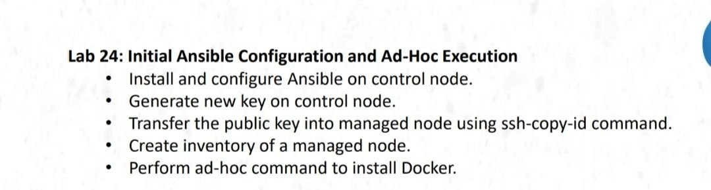
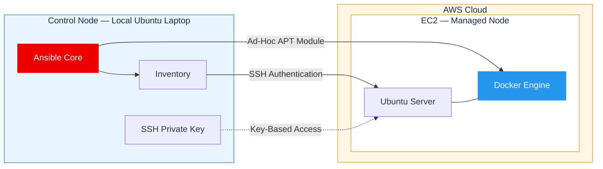
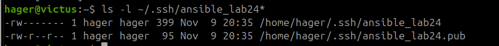
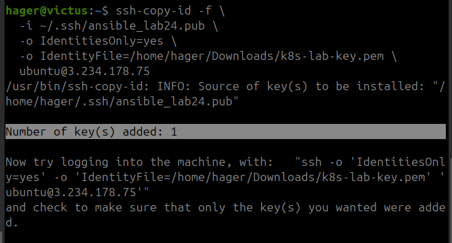
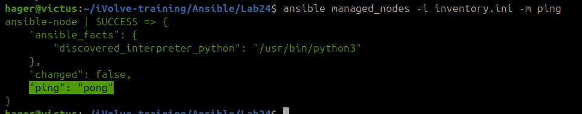
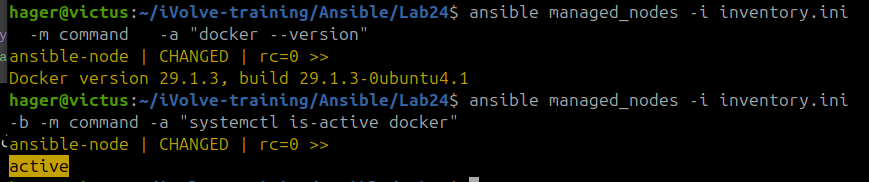

# Lab 24 — Ansible Configuration & Ad-Hoc Automation


## Overview

This lab demonstrates how to configure **Ansible** on a local Ubuntu control node and remotely manage an **AWS EC2 instance** using SSH key-based authentication.

The main objective is to establish secure, passwordless SSH access, configure an Ansible inventory, verify connectivity, and automate Docker installation using an **Ansible Ad-Hoc Command**.

All configuration management operations are initiated from the local machine without manually installing Docker on the remote server.



## Architecture



### Infrastructure

| Component | Configuration |
|---|---|
| Control Node | Local Ubuntu Laptop |
| Managed Node | AWS EC2 |
| Managed OS | Ubuntu Server 26.04.1 LTS |
| Configuration Management | Ansible Core |
| Authentication | SSH ED25519 Key Pair |
| Automation Method | Ansible Ad-Hoc Commands |
| Target Software | Docker Engine 29.1.3 |


## Implementation Details

The following sections contain the commands used during implementation. Expand each section to view the configuration and execution steps.

<details>
<summary><b>01 — Install Ansible on Control Node</b></summary>

Ansible was installed locally using the Ubuntu package manager.

```bash
sudo apt update
sudo apt install -y ansible-core
```

Verify installation:

```bash
ansible --version
```

</details>

The local Ubuntu laptop acts as the **Ansible Control Node**, responsible for executing automation tasks on remote machines.

<details>
<summary><b>02 — Generate SSH Key Pair</b></summary>

Generate a dedicated ED25519 SSH key pair for Ansible:

```bash
ssh-keygen -t ed25519 \
  -f ~/.ssh/ansible_lab24 \
  -C "ansible-lab24"
```

Verify the generated keys:

```bash
ls -l ~/.ssh/ansible_lab24*
```

Two files are created:

- `ansible_lab24` — Private key used by the control node.
- `ansible_lab24.pub` — Public key authorized on the managed node.


</details>



<details>

<summary><b>03 — Configure AWS EC2 and SSH Authentication</b></summary>

The newly generated Ansible public key was transferred using `ssh-copy-id`.

```bash
ssh-copy-id -f \
  -i ~/.ssh/ansible_lab24.pub \
  -o IdentitiesOnly=yes \
  -o IdentityFile=/path/to/aws-key.pem \
  ubuntu@<EC2_PUBLIC_IP>
```

The `-f` option was used during troubleshooting to force copying the key after an initial key-detection issue.

Verify SSH authentication using the new key:

```bash
ssh -o IdentitiesOnly=yes \
  -i ~/.ssh/ansible_lab24 \
  ubuntu@<EC2_PUBLIC_IP>
```

**Result:** Successfully authenticated to the managed EC2 instance using the dedicated Ansible SSH key.

</details>

A separate AWS EC2 instance was provisioned as the managed node to keep the existing Kubernetes infrastructure isolated from this lab.

**EC2 Configuration:**

- Ubuntu Server
- SSH access enabled
- Existing AWS key pair used for initial access
- Public IPv4 address assigned



<details>
<summary><b>04 — Configure Ansible Inventory</b></summary>

An inventory file was created to define the managed EC2 instance and its SSH connection parameters.

**File:** `inventory.ini`

```ini
[managed_nodes]
ansible-node ansible_host=<EC2_PUBLIC_IP> ansible_user=ubuntu ansible_ssh_private_key_file=/home/hager/.ssh/ansible_lab24
```

Verify connectivity:

```bash
ansible managed_nodes -i inventory.ini -m ping
```

</details>

**Inventory Parameters:**

| Parameter | Purpose |
|---|---|
| `managed_nodes` | Group containing managed hosts |
| `ansible-node` | Logical hostname |
| `ansible_host` | EC2 public IP address |
| `ansible_user` | Remote SSH username |
| `ansible_ssh_private_key_file` | SSH private key path |

The Ansible ping module verifies remote connectivity and Python execution on the managed node.



<details>
<summary><b>05 — Install Docker Using Ansible Ad-Hoc Command</b></summary>

Docker was installed remotely using Ansible's `apt` module.

```bash
ansible managed_nodes -i inventory.ini \
  -b \
  -m apt \
  -a "name=docker.io state=present update_cache=yes"
```

The command installed Docker and its required dependencies on the EC2 instance.

**Verify Docker Installation:**

```bash
ansible managed_nodes -i inventory.ini \
  -m command \
  -a "docker --version"
```

**Verify Docker Service:**

```bash
ansible managed_nodes -i inventory.ini \
  -b \
  -m command \
  -a "systemctl is-active docker"
```

</details>

The Ansible ping module verifies remote connectivity and Python execution on the managed node.



## Verification Results

The following results were captured during execution.

| Verification | Observed Result |
|---|---|
| SSH authentication | Successful using Ansible private key |
| Docker package installation | `changed: true` |
| Docker CLI version | `29.1.3` |
| Docker service status | `active` |
| Ansible Docker installation command | Completed without errors |

### Docker Version

```text
ansible-node | CHANGED | rc=0 >>
Docker version 29.1.3, build 29.1.3-0ubuntu4.1
```

### Docker Service

```text
ansible-node | CHANGED | rc=0 >>
active
```

> **Note:** Ansible's `command` module reports `CHANGED` by default, even when executing read-only verification commands. The important indicators here are the successful return code and the actual command output.

## Challenges & Troubleshooting

<details>
<summary><b>SSH Public Key Authentication Issue</b></summary>

**Issue:**

The first SSH connection using the new Ansible key returned:

```text
Permission denied (publickey).
```

**Resolution:**

The existing AWS SSH key was used to establish initial access, and the new Ansible public key was transferred using `ssh-copy-id -f`.

The connection was then successfully verified using the new Ansible private key.

</details>


## Key Takeaways

- Configured Ansible for remote Linux server management.
- Established SSH key-based authentication between a local control node and an AWS EC2 instance.
- Created an inventory to manage remote hosts.
- Used Ansible Ad-Hoc Commands to automate package installation.
- Verified Docker installation and service availability remotely.
- Practiced configuration management without manually executing installation commands on the managed server.

## Outcome

**Successfully configured Ansible and automated Docker installation on an AWS EC2 instance using SSH authentication and Ad-Hoc Commands.**

This lab establishes the foundation for more advanced configuration management workflows using **Ansible Playbooks, Roles, and reusable infrastructure automation**.

---

**Part of the [iVolve DevOps Training Labs](../../README.md) — Configuration Management Track.**