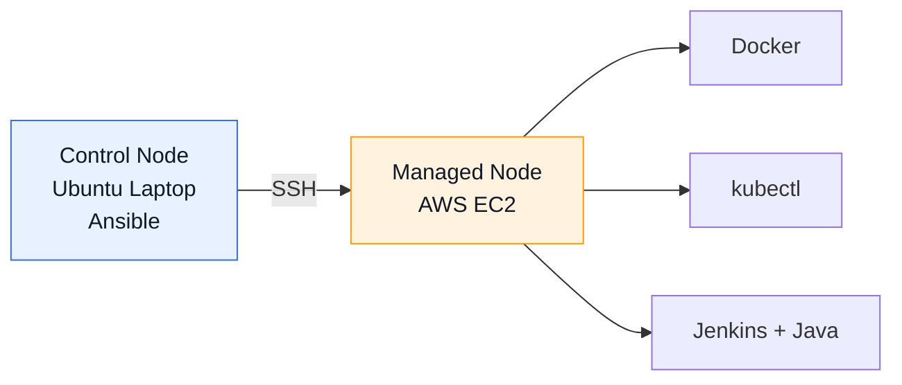
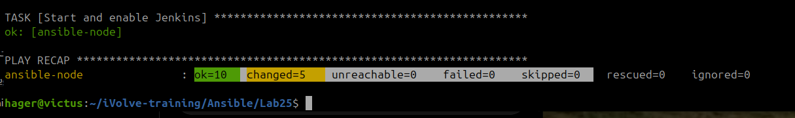
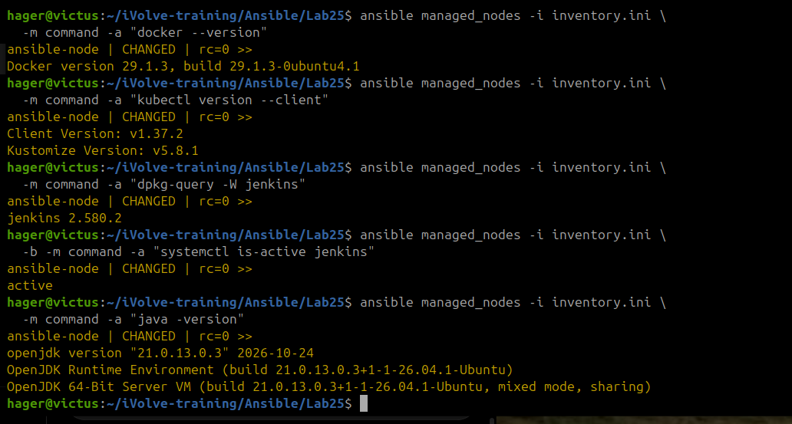
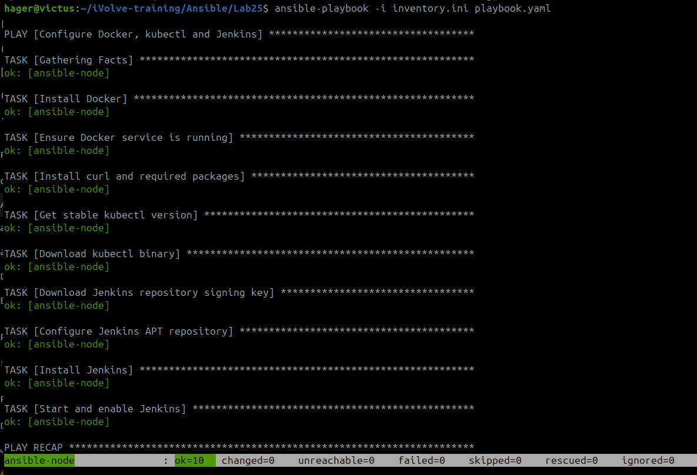

# Lab 25 — Automated Server Configuration with Ansible


## Overview

Automated the installation and configuration of **Docker, kubectl, and Jenkins** on an AWS EC2 instance using a single Ansible Playbook.

The automation runs remotely over SSH, manages system packages and services, and demonstrates **idempotent configuration management**.

## Architecture



## Implementation

### 1. Create the Playbook

Created [`playbook.yaml`](playbook.yaml) to install the required tools, configure the Jenkins APT repository, and ensure Docker and Jenkins services are enabled and running.

<details>
<summary><b>View Syntax Validation Command</b></summary>

```bash
ansible-playbook -i inventory.ini playbook.yaml --syntax-check
```

</details>

### 2. Execute the Playbook

<details>
<summary><b>View Execution Command</b></summary>

```bash
ansible-playbook -i inventory.ini playbook.yaml
```

</details>

The initial execution completed successfully with **5 configuration changes and 0 failures**.



### 3. Verify the Configuration

Verified the installed versions of Docker, kubectl, Java, and Jenkins, along with the Jenkins service status on the managed node.

<details>
<summary><b>View Verification Commands</b></summary>

```bash
ansible managed_nodes -i inventory.ini -m command -a "docker --version"

ansible managed_nodes -i inventory.ini -m command -a "kubectl version --client"

ansible managed_nodes -i inventory.ini -m command -a "java -version"

ansible managed_nodes -i inventory.ini -m command -a "dpkg-query -W jenkins"

ansible managed_nodes -i inventory.ini -b -m command -a "systemctl is-active jenkins"
```

</details>



### 4. Validate Idempotency

Re-executed the same playbook to verify that Ansible maintains the desired configuration without introducing unnecessary changes.

<details>
<summary><b>View Idempotency Test Command</b></summary>

```bash
ansible-playbook -i inventory.ini playbook.yaml
```

</details>

The second execution completed with **`changed=0` and `failed=0`**, confirming idempotent behavior.



## Results

| Component | Verification | Status |
|---|---|---|
| Docker | v29.1.3 | Passed |
| kubectl | v1.37.2 | Passed |
| Jenkins | v2.580.2 — Service Active | Passed |
| Java | OpenJDK 21 | Passed |
| Initial Execution | 10 OK · 5 Changed · 0 Failed | Passed |
| Idempotency Test | 10 OK · 0 Changed · 0 Failed | Passed |

## Key Takeaways

- Automated server provisioning using an Ansible Playbook instead of individual ad-hoc commands.
- Managed packages, repositories, and system services declaratively.
- Configured and verified an AWS EC2 managed node remotely over SSH.
- Validated **Ansible idempotency** through a second execution with zero changes.
- Prepared the automation for modularization into reusable Ansible Roles in Lab 26.

---

[Back to iVolve Training](../../README.md)