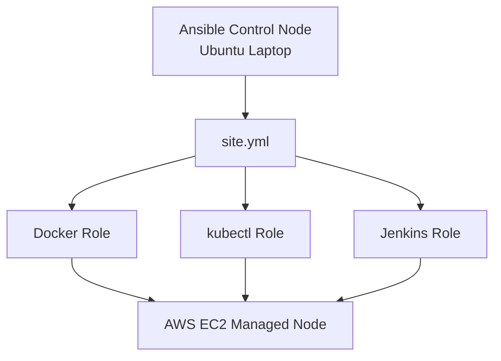
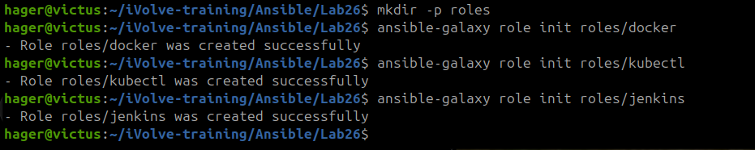
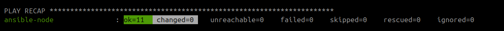

# Lab 26 — Structured Configuration Management with Ansible Roles


## Overview

Refactored the server configuration automation from **Lab 25** into three independent Ansible Roles for **Docker, kubectl, and Jenkins**.

Instead of maintaining all installation tasks in a single playbook, each tool is managed through its own reusable role, improving modularity, maintainability, and scalability.

## Architecture



## Implementation

### 1. Initialize Ansible Roles

Generated the standard Ansible Role structure using `ansible-galaxy`.

<details>
<summary><b>View Role Initialization Commands</b></summary>

```bash
ansible-galaxy role init roles/docker
ansible-galaxy role init roles/kubectl
ansible-galaxy role init roles/jenkins
```

</details>



### 2. Configure Role Tasks

Created separate task definitions for each component:

- **Docker Role:** Installs Docker and ensures its service is enabled and running.
- **kubectl Role:** Installs prerequisites and downloads the Kubernetes CLI.
- **Jenkins Role:** Installs Java, configures the Jenkins repository, installs Jenkins, and manages its service.

**Role source files:**

- [Docker Tasks](roles/docker/tasks/main.yml)
- [kubectl Tasks](roles/kubectl/tasks/main.yml)
- [Jenkins Tasks](roles/jenkins/tasks/main.yml)

### 3. Execute the Roles

Created [`site.yml`](site.yml) to execute all three roles against the managed EC2 instance.

<details>
<summary><b>View Main Playbook</b></summary>

```yaml
---
- name: Configure DevOps tools using Ansible Roles
  hosts: managed_nodes
  become: true

  roles:
    - docker
    - kubectl
    - jenkins
```

</details>

<details>
<summary><b>View Execution Command</b></summary>

```bash
ansible-playbook -i inventory.ini site.yml
```

</details>

All roles executed successfully without introducing additional configuration changes.



## Results

| Verification | Result |
|---|---|
| Docker | v29.1.3 |
| kubectl | v1.37.2 |
| Jenkins | v2.580.2 |
| Jenkins Service | Active |
| Playbook Execution | 11 OK · 0 Changed · 0 Failed |

The execution reported **`changed=0`** because the managed node had already been configured in Lab 25. Ansible verified the desired configuration and avoided unnecessary changes.

## Key Takeaways

- Structured configuration management using independent Ansible Roles.
- Used `ansible-galaxy role init` to generate standardized role directories.
- Improved code reusability by separating Docker, kubectl, and Jenkins configuration.
- Simplified the main playbook by referencing roles instead of individual tasks.
- Confirmed idempotent behavior on an already-configured AWS EC2 instance.

---

[Back to iVolve Training](../../README.md)