# Labs 27–28 — Automated MySQL Provisioning on AWS with Ansible

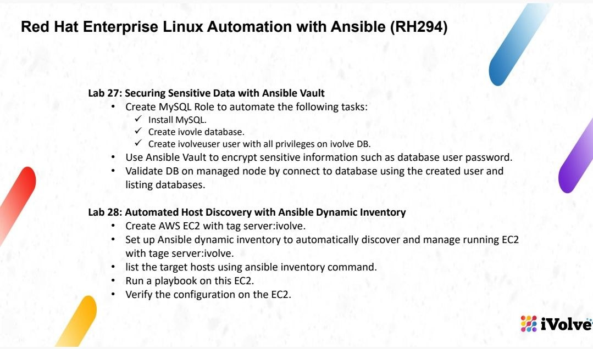

## Overview

This lab provisions and configures MySQL on an AWS EC2 instance using **Ansible Roles**, **AWS EC2 Dynamic Inventory**, and **Ansible Vault**. EC2 hosts are discovered automatically using the `server=ivolve` tag; database credentials are stored in an encrypted Vault file.

### Technologies

- AWS EC2, IAM, AWS CLI v2
- Ansible, `amazon.aws` and `ansible.mysql` collections
- Python, `boto3`, `botocore`
- MySQL 8.4, PyMySQL
- Ansible Vault

## 1. Install and verify AWS CLI

Install AWS CLI v2 on the control node:

```bash
sudo apt update
sudo apt install -y curl unzip
cd /tmp
curl -fsSL "https://awscli.amazonaws.com/awscli-exe-linux-x86_64.zip" -o awscliv2.zip
unzip -q awscliv2.zip
sudo ./aws/install
aws --version
```

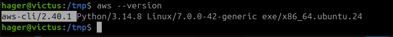

## 2. Configure AWS access

Create an IAM user with the EC2 read permissions required by the inventory plugin, generate an access key, and configure a named AWS CLI profile:

```bash
aws configure --profile ivolve-lab
```

Keep access keys private. Verify the profile and the ability to list instances:

```bash
aws sts get-caller-identity --profile ivolve-lab

aws ec2 describe-instances \
  --profile ivolve-lab \
  --region us-east-1 \
  --query 'Reservations[].Instances[].[InstanceId,State.Name]' \
  --output table
```

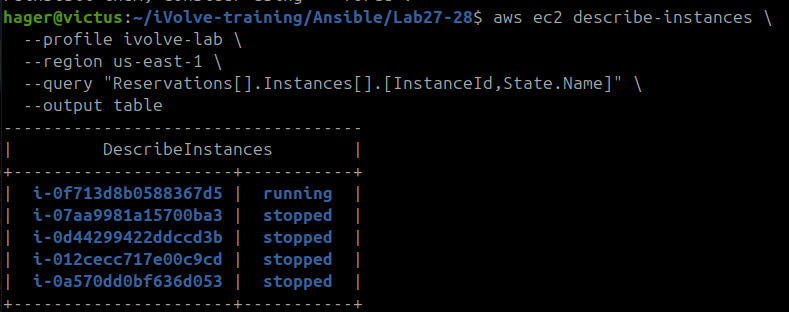

## 3. Prepare the EC2 target

Launch an Ubuntu EC2 instance in `us-east-1`, configure SSH access from the control node, and apply the tag below to the target instance:

| Key | Value |
| --- | --- |
| `server` | `ivolve` |

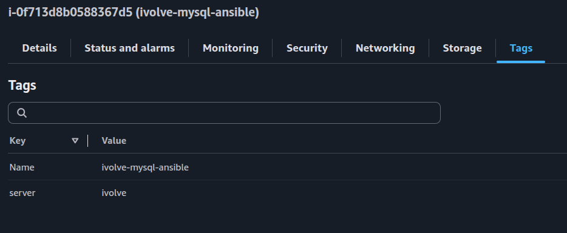

Verify that the instance has the intended tag:

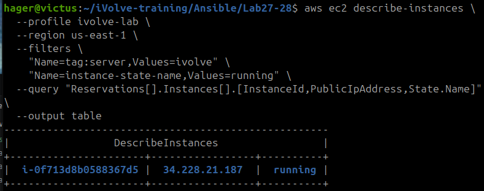

> **Security:** Limit inbound SSH access to trusted IP addresses. Do not publish the private SSH key or AWS credentials.

## 4. Configure Ansible and AWS Dynamic Inventory

Activate the project's Python virtual environment, and verify the required dependencies and collections:

```bash
source .venv/bin/activate
python -m pip check
ansible-galaxy collection list amazon.aws
ansible-galaxy collection list ansible.mysql
```

Create `inventory/aws_ec2.yml`:

```yaml
---
plugin: amazon.aws.aws_ec2
regions:
  - us-east-1
profile: ivolve-lab
filters:
  tag:server: ivolve
  instance-state-name: running
hostnames:
  - ip-address
use_deprecated_tags: false
keyed_groups:
  - key: ec2_tags.server
    prefix: server
```

Verify the AWS region and inspect the dynamic inventory:

```bash
aws ec2 describe-availability-zones \
  --profile ivolve-lab \
  --region us-east-1 \
  --query 'AvailabilityZones[].ZoneName' \
  --output table

ansible-inventory -i inventory/aws_ec2.yml --graph
```

The running instance should appear in the `server_ivolve` group. Setting `use_deprecated_tags: false` avoids the deprecated `tags` host variable while retaining `ec2_tags`.

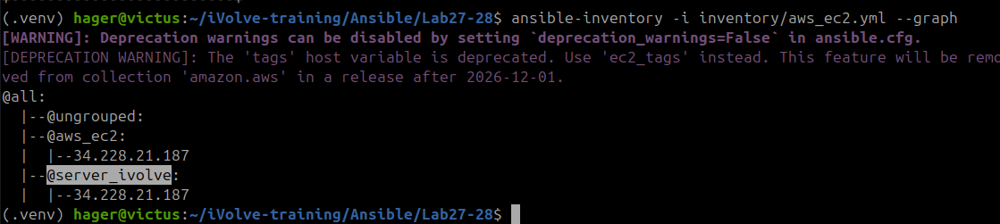

## 5. Test Ansible connectivity

```bash
ansible -i inventory/aws_ec2.yml server_ivolve \
  -m ansible.builtin.ping \
  -u ubuntu \
  --private-key ~/Downloads/k8s-lab-key.pem \
  --ask-vault-pass
```

A successful response contains `"ping": "pong"`. The Vault prompt is needed once the encrypted group variables are present.


## 6. Implement the MySQL role

The MySQL role installs the server and Python driver, enables the service, creates the `ivolve` database, and grants `ivolveuser` privileges on that database.

Create `roles/mysql/tasks/main.yml`:

```yaml
---
- name: Install MySQL server and Python driver
  ansible.builtin.apt:
    name:
      - mysql-server
      - python3-pymysql
    state: present
    update_cache: true

- name: Ensure MySQL service is running
  ansible.builtin.service:
    name: mysql
    state: started
    enabled: true

- name: Create application database
  ansible.mysql.mysql_db:
    name: ivolve
    state: present
    login_unix_socket: /var/run/mysqld/mysqld.sock

- name: Create application database user
  ansible.mysql.mysql_user:
    name: ivolveuser
    host: localhost
    plugin: caching_sha2_password
    plugin_auth_string: "{{ vault_mysql_password }}"
    salt: "{{ vault_mysql_salt }}"
    priv: "ivolve.*:ALL"
    state: present
    login_unix_socket: /var/run/mysqld/mysqld.sock
  no_log: true
```

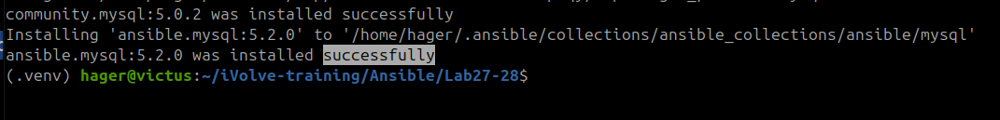

## 7. Protect credentials with Ansible Vault

Create an encrypted variables file:

```bash
mkdir -p group_vars/all
EDITOR=nano ansible-vault create group_vars/all/vault.yml
```

Enter the following variable names with your **own secret values**:

```yaml
vault_mysql_password: "REPLACE_WITH_A_STRONG_PASSWORD"
vault_mysql_salt: "REPLACE_WITH_20_CHAR_SALT"
```

Generate a random 20-character salt once and keep it stable across subsequent runs:

```bash
python3 -c "import secrets,string; a=string.ascii_letters+string.digits; print(''.join(secrets.choice(a) for _ in range(20)))"
```

For later edits:

```bash
EDITOR=nano ansible-vault edit group_vars/all/vault.yml
```

Confirm that the file is encrypted without revealing its contents:

```bash
head -n 1 group_vars/all/vault.yml
# $ANSIBLE_VAULT;1.1;AES256
```

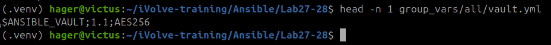

> Never commit the Vault password, unencrypted secrets, AWS access keys, or private SSH keys. The encrypted `vault.yml` file can be version-controlled if the decryption password is stored separately.

## 8. Create and run the playbook

Create `site.yml`:

```yaml
---
- name: Provision MySQL on AWS EC2
  hosts: server_ivolve
  become: true
  roles:
    - mysql
```

Execute the playbook:

```bash
ansible-playbook \
  -i inventory/aws_ec2.yml \
  site.yml \
  -u ubuntu \
  --private-key ~/Downloads/k8s-lab-key.pem \
  --ask-vault-pass
```

The final successful execution provisioned the database and user with no failed tasks.


### Troubleshooting: MySQL authentication plugin

During the initial run, MySQL returned:

```text
(1524, "Plugin 'mysql_native_password' is not loaded")
```

The target used MySQL 8.4, where `mysql_native_password` was disabled. The role was updated to explicitly use `caching_sha2_password` with `plugin_auth_string` and a stable `salt`. Adding `plugin: caching_sha2_password` alone did **not** resolve the issue when the `password` parameter was still used.

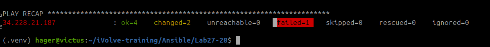

## 9. Verify the database and user

Verify the database and authentication plugin using a privileged MySQL query on the EC2 instance:

```bash
ansible -i inventory/aws_ec2.yml server_ivolve \
  -b \
  -m ansible.builtin.command \
  -a 'mysql -N -e "SHOW DATABASES; SELECT user,host,plugin FROM mysql.user WHERE user='\''ivolveuser'\'';"' \
  -u ubuntu \
  --private-key ~/Downloads/k8s-lab-key.pem \
  --ask-vault-pass
```

Expected entries include database `ivolve` and user `ivolveuser@localhost` with the `caching_sha2_password` plugin.

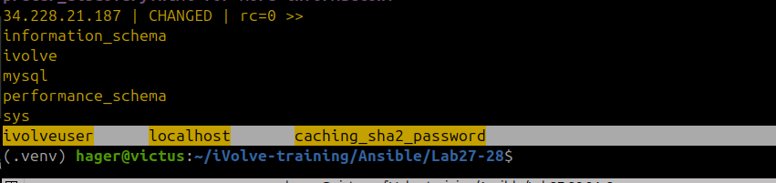

## 10. Test application-user access

Connect to the instance (replace the IP if the instance's public address changes):

```bash
ssh -i ~/Downloads/k8s-lab-key.pem ubuntu@34.228.21.187
mysql -u ivolveuser -p ivolve
```

Enter the MySQL user password when prompted, then run:

```sql
SELECT DATABASE();
SHOW TABLES;
SHOW GRANTS;
```

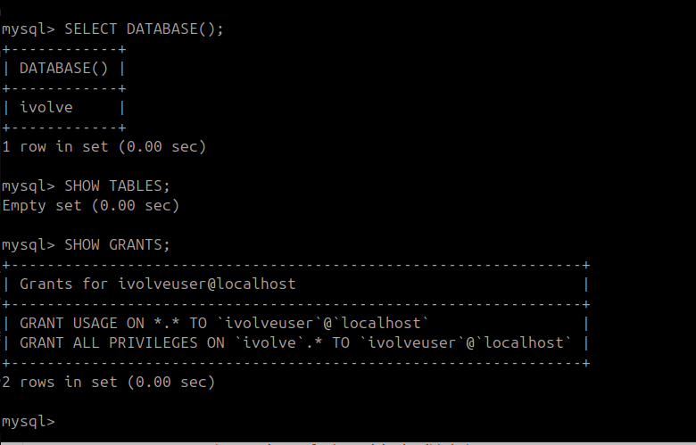

`SELECT DATABASE()` should return `ivolve`. Exit MySQL and SSH when finished:

```sql
exit;
```

```bash
exit
```

## Results

- AWS EC2 instance discovered dynamically by tag.
- SSH/Ansible connectivity verified.
- MySQL installed and configured through a reusable role.
- Application database and user provisioned with `caching_sha2_password` authentication.
- Sensitive variables encrypted with Ansible Vault.
- Playbook re-run successfully with **`changed=0`** and **`failed=0`**.
- Deprecated inventory `tags` warning resolved with `use_deprecated_tags: false`.

> **Cost reminder:** Stop the EC2 instance when it is no longer needed. Attached storage may still incur charges.
