# Lab 23 — Automated CI/CD with Jenkins & Argo CD

**GitOps Deployment on AWS Kubernetes**

An end-to-end CI/CD pipeline that automatically builds, scans, and publishes Docker images using Jenkins, then deploys them to Kubernetes through Argo CD.

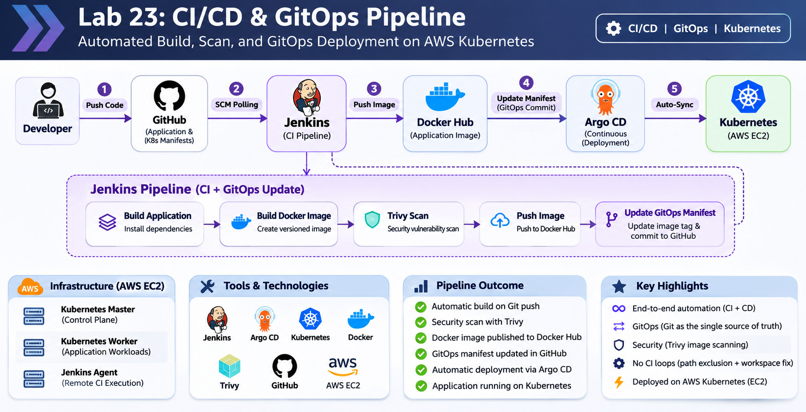


---

## Architecture

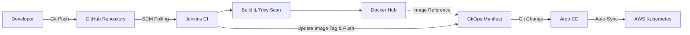

**CI:** Jenkins builds, scans, and publishes the application image.

**CD:** Argo CD automatically deploys the image defined in Git.

---

## Demo

**End-to-End CI/CD & GitOps Workflow**

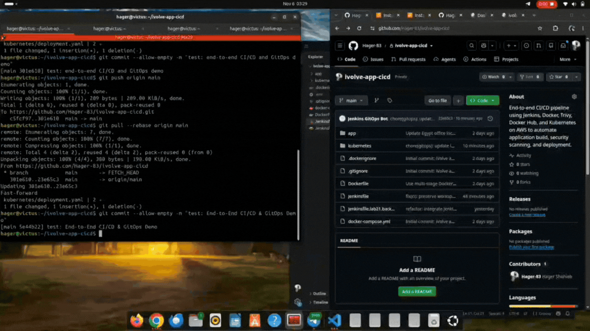

The demo covers a Git push, automatic Jenkins build, Docker image publication, GitOps manifest update, Argo CD synchronization, and Kubernetes deployment.

---

## 1. AWS Infrastructure & Cluster Verification

Three AWS EC2 instances were used:

| Instance | Purpose |
|---|---|
| Kubernetes Master | Cluster control plane |
| Kubernetes Worker | Application workloads |
| Jenkins Agent | Remote CI execution |

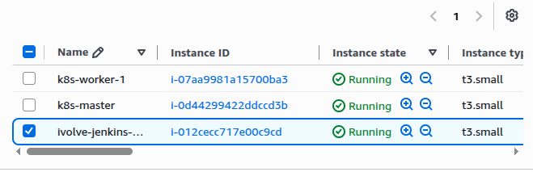

<details>
<summary><b>EC2 SSH Connections</b></summary>

**Kubernetes Master**

```bash
ssh -i ~/Downloads/k8s-lab-key.pem ubuntu@34.230.83.69
```

**Kubernetes Worker**

```bash
ssh -i ~/Downloads/k8s-lab-key.pem ubuntu@184.198.31.117
```

**Jenkins Agent**

```bash
ssh -i ~/Downloads/k8s-lab-key.pem ubuntu@32.201.75.178
```

> Public IP addresses may change after restarting EC2 instances.

</details>

### Verify the Cluster

On the Kubernetes Master:

```bash
kubectl get nodes -o wide
kubectl get deployment ivolveapp -n ivolve
kubectl get pods -n ivolve
```

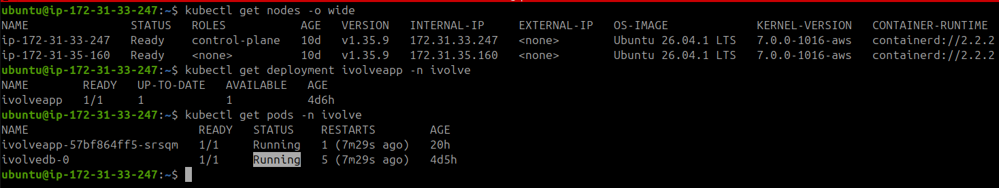

---

## 2. Argo CD Installation

Installed Argo CD in a dedicated Kubernetes namespace.

<details>
<summary><b>Installation Commands</b></summary>

```bash
kubectl create namespace argocd

kubectl apply -n argocd \
  -f https://raw.githubusercontent.com/argoproj/argo-cd/stable/manifests/install.yaml

kubectl get pods -n argocd
```

</details>

### Pod Scheduling Issue

Some Argo CD pods initially remained `Pending` because the worker node had the taint:

`workload=ivolveApp:NoSchedule`

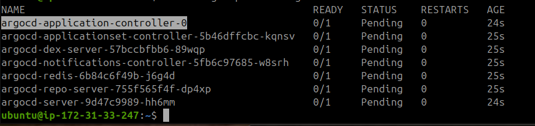

Added matching tolerations to the Argo CD Deployments and Application Controller StatefulSet.

<details>
<summary><b>View Toleration Fix</b></summary>

**Patch Deployments**

```bash
kubectl get deployments -n argocd -o name | while read deployment; do
  kubectl patch "$deployment" -n argocd --type=strategic \
    -p '{"spec":{"template":{"spec":{"tolerations":[{"key":"workload","operator":"Equal","value":"ivolveApp","effect":"NoSchedule"}]}}}}'
done
```

**Patch StatefulSet**

```bash
kubectl patch statefulset argocd-application-controller \
  -n argocd --type=strategic \
  -p '{"spec":{"template":{"spec":{"tolerations":[{"key":"workload","operator":"Equal","value":"ivolveApp","effect":"NoSchedule"}]}}}}'
```

**Verify**

```bash
kubectl get pods -n argocd

kubectl rollout status statefulset/argocd-application-controller \
  -n argocd --timeout=180s
```

</details>

All Argo CD pods successfully reached the `Running` state.

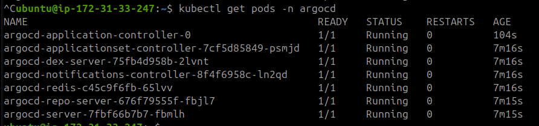

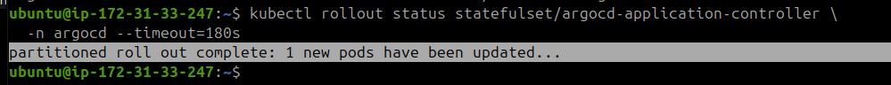

---

## 3. Argo CD Web UI Access

Used Kubernetes port forwarding and an SSH tunnel to securely access the Argo CD Web UI from the local laptop.

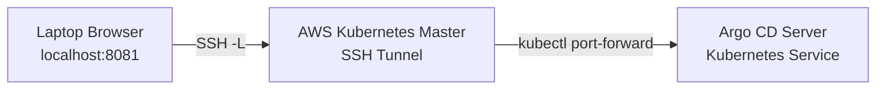

<details>
<summary><b>View Connection Commands</b></summary>

**On Kubernetes Master**

```bash
kubectl port-forward svc/argocd-server \
  -n argocd 8081:443 \
  --address 127.0.0.1
```

**On Local Laptop**

```bash
ssh -i ~/Downloads/k8s-lab-key.pem \
  -N \
  -L 8081:127.0.0.1:8081 \
  ubuntu@34.230.83.69
```

**Open Argo CD**

https://localhost:8081

**Get Initial Admin Password — Kubernetes Master**

```bash
kubectl -n argocd get secret argocd-initial-admin-secret \
  -o jsonpath="{.data.password}" | base64 -d

echo
```

Username: `admin`

</details>

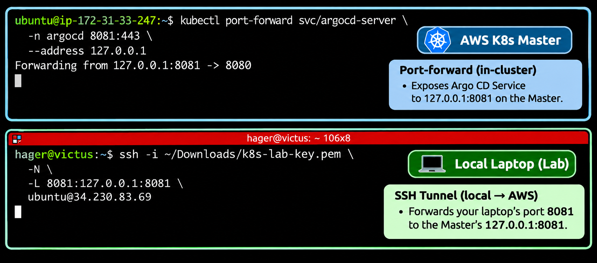

---

## 4. GitHub Integration & Argo CD Application

Connected Argo CD to the existing private GitHub application repository using a read-only Personal Access Token.

**Application Repository:** [ivolve-app-cicd](https://github.com/Hager-83/ivolve-app-cicd)

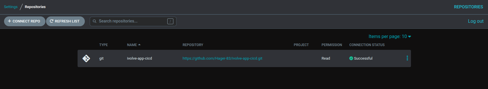

### Application Configuration

| Setting | Value |
|---|---|
| Application | `ivolve` |
| Repository | `ivolve-app-cicd` |
| Branch | `main` |
| Manifest Path | `kubernetes` |
| Namespace | `ivolve` |
| Destination | `https://kubernetes.default.svc` |
| Initial Sync | Manual |

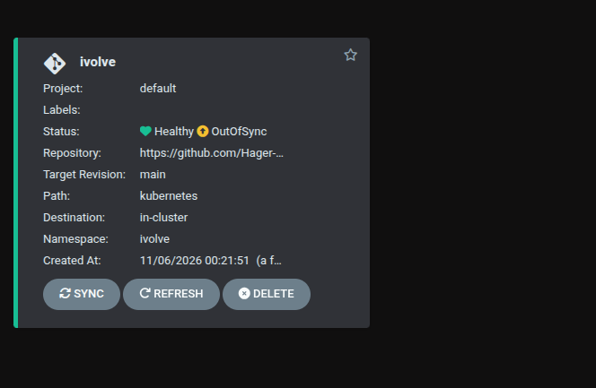


### Initial Application Verification

The initial application state was inspected, including configuration differences between Git and the live Kubernetes resources.

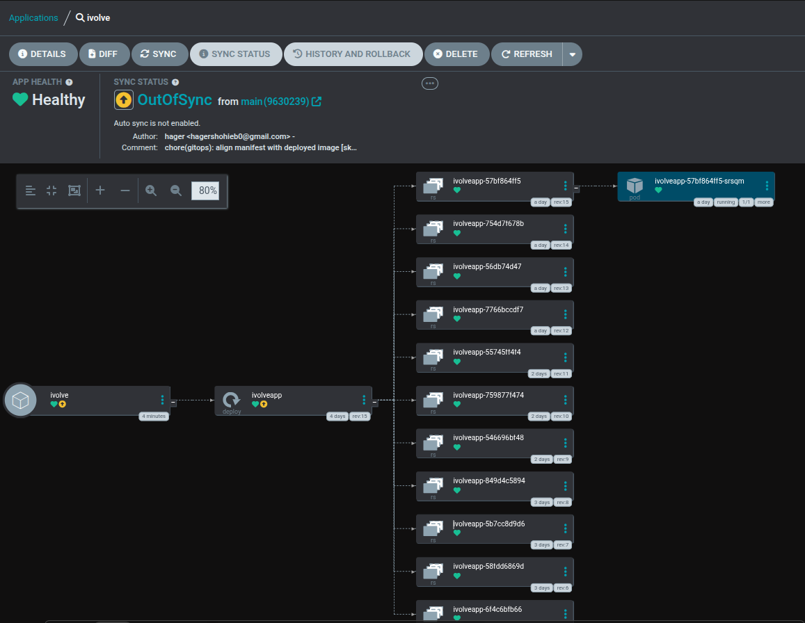

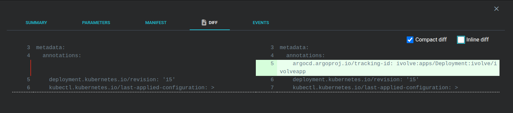

The first synchronization was performed manually to validate the deployment.

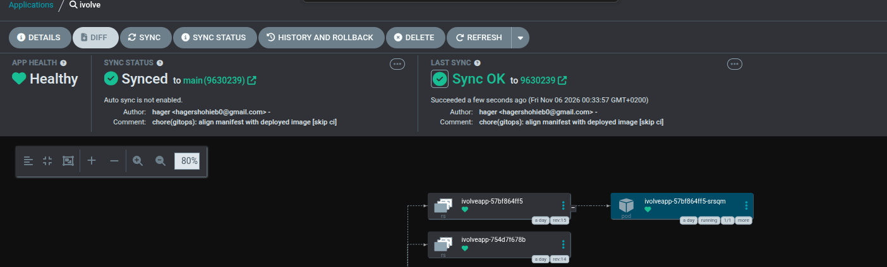

---

## 5. Jenkins Shared Library — GitOps Integration

Updated the existing Jenkins Shared Library to support GitOps instead of direct Kubernetes deployment.

**Repository:** [iVolve-jenkins-shared-library](https://github.com/Hager-83/iVolve-jenkins-shared-library)

### Shared Library Structure

```text
vars/
├── buildApp.groovy
├── buildImage.groovy
└── updateGitOpsManifest.groovy
```

| Function | Responsibility |
|---|---|
| `buildApp()` | Checkout and application dependencies |
| `buildImage()` | Docker build, Trivy scan, Docker Hub push |
| `updateGitOpsManifest()` | Update image tag, commit, and push manifest |

The previous `deployOnK8s.groovy` function was removed. Argo CD now handles deployment.

<details>
<summary><b>View GitOps Function Changes</b></summary>

**New file:** `vars/updateGitOpsManifest.groovy`

The function:

1. Reads the image generated by the pipeline.
2. Updates the application container image in `kubernetes/deployment.yaml`.
3. Commits the change using a GitOps commit message.
4. Pushes the manifest to the `main` branch using Jenkins credentials.

**GitOps commit message:**

```bash
git commit -m "chore(gitops): update image [skip ci]"
```

**Updated manifest example:**

```yaml
containers:
  - name: ivolve-app
    image: hager83/ivolve-app:<BUILD_NUMBER>-<GIT_SHA>
```

The exact image tag is generated during the Jenkins build.

</details>

---

## 6. Jenkins Pipeline Updates

The Jenkinsfile was updated to use the new GitOps deployment process.

### Pipeline Stages

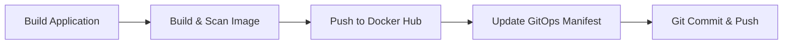

<details>
<summary><b>View Modified Jenkinsfile Stages</b></summary>

```groovy
stage('Build Application') {
    steps {
        script {
            buildApp(
                appDir: 'app',
                buildCommand: 'npm ci'
            )
        }
    }
}

stage('Build and Push Docker Image') {
    steps {
        script {
            buildImage(
                imageRepo: 'hager83/ivolve-app',
                dockerfile: 'Dockerfile',
                context: '.',
                registryCredentials: 'dockerhub-credentials',
                scanSeverity: 'HIGH,CRITICAL'
            )
        }
    }
}

stage('Update GitOps Manifest') {
    steps {
        script {
            updateGitOpsManifest(
                manifest: 'kubernetes/deployment.yaml',
                container: 'ivolve-app',
                gitCredentials: 'github-private-repos'
            )
        }
    }
}
```

</details>

<details>
<summary><b>Workspace Cleanup Adjustment</b></summary>

Disabled automatic workspace cleanup:

```groovy
// cleanWs()
```

This preserves the Git workspace to support workspace-based SCM polling and changed-path filtering.

Workspace cleanup is optional and is not required for GitOps deployment.

</details>

### GitHub Credentials

Updated the Jenkins GitHub token with repository Contents read/write access to allow GitOps manifest commits.

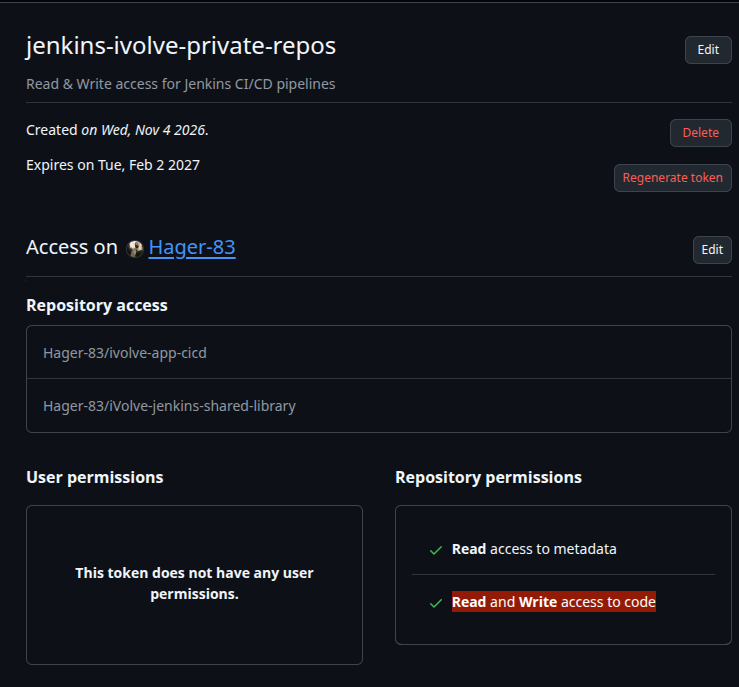

---

## 7. Automatic CI Trigger & Loop Prevention

Configured Jenkins SCM Polling to automatically detect new commits.

**SCM Polling Schedule:**

```text
* * * * *
```

### GitOps Commit Exclusion

Configured Git polling to ignore changes affecting only the Kubernetes directory.

```text
Included Regions: (empty)
Excluded Regions: kubernetes/.*
```

This prevents manifest-only changes from being treated as application source changes when the path exclusion is correctly applied.


<details>
<summary><b>CI Loop Troubleshooting</b></summary>

**Issue:** Jenkins repeatedly triggered new builds after pushing GitOps manifest updates.

**Polling log:**

```text
[poll] Working Directory does not exist
Changes found
```

**Changes made:**

- Configured Git polling path exclusions.
- Disabled `cleanWs()` to preserve the workspace.
- Retained the GitOps commit message with `[skip ci]`.

The final pipeline test checks that the GitOps commit does not trigger another build.

</details>

---

## 8. Jenkins Controller & AWS Agent Connection

The Jenkins Controller runs on the local laptop, while the Jenkins Agent executes CI jobs on AWS EC2.

The connection uses a reverse SSH tunnel and Jenkins WebSocket communication.

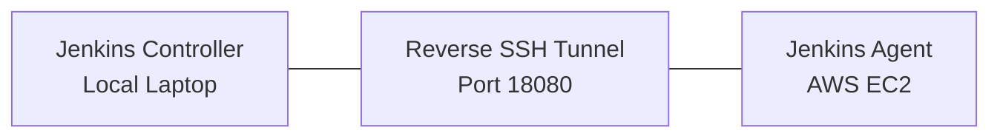

<details>
<summary><b>Start Reverse SSH Tunnel</b></summary>

**On Local Laptop**

```bash
ssh -i ~/Downloads/k8s-lab-key.pem \
  -o ExitOnForwardFailure=yes \
  -o ServerAliveInterval=30 \
  -o ServerAliveCountMax=3 \
  -N \
  -R 127.0.0.1:18080:127.0.0.1:8080 \
  ubuntu@32.201.75.178
```

Keep the tunnel running.

</details>

<details>
<summary><b>Start Jenkins Agent</b></summary>

**On AWS Jenkins Agent**

```bash
sudo -iu jenkins

cd /home/jenkins/agent
```

```bash
java -jar agent.jar \
  -url http://127.0.0.1:18080/ \
  -secret '<JENKINS_AGENT_SECRET>' \
  -name "ivolve-pipeline-agent" \
  -webSocket \
  -workDir "/home/jenkins/agent"
```

Use the secret generated by Jenkins for this agent. Never commit the real secret to GitHub.

</details>

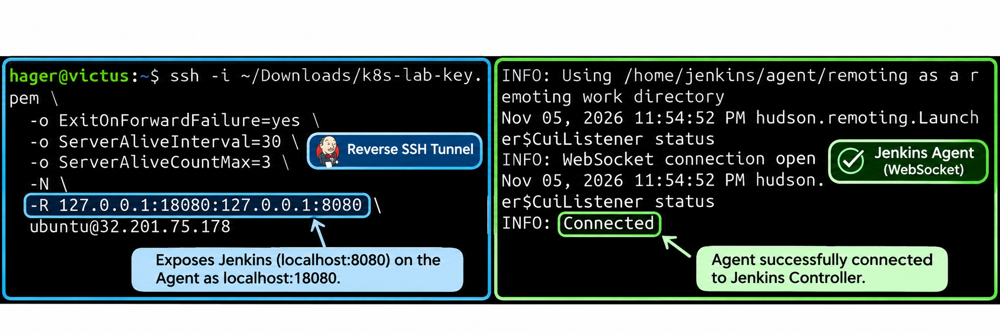

---

## 9. Enable Argo CD Auto-Sync

After verifying the initial manual synchronization, enabled automatic synchronization.

| Setting | Value |
|---|---|
| Auto-Sync | Enabled |
| Prune | Disabled |
| Self-Heal | Disabled |

Argo CD now automatically applies new desired-state changes from the Git repository.

<details>
<summary><b>Verify Auto-Sync and Deployment</b></summary>

**On Kubernetes Master**

```bash
kubectl get application ivolve -n argocd

kubectl get application ivolve -n argocd \
  -o jsonpath='{.spec.syncPolicy.automated}{"\n"}'

kubectl get deployment ivolveapp -n ivolve \
  -o jsonpath='{.spec.template.spec.containers[?(@.name=="ivolve-app")].image}{"\n"}'

kubectl rollout status deployment/ivolveapp \
  -n ivolve --timeout=300s
```

</details>

---

## 10. End-to-End Pipeline Test

Triggered the complete workflow using a Git commit.

### Test Commit

**On Local Laptop**

```bash
cd ~/ivolve-app-cicd

git pull --rebase origin main

git commit --allow-empty \
  -m "test: validate end-to-end CI/CD and GitOps workflow"

git push origin main
```

### Validation Checklist

- [ ] Jenkins detects the new Git commit automatically.
- [ ] Application dependencies install successfully.
- [ ] Docker image builds successfully.
- [ ] Trivy scan completes.
- [ ] Docker image is pushed to Docker Hub.
- [ ] Jenkins updates and pushes the GitOps manifest.
- [ ] Argo CD synchronizes the updated manifest automatically.
- [ ] Kubernetes deployment rolls out successfully.
- [ ] No additional CI build is triggered by the GitOps-only commit.

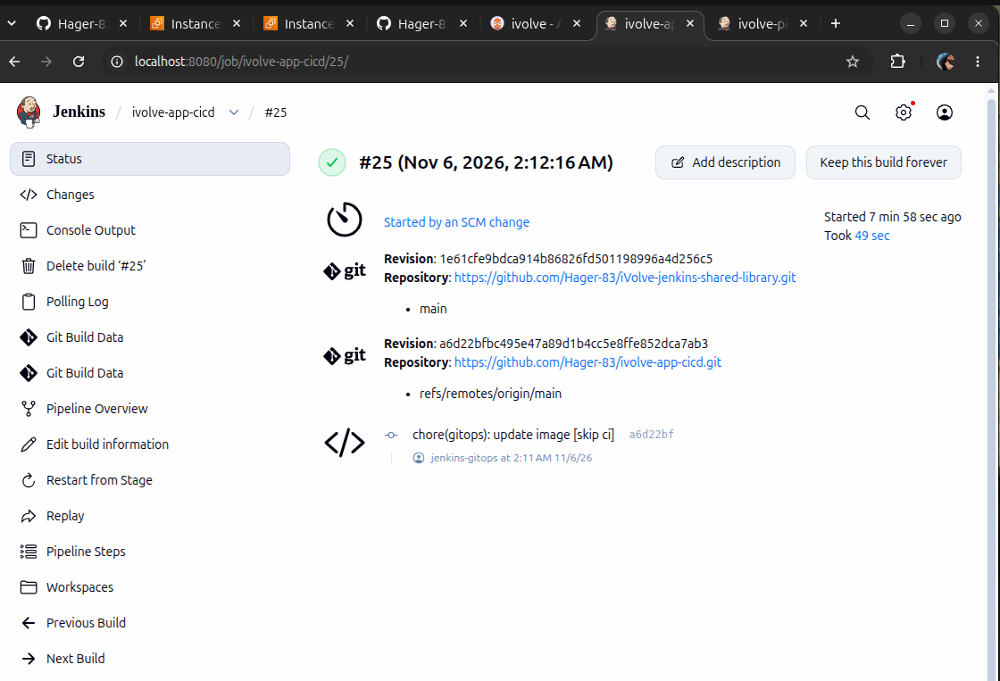

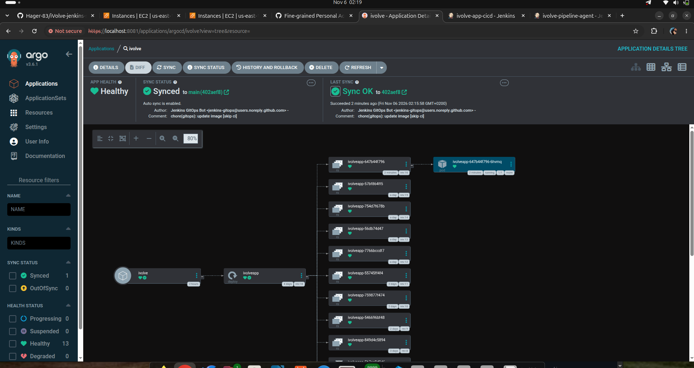

<details>
<summary><b>Verify Kubernetes Deployment</b></summary>

**On Kubernetes Master**

```bash
kubectl get application ivolve -n argocd

kubectl get deployment ivolveapp -n ivolve

kubectl get pods -n ivolve

kubectl rollout status deployment/ivolveapp \
  -n ivolve --timeout=300s
```

</details>

---

## 11. Local Git Synchronization

Jenkins automatically commits manifest updates to GitHub, so the local repository may fall behind the remote branch.

Configured a Git alias to simplify synchronization.

<details>
<summary><b>Git Sync Commands</b></summary>

**Configure once:**

```bash
git config alias.sync 'pull --rebase origin main'
```

**Use before future changes or pushes:**

```bash
git sync
```

Equivalent to:

```bash
git pull --rebase origin main
```

</details>

---

## Final Workflow

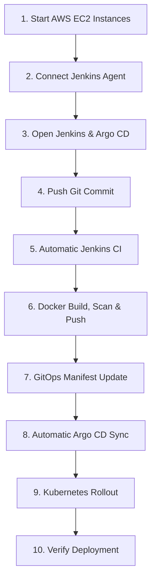

### Outcome

Implemented a GitOps-based CI/CD workflow on AWS Kubernetes.

- **Jenkins** automates application building, image scanning, publishing, and manifest updates.
- **GitHub** stores the application source and desired Kubernetes deployment configuration.
- **Argo CD** automatically synchronizes the Kubernetes cluster with Git.
- **Kubernetes** runs the updated application.

**CI and CD are separated, automated, and driven by Git commits.**
