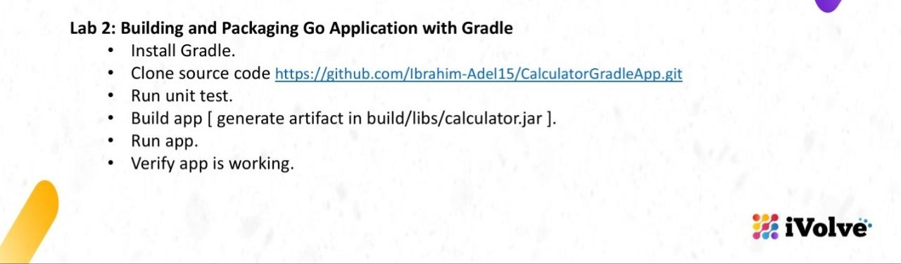
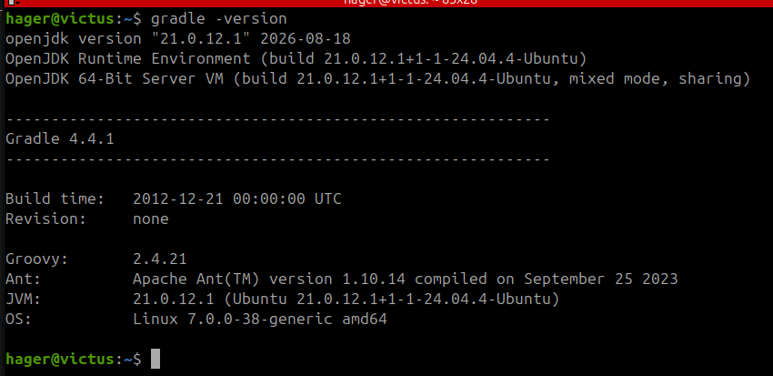
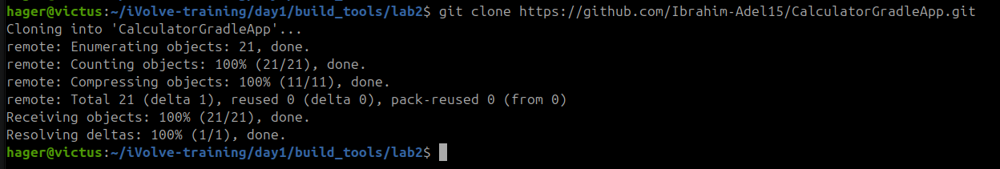
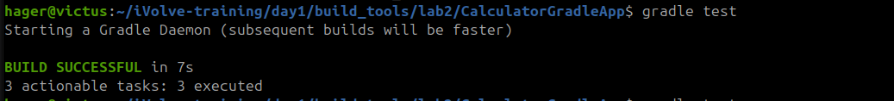
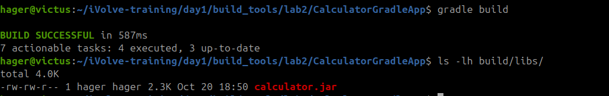

# Lab 2: Building and Packaging a Java Application with Gradle



## Overview

This lab demonstrates how to build, test, and run a Java Calculator application using Gradle. It covers running unit tests, building the application, and verifying the generated executable JAR file.

## Prerequisites

Before starting, ensure that the following tools are installed:

- Java Development Kit (JDK) 17
- Gradle 8.14.3 or a compatible version

Verify the installed versions:

```bash
java -version
gradle --version
```



## Clone the Repository

Clone the source code repository and navigate to the project directory:

```bash
git clone https://github.com/Ibrahim-Adel15/CalculatorGradleApp.git
cd CalculatorGradleApp
```



## Run Unit Tests

Run the unit tests to verify the application's functionality:

```bash
gradle test
```

The command completed successfully, confirming that the test task executed without build errors.



## Build the Application

Build the application using Gradle:

```bash
gradle build
```

This task compiles the source code, runs the tests, and generates the build artifacts.

The executable JAR file is available at:

```text
build/libs/calculator.jar
```



## Run and Verify the Application

### Run Using Gradle

Start the application with:

```bash
gradle run
```

The application prompts the user to enter two numbers and displays the results of the arithmetic operations.

For interactive console input, ensure that `build.gradle` contains the following configuration:

```groovy
run {
    standardInput = System.in
}
```

### Run the Executable JAR

Alternatively, run the packaged application directly:

```bash
java -jar build/libs/calculator.jar
```

This command launches the generated JAR file using Java.

Both methods can be used to verify the application's behavior.


## Conclusion

In this lab, I used Gradle to run unit tests, build a Java application, and generate an executable JAR file. I also verified the application by running it through Gradle and directly using Java.

This lab provided practical experience with Gradle tasks and the Java build process.