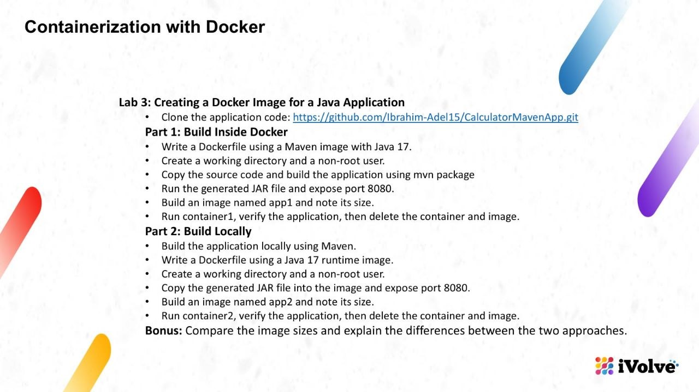
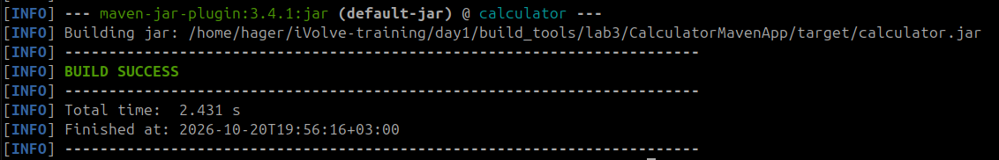
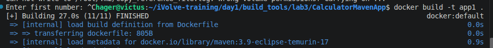
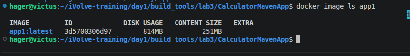
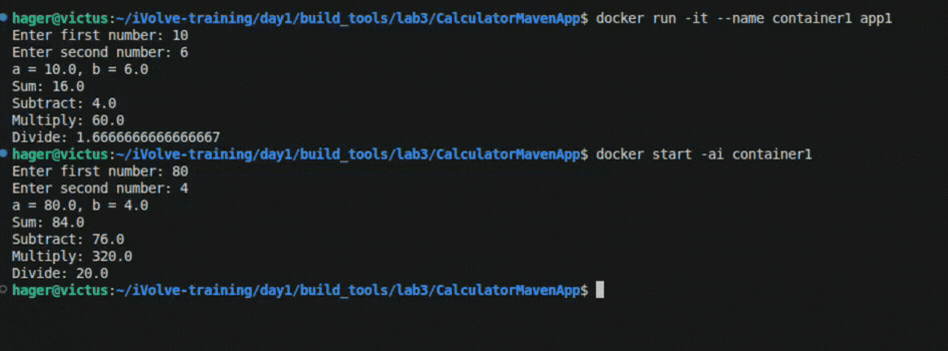
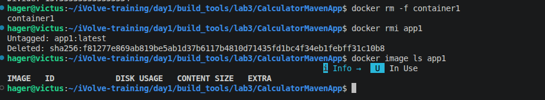
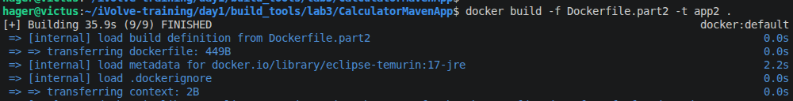
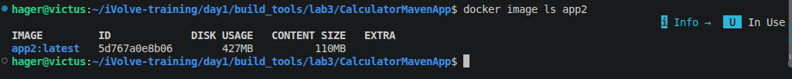
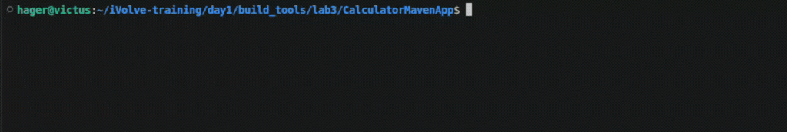

# Lab 3: Creating a Docker Image for a Java Application



## Part 1: Build the Application Inside Docker

### 1. Verify the Project Build

Before creating the Docker image, verify that the Java application builds successfully using Maven.



### 2. Create the Dockerfile

Create a `Dockerfile` in the project root using the following instructions:

- Use the official Maven image with Java 17 as the base image.
- Set `/app` as the working directory.
- Create a non-root user named `appuser`.
- Copy the Maven project files into the container.
- Build the application using `mvn package`.
- Run the application as the non-root user.
- Expose port `8080`.
- Configure the container to start the calculator application.

### 3. Build the Docker Image

Build the Docker image and name it `app1`.

```bash
docker build -t app1 .
```



### 4. Check the Image Size

Verify that the image was created successfully and record its size.

```bash
docker image ls app1
```



- **Disk usage:** 
- **Content size:** 

### 5. Run and Test the Calculator

Create and start a container named `container1` using the `app1` image.

```bash
docker run -it --name container1 app1
```

Enter two numbers when prompted and verify that the calculator correctly displays the sum, subtraction, multiplication, and division results.

If the container already exists and you want to start it again, use:

```bash
docker start -ai container1
```



### 6. Clean Up Docker Resources

Remove the container:

```bash
docker rm -f container1
```

Remove the Docker image:

```bash
docker rmi app1
```

Verify that the image has been removed:

```bash
docker image ls app1
```



**Part 1 completed:** The application was built inside Docker, tested successfully, and the Docker resources were removed.

---

## Part 2: Build the Application Locally

### 1. Build the Application Locally

Build the Java application on the host machine using Maven:

```bash
mvn clean package
```

Verify that the generated JAR file exists:

```bash
ls -lh target/calculator.jar
```

### 2. Create the Dockerfile

Create a file named `Dockerfile.part2` in the project root using the following instructions:

- Use a Java 17 JRE image as the base image.
- Create `/app` as the working directory.
- Create a non-root user named `appuser`.
- Copy the locally generated JAR file into the image.
- Run the application as the non-root user.
- Expose port `8080`.
- Configure the container to start the calculator application.

### 3. Build the Docker Image

Build the image and name it `app2`.

```bash
docker build -f Dockerfile.part2 -t app2 .
```



### 4. Check the Image Size

Verify that the image was created successfully.

```bash
docker image ls app2
```



- **Disk usage:** 
- **Content size:** 

### 5. Run and Test the Calculator

Create and start a container named `container2`.

```bash
docker run -it --name container2 app2
```

Enter two numbers and verify the calculator's output.

If the container already exists and you want to start it again, use:

```bash
docker start -ai container2
```



### 6. Clean Up Docker Resources

Remove the container:

```bash
docker rm -f container2
```

Remove the Docker image:

```bash
docker rmi app2
```

Verify that the image has been removed:

```bash
docker image ls app2
```

**Part 2 completed:** The application was built locally, packaged into a runtime image, tested successfully, and the Docker resources were removed.

---

## Part 3: Image Size Comparison

### 1. Comparison Table

| Feature | `app1` — Build Inside Docker | `app2` — Build Locally |
|---|---|---|
| Base image | `maven:3.9-eclipse-temurin-17` | `eclipse-temurin:17-jre` |
| Build location | Inside Docker | On the host machine |
| Maven included in the final image | Yes | No |
| Java compiler (JDK) included in the final image | Yes | No |
| Disk usage | 814 MB | 427 MB |
| Content size | 251 MB | 110 MB |

### 2. Image Size Difference

Using the reported content sizes:

- `app1`: 251 MB
- `app2`: 110 MB
- **Difference:** 141 MB
- **Reduction:** Approximately 56.2%

### 3. Explanation

The `app1` image uses a Maven base image containing Maven and the Java Development Kit (JDK), allowing the application to be built inside Docker. These additional tools increase the image size.

The `app2` image uses a Java Runtime Environment (JRE) because the application is built locally before the image is created. Only the generated JAR file and the runtime environment are needed to run the application.

Therefore, `app2` has a smaller content size than `app1`, reducing the amount of image content needed to package and run the application.

**Conclusion:** Building locally and using a runtime-only base image produces a smaller final image for this application.

