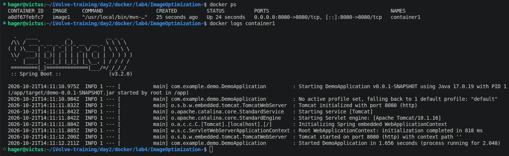
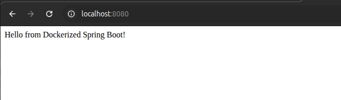
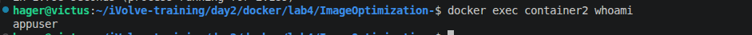

# Lab 5: Docker Image Vulnerability Scanning with Trivy


## 1. Build and Scan the Initial Docker Image

Build the initial Docker image before applying security improvements.

### Build the original image

```bash
docker build -t ivolve-app:v1 .
```

### Check the image

```bash
docker images ivolve-app:v1
```

### Scan the image with Trivy

Run a complete vulnerability scan:

```bash
trivy image ivolve-app:v1
```

To display only HIGH and CRITICAL vulnerabilities:

```bash
trivy image --severity HIGH,CRITICAL ivolve-app:v1
```

The scan identifies known vulnerabilities in the image's operating system packages and application dependencies.


---

## 2. Generate Trivy Scan Reports

Trivy supports exporting scan results into different formats for easier inspection and documentation.

### Generate an HTML report

```bash
trivy image --format template --template "@html.tpl" -o trivy-report.html ivolve-app:v1
```

### Generate a report for HIGH and CRITICAL vulnerabilities

```bash
trivy image --severity HIGH,CRITICAL --format template --template "@html.tpl" -o trivy-high-critical.html ivolve-app:v1
```

### Open the reports

```bash
xdg-open trivy-report.html
xdg-open trivy-high-critical.html
```

The HTML reports provide a readable summary of the detected vulnerabilities, including their severity and affected packages.





---

## 3. Inspect and Update Application Dependencies

Application dependencies can introduce vulnerabilities even when the application itself works correctly.

### Install the dependencies

```bash
npm install
```

### List the installed dependencies

```bash
npm ls --depth=0
```

### Check for known dependency vulnerabilities

```bash
npm audit
```

The `npm audit` command checks the application's npm dependencies against known vulnerability advisories.

### Update the affected dependency

```bash
npm install express@^4
```

Run the audit again:

```bash
npm audit
```

The dependency audit reported:

```text
found 0 vulnerabilities
```

This confirms that npm did not report known vulnerabilities in the dependency tree at the time of the audit. It does not guarantee that the complete Docker image is vulnerability-free.


---

## 4. Optimize and Rebuild the Docker Image

After inspecting the initial scan results, improve the Docker image to reduce its attack surface.

The updated Dockerfile uses the following security practices:

- **Lightweight base image:** Uses `node:22-alpine`.
- **Production dependencies only:** Installs dependencies with `npm ci --omit=dev`.
- **Reduced image contents:** Removes npm and npx after installing the application dependencies, as configured in the Dockerfile.
- **Dependency cleanup:** Cleans the npm cache to avoid retaining unnecessary cache files.

### Build the updated image

```bash
docker build --no-cache -t ivolve-app:v2 .
```

The `--no-cache` option forces Docker to rebuild the image layers instead of reusing cached build results.

### Check the new image

```bash
docker images ivolve-app:v2
```



---

## 5. Run and Verify the Updated Image

Run a container from the updated image:

```bash
docker run --rm -d --name ivolve-test -p 3000:3000 ivolve-app:v2
```

### Check the running container

```bash
docker ps
docker logs ivolve-test
```

### Verify the application

Open the application in your browser:

[http://localhost:3000](http://localhost:3000)

The application should respond successfully if the container starts correctly and the application listens on the configured port.


### Stop the container

```bash
docker stop ivolve-test
```

The `--rm` option automatically removes the container when it stops.

---

## 6. Scan the Updated Docker Image

Run Trivy against the rebuilt image to evaluate the effect of the changes.

### Run a complete scan

```bash
trivy image ivolve-app:v2
```

### Check HIGH and CRITICAL vulnerabilities

```bash
trivy image --severity HIGH,CRITICAL ivolve-app:v2
```

### Generate the final HTML report

```bash
trivy image --severity HIGH,CRITICAL --format template --template "@html.tpl" -o trivy-high-critical-v2.html ivolve-app:v2
```

Open the report:

```bash
xdg-open trivy-high-critical-v2.html
```

Compare the initial and updated scan results to see whether the number and severity of reported vulnerabilities have changed.


---

## 7. Compare the Results

The initial scan revealed vulnerabilities in the image, including operating system packages and Node.js dependencies.

After updating the application dependencies and rebuilding the Docker image, the final scan was used to verify the changes.

### Results

- The npm dependency audit reported zero vulnerabilities.
- The Docker image was rebuilt using a lightweight Alpine base image.
- Development dependencies and unnecessary tooling were excluded or removed according to the Dockerfile configuration.
- The final Trivy scan was used to check for remaining HIGH and CRITICAL vulnerabilities.

**Result:** The updated image showed no HIGH or CRITICAL vulnerabilities in the final scan, based on the recorded lab results. This does not mean that the image has no vulnerabilities of any severity.

---

## Conclusion

In this lab, I:

- Built and scanned the initial Docker image using Trivy.
- Identified vulnerabilities in operating system packages and application dependencies.
- Generated HTML vulnerability reports.
- Inspected and updated npm dependencies.
- Rebuilt the Docker image using a lightweight base image and production-only dependencies.
- Ran the updated container and verified the application.
- Scanned the final image and compared the security results.

**Result:** The lab demonstrated how Trivy can be used to identify Docker image vulnerabilities and verify security improvements after updating dependencies and reducing unnecessary image contents.
