# lab5 


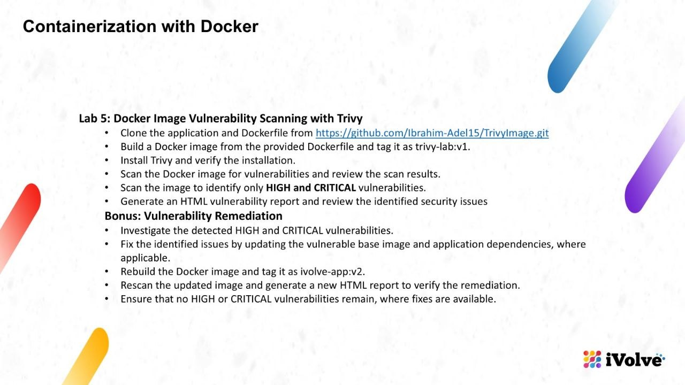

```
docker build -t trivy-lab:v1 .
```

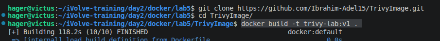

```
sudo apt-get update
sudo apt-get install -y trivy
trivy --version
```
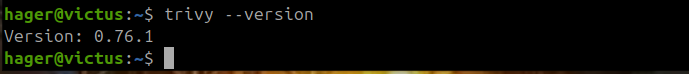


```
trivy image trivy-lab:v1
```

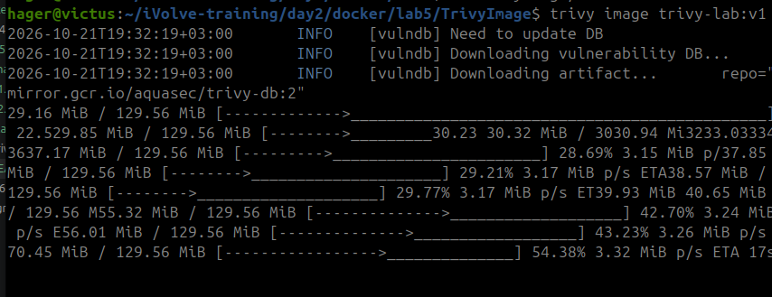


- chect the high and critical issues 

```
trivy image --severity HIGH,CRITICAL trivy-lab:v1
```

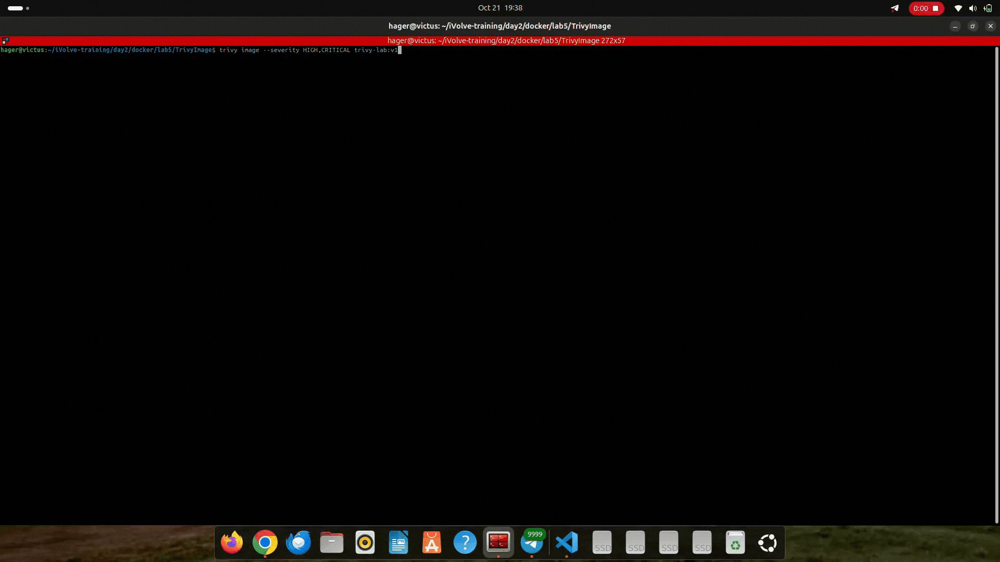

- scan and  make html file nmaed trivy-report.html

```
trivy image --format template --template "@html.tpl" --output trivy-report.html trivy-lab:v1
```

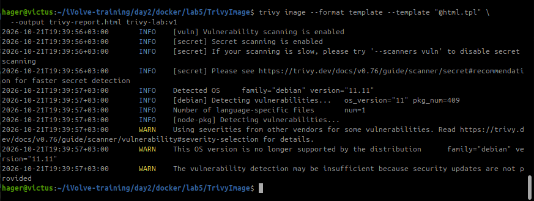


- scan and  make html file `with high and critical isses` nmaed trivy-high-critical.html 


```
trivy image --severity HIGH,CRITICAL \
  --format template --template "@html.tpl" \
  --output trivy-high-critical.html trivy-lab:v1


```

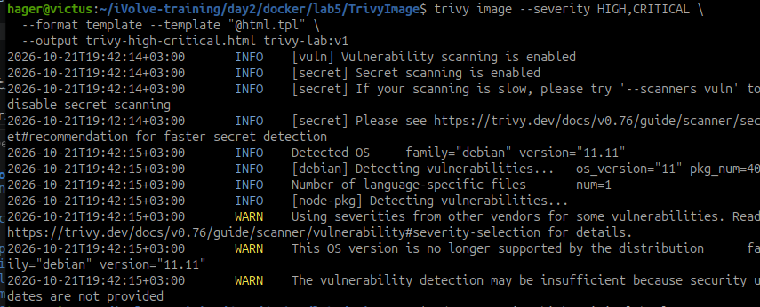

open the html from terminal 

```
xdg-open trivy-high-critical.html
```
-----
```
npm install
```

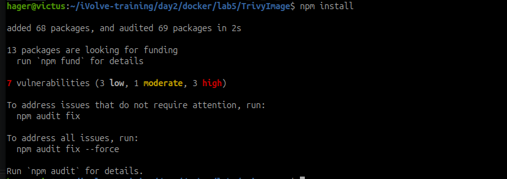

```
npm ls --depth=0
npm ls express body-parser brace-expansion cross-spawn glob http-cache-semantics

```

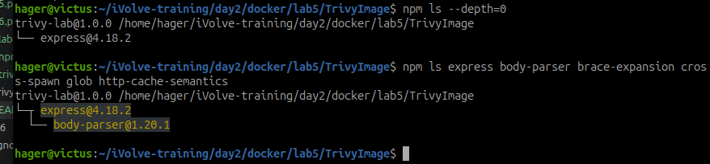


after check the fils ` package-lock.json`--> the app depend on express@4.18.2

```
npm install express@^4
npm audit
```


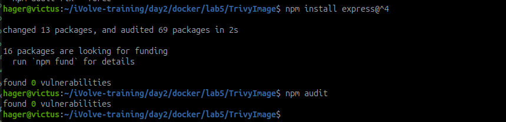


The original `node:22-bookworm-slim` base included outdated Debian packages and the runtime image retained npm's bundled CLI dependencies. For the bonus remediation, the Dockerfile now uses `node:22-alpine`, installs only production dependencies, and removes npm/npx after installation because the application starts directly with Node.

rebuild the image 

```
docker build --no-cache -t ivolve-app:v2 .
```

```
docker images ivolve-app
```

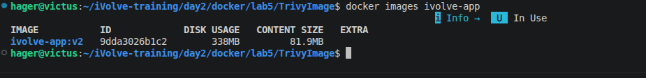

run 
```
docker run --rm -d --name ivolve-test -p 3000:3000 ivolve-app:v2
```

http://localhost:3000

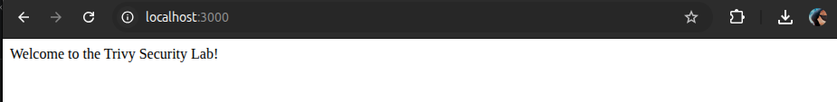


```
trivy image ivolve-app:v2

trivy image --severity HIGH,CRITICAL ivolve-app:v2

trivy image --severity HIGH,CRITICAL \
  --format template --template "@html.tpl" \
  --output trivy-high-critical-v2.html ivolve-app:v2
```

Verified: the rebuilt `ivolve-app:v2` image has no HIGH or CRITICAL findings. The regenerated report is `TrivyImage/trivy-high-critical-v2.html`. To repeat the bonus build and scan from the lab directory:

```sh
cd TrivyImage
docker build --no-cache -t ivolve-app:v2 .
trivy image --severity HIGH,CRITICAL ivolve-app:v2
trivy image --severity HIGH,CRITICAL \
  --format template --template "@html.tpl" \
  --output trivy-high-critical-v2.html ivolve-app:v2
```


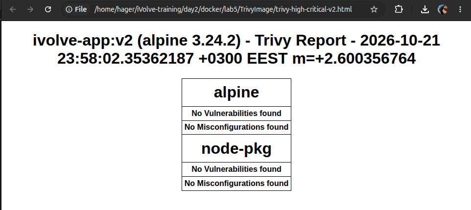
