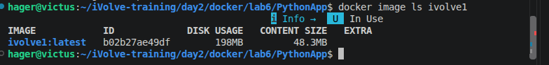
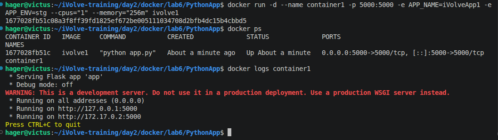
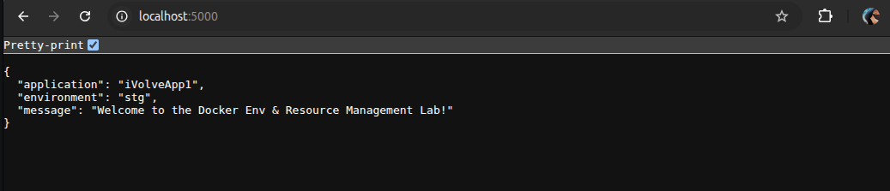
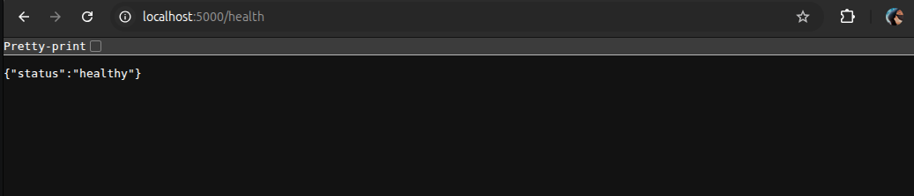
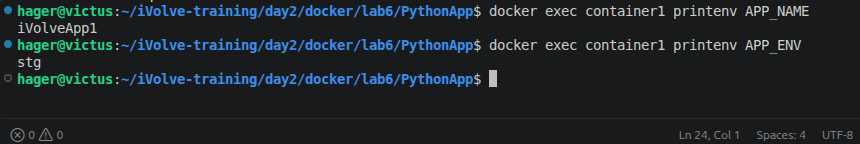
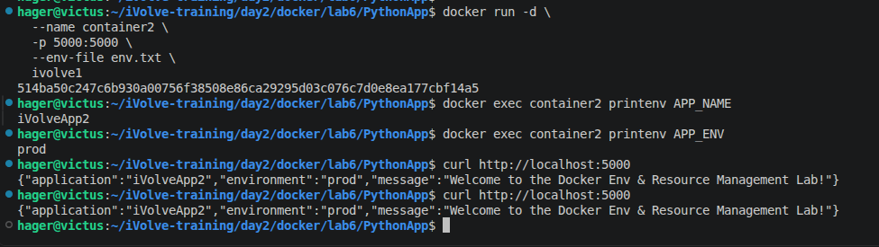
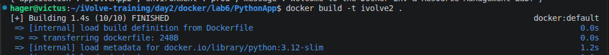
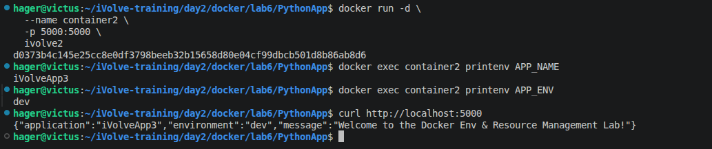

# Lab 6: Docker Environment Variables and Resource Management

## 1. Build the Docker Image

Build the Docker image using the `Dockerfile` and tag it as `ivolve1`.

```bash
docker build -t ivolve1 .
```



## 2. Run Container1 with Environment Variables and Resource Limits

Run a container named `container1`, map port `5000`, configure the environment variables, and limit CPU and memory resources.

```bash
docker run -d --name container1 -p 5000:5000 -e APP_NAME=iVolveApp1 -e APP_ENV=stg --cpus="1" --memory="256m" ivolve1
```

- `-d`: Runs the container in detached mode.
- `--name container1`: Assigns a name to the container.
- `-p 5000:5000`: Maps host port 5000 to container port 5000.
- `-e`: Sets environment variables.
- `--cpus="1"`: Limits the container to one CPU.
- `--memory="256m"`: Limits the container memory to 256 MB.



## 3. Verify the Application

Open the application in a browser:

http://localhost:5000

The application returns the configured application name, environment, and welcome message.



Check the health endpoint:

```bash
curl http://localhost:5000/health
```

Expected response:

```json
{"status":"healthy"}
```



## 4. Verify Environment Variables

Check the environment variables inside `container1`:

```bash
docker exec container1 printenv APP_NAME
docker exec container1 printenv APP_ENV
```

Expected values:

```text
iVolveApp1
stg
```

## 5. Monitor CPU and Memory Usage

Monitor the container's resource consumption:

```bash
docker stats container1
```

The command displays real-time CPU and memory usage, along with network and block I/O statistics.

Press `Ctrl+C` to exit.



## 6. Run Container2 Using an Environment File

Create an `env.txt` file with the following variables:

```dotenv
APP_NAME=iVolveApp2
APP_ENV=prod
```

Run the container using the environment file:

```bash
docker run -d --name container2 -p 5000:5000 --env-file env.txt ivolve1
```

> **Note:** Stop `container1` before running `container2`, because both containers use host port 5000.

```bash
docker stop container1
```

Verify the environment variables:

```bash
docker exec container2 printenv APP_NAME
docker exec container2 printenv APP_ENV
```

Expected values:

```text
iVolveApp2
prod
```

Test the application:

```bash
curl http://localhost:5000
```

The response should contain `iVolveApp2` as the application name and `prod` as the environment.



## 7. Set Environment Variables in the Dockerfile

Update the `Dockerfile` to define the environment variables directly in the image:

```dockerfile
FROM python:3.12-slim

WORKDIR /app

COPY requirements.txt .

RUN pip install --no-cache-dir -r requirements.txt

COPY app.py .

ENV APP_NAME=iVolveApp3
ENV APP_ENV=dev

EXPOSE 5000

CMD ["python", "app.py"]
```

The `ENV` instruction defines default environment variables that are available to containers created from this image.

## 8. Build the New Docker Image

Build a new image named `ivolve2`:

```bash
docker build -t ivolve2 .
```



## 9. Run a Container from the New Image

Stop and remove the previous `container2` before reusing its name:

```bash
docker stop container2
docker rm container2
```

Run a new container using `ivolve2`:

```bash
docker run -d --name container2 -p 5000:5000 ivolve2
```

Verify the environment variables:

```bash
docker exec container2 printenv APP_NAME
docker exec container2 printenv APP_ENV
```

Expected values:

```text
iVolveApp3
dev
```

Test the application:

```bash
curl http://localhost:5000
```

The response should contain `iVolveApp3` as the application name and `dev` as the environment.



## 10. What I Learned

- Built a Docker image for a Python Flask application using `python:3.12-slim`.
- Configured environment variables using the `-e` option in `docker run`.
- Loaded environment variables from a file using `--env-file`.
- Defined default environment variables using the `ENV` instruction in a Dockerfile.
- Managed container CPU and memory limits using `--cpus` and `--memory`.
- Verified application functionality using browser requests and `curl`.
- Inspected environment variables using `docker exec`.
- Monitored container resource consumption using `docker stats`.