# Lab 8: Containerized Node.js and MySQL Stack Using Docker Compose

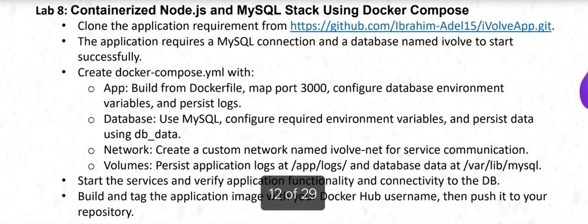

## 1. Create the Docker Compose Configuration

Create a `docker-compose.yml` file to define the Node.js application, MySQL database, persistent volumes, and custom network.

```yaml
services:
  app:
    build: .
    image: hager83/ivolve-app:latest
    container_name: ivolve-app
    ports:
      - "3000:3000"
    environment:
      DB_HOST: db
      DB_USER: root
      DB_PASSWORD: ${DB_PASSWORD}
      DB_NAME: ivolve
    volumes:
      - app_logs:/app/logs
    depends_on:
      - db
    networks:
      - ivolve-net

  db:
    image: mysql:8.0
    container_name: ivolve-db
    environment:
      MYSQL_ROOT_PASSWORD: ${DB_PASSWORD}
      MYSQL_DATABASE: ivolve
    volumes:
      - db_data:/var/lib/mysql
    networks:
      - ivolve-net

volumes:
  app_logs:
  db_data:

networks:
  ivolve-net:
    driver: bridge
```

Create a local `.env` file containing the database password:

```dotenv
DB_PASSWORD=your_secure_password
```

Replace `your_secure_password` with your own password. Keep this file local and never commit it to Git.

## 2. Build and Start the Containers

Build the application image and start the services in the background:

```bash
docker compose up --build -d
```

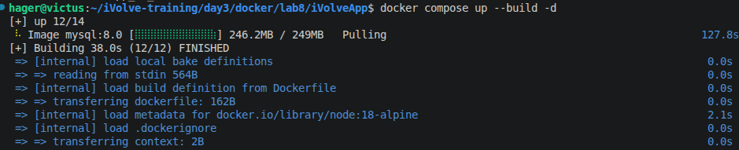

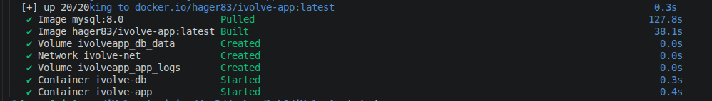


## 3. Check Container Logs

Check the application logs:

```bash
docker compose logs --tail=50 app
```


Check the MySQL database logs:

```bash
docker compose logs --tail=50 db
```

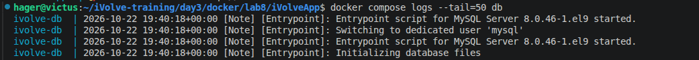

## 4. Fix the Database Connection

Initially, the application encountered database connection issues because MySQL was not ready to accept connections when the application started.

The application was updated to initialize the database, create the required `products` table, and insert sample products when the table is empty. The database connection logic retries until MySQL becomes available.

Rebuild and restart the application:

```bash
docker compose up --build -d
```

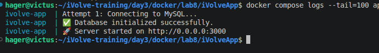

## 5. Verify the Database

Check that the `products` table exists and contains the sample records:

```bash
docker compose exec db mysql -uroot -p -D ivolve -e "SHOW TABLES; SELECT * FROM products;"
```

Enter the MySQL root password when prompted.


## 6. Test the Application Health Endpoints

Check the application's health endpoint:

```bash
curl -i http://localhost:3000/health
```

Check the application's readiness endpoint:

```bash
curl -i http://localhost:3000/ready
```

Both endpoints should return a successful HTTP response when the application and database are working correctly.

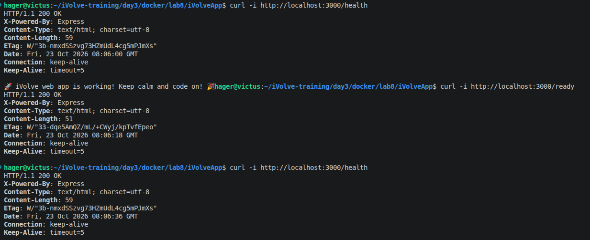

## 7. Access the Web Application

Open the application in a browser:

```text
http://localhost:3000
```

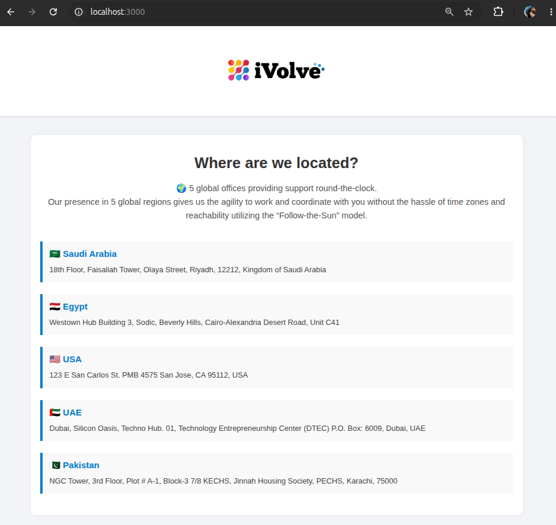

Check the HTTP response headers from the terminal:

```bash
curl -I http://localhost:3000
```


## 8. Verify Persistent Volumes

List the Docker volumes:

```bash
docker volume ls
```

The output should include the volumes used for MySQL data and application logs.

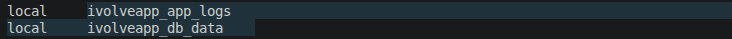

Inspect the application container configuration:

```bash
docker inspect ivolve-app
```

Review the `Mounts` section to verify the application log volume.

## 9. Test Database Persistence

Restart the Compose services:

```bash
docker compose restart
```

After the services are running again, verify that the products remain in the database:

```bash
docker compose exec db mysql -uroot -p -D ivolve -e "SELECT * FROM products;"
```

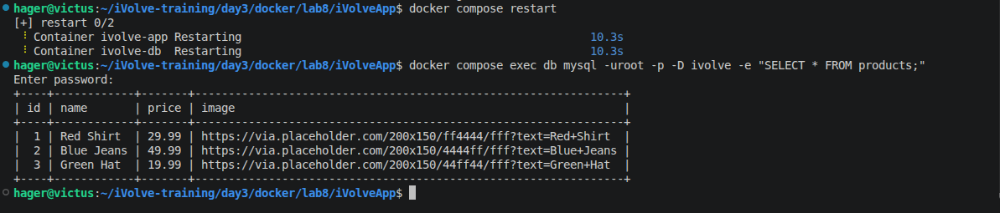

The database records should remain available because MySQL data is stored in the named `db_data` volume.

The `app_logs` volume separately preserves application logs.

## 10. Push the Application Image to Docker Hub

Log in to Docker Hub:

```bash
docker login
```

Push the application image:

```bash
docker push hager83/ivolve-app:latest
```

The push must complete successfully before considering the image published.

Verify the repository and `latest` tag on Docker Hub.

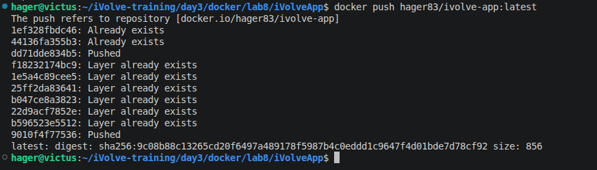

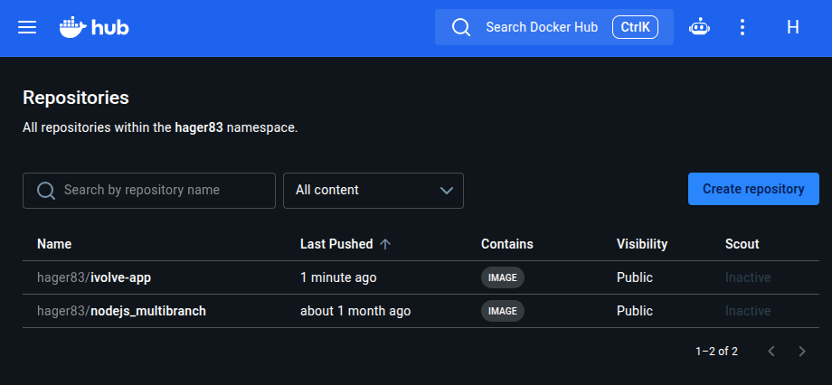

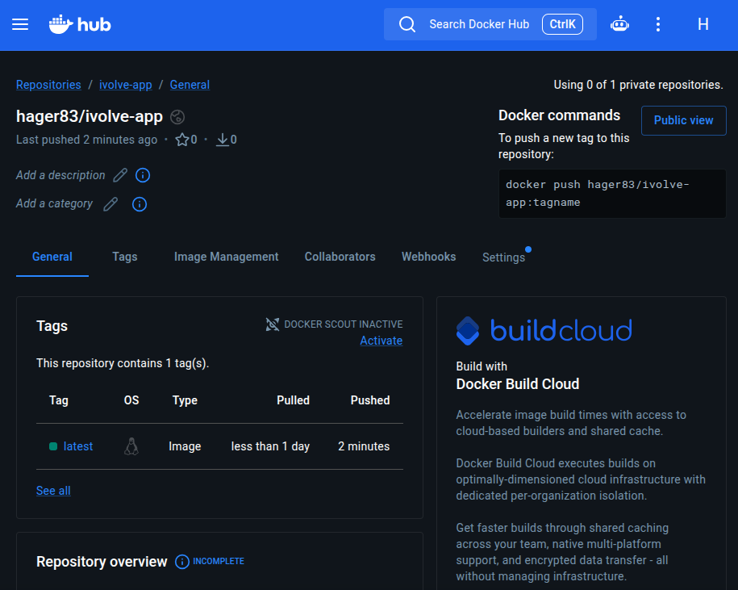

Docker Hub repository: https://hub.docker.com/r/hager83/ivolve-app

## 11. Stop the Services

Stop and remove the containers and Compose-created network:

```bash
docker compose down
```

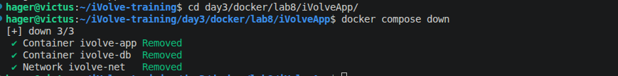

The named volumes are retained when running `docker compose down` without the `-v` option. This allows the database data and application logs to persist when the services are started again.

## 12. Security Notes

- Store database credentials in a local `.env` file.
- Exclude `.env` from Git using `.gitignore`.
- Never commit passwords or other secrets.
- Use a strong database password.
- Do not publish environment files or credentials in Docker images or screenshots.
