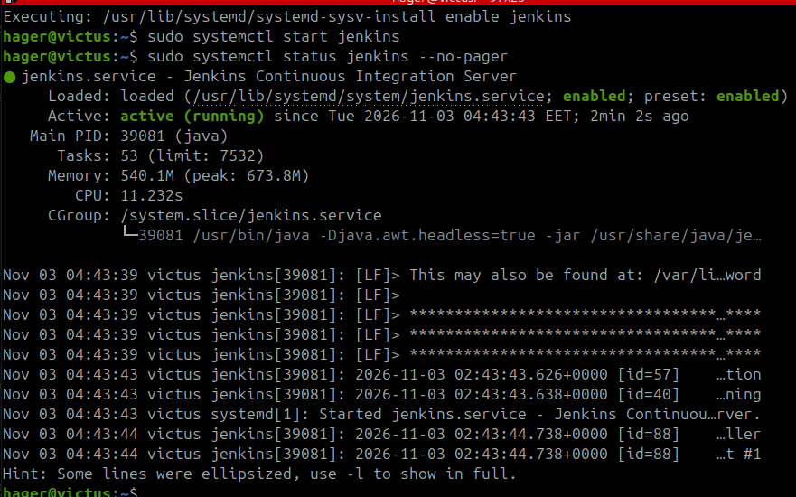
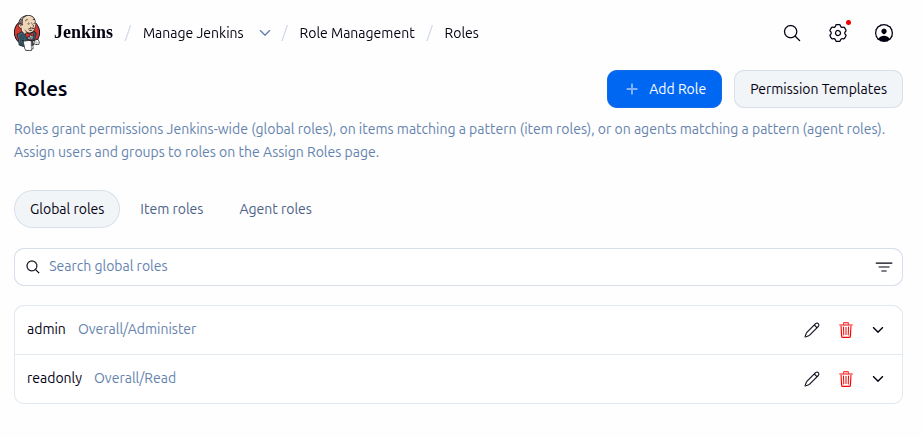
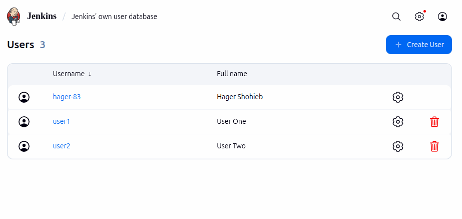
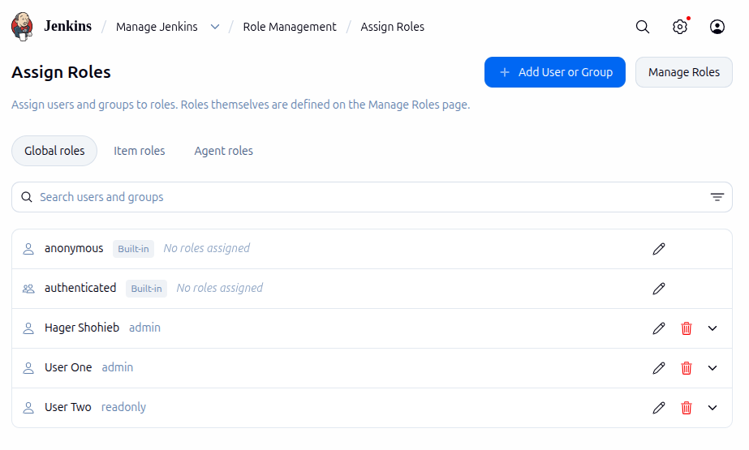
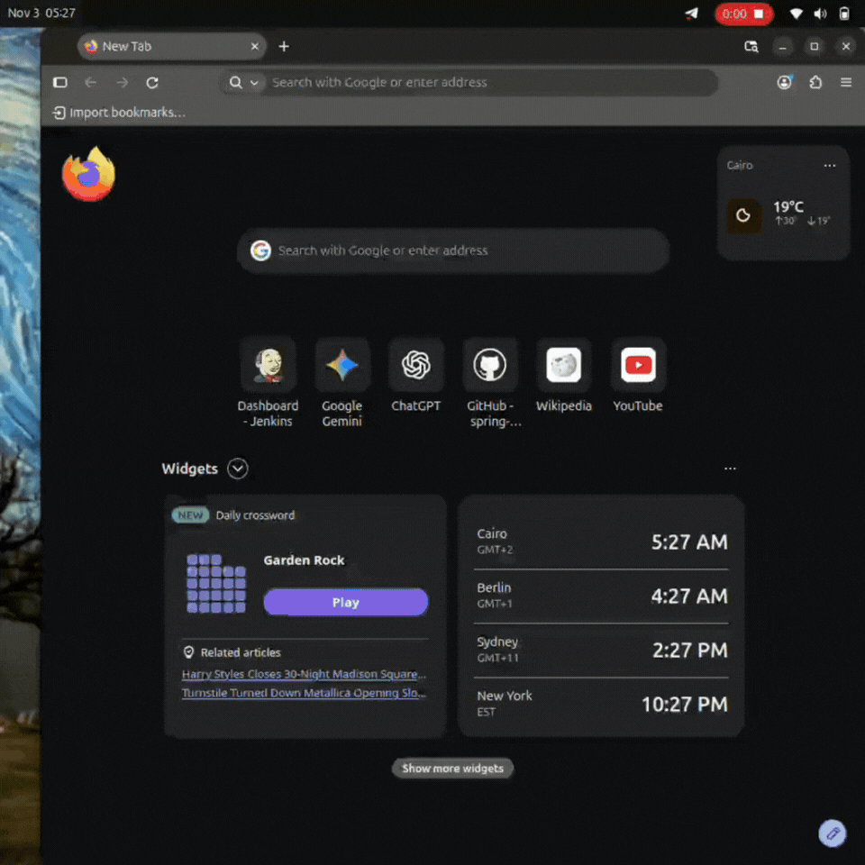

# Lab 20: Role-Based Authorization in Jenkins


## 1. Install Jenkins

Install Jenkins using APT:

```bash
sudo apt install -y jenkins
```

## 2. Start and Enable Jenkins

Enable Jenkins to start automatically when the system boots, then start the service.

```bash
# Enable Jenkins on system startup
sudo systemctl enable jenkins

# Start Jenkins
sudo systemctl start jenkins

# Check service status
sudo systemctl status jenkins --no-pager
```

The service should be active and running.



## 3. Unlock Jenkins

Retrieve the initial administrator password:

```bash
sudo cat /var/lib/jenkins/secrets/initialAdminPassword
```

Open Jenkins in your browser:

```text
http://localhost:8080
```

Enter the initial password, install the suggested plugins, and create the first administrator account.

## 4. Install Role-Based Authorization Strategy Plugin

From the Jenkins Dashboard:

1. Navigate to **Manage Jenkins → Plugins**.
2. Open **Available plugins**.
3. Search for `Role-based Authorization Strategy`.
4. Install the plugin.

This plugin allows administrators to define roles and assign specific permissions to Jenkins users.

## 5. Enable Role-Based Authorization

Navigate to:

**Manage Jenkins → Security → Authorization**

Select:

`Role-Based Strategy`

## 6. Create Roles

Navigate to:

**Manage Jenkins → Role Management → Manage Roles**

The existing `admin` role was used for administrative access.

Create a new role named `readonly` with the following permissions:

The `readonly` role allows users to view Jenkins and jobs without modifying them.



## 7. Create Users

Navigate to:

**Manage Jenkins → Users**

Create the following users:

| Username | Purpose |
|---|---|
| user1 | Administrator |
| user2 | Read-only user |



## 8. Assign Roles to Users

Navigate to:

**Manage Jenkins → Role Management → Assign Roles**

Assign the roles as follows:

| User | Assigned Role |
|---|---|
| hager | admin |
| user1 | admin |
| user2 | readonly |

The main administrator account (`hager`) retains administrative access.



## 9. Test User Permissions

Log in with each account separately to verify the assigned permissions.

### User 1 – Admin

Log in using `user1` and verify that the account can:

- Access the Jenkins Dashboard.
- Open Manage Jenkins.
- Access administrative settings.
- Create and configure Jenkins jobs.

### User 2 – Read-only

Log in using `user2` and verify that the account can:

- Access the Jenkins Dashboard.
- View available jobs.
- View job details.

The account should not be able to:

- Create jobs.
- Configure existing jobs.
- Delete jobs.
- Access administrative settings.



## 10. Final Results

| User | Expected Access | Result |
|---|---|---|
| hager | Administrator | 🟢 **PASSED** |
| user1 | Administrator | 🟢 **PASSED** |
| user2 | Read-only | 🟢 **PASSED** |

## Conclusion

In this lab, Jenkins was installed and configured with Role-Based Authorization Strategy. Two users were created with different access levels: `user1` received administrative permissions, while `user2` received read-only permissions.

This demonstrates how Jenkins access can be controlled by assigning roles and permissions to individual users.