# Lab 21: Jenkins CI/CD Pipeline for Kubernetes Deployment

This lab demonstrates how to build an automated CI/CD pipeline using Jenkins to build, scan, publish, and deploy a containerized Node.js application to a Kubernetes cluster running on AWS EC2.

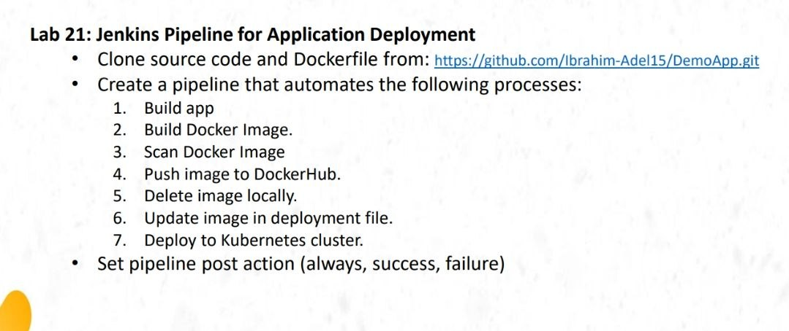

## 1. Prepare the Application Repository

Create a dedicated GitHub repository named `ivolve-app-cicd` to store the application, Docker configuration, Kubernetes manifests, and Jenkins pipeline.

The project follows this structure:

```text
ivolve-app-cicd/
│
├── app/
│   ├── server.js
│   ├── db.js
│   ├── package.json
│   └── frontend/
│
├── Dockerfile
├── docker-compose.yml
├── .dockerignore
│
├── kubernetes/
│   └── deployment.yaml
│
├── Jenkinsfile
└── README.md
```

## 2. Validate the Application Locally

Before configuring Jenkins, verify that the application works correctly using Docker Compose.

Build and start the application and MySQL containers:

```bash
docker compose up -d --build
docker compose ps
```

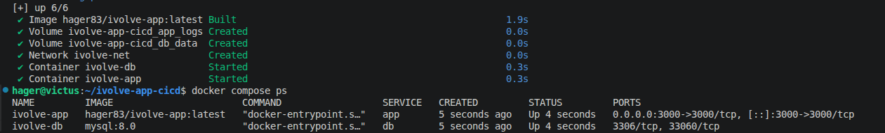

### Test Application Health

Check the application health and readiness endpoints:

```bash
curl -i http://localhost:3000/health
curl -i http://localhost:3000/ready
```

### Access the Application

Open the application in the browser to verify that the frontend is accessible.

```text
http://localhost:3000/
```

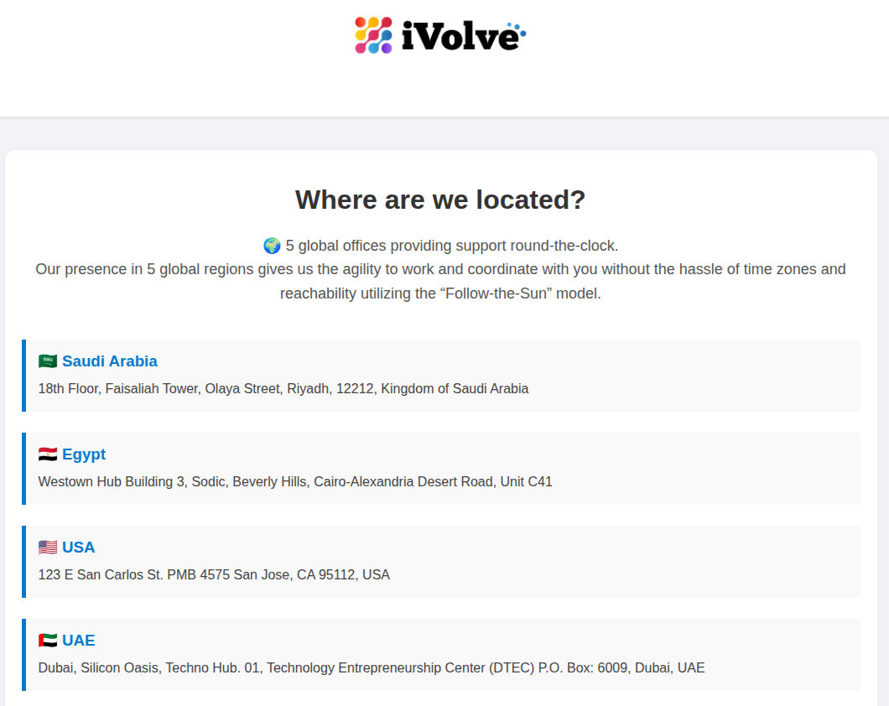

## 3. Prepare the Kubernetes Deployment

Create a Kubernetes deployment manifest to define how the application will run inside the existing `ivolve` namespace.

```bash
cd ~/ivolve-app-cicd

mkdir -p kubernetes
```

### Create the Deployment Manifest

The manifest includes the application container, database initialization, environment variables, health probes, resource limits, and persistent storage.

It also uses the existing Kubernetes node labels and tolerations to schedule the application on the intended worker node.


<details>
<summary><strong>View Kubernetes Deployment Manifest (deployment.yaml)</strong></summary>

```yaml
apiVersion: apps/v1
kind: Deployment
metadata:
  name: ivolveapp
  namespace: ivolve

spec:
  replicas: 1

  selector:
    matchLabels:
      app: ivolveApp

  strategy:
    type: Recreate

  template:
    metadata:
      labels:
        app: ivolveApp

    spec:
      nodeSelector:
        project: ivolve

      tolerations:
        - key: workload
          operator: Equal
          value: ivolveApp
          effect: NoSchedule

      imagePullSecrets:
        - name: dockerhub-secret

      initContainers:
        - name: mysql-init
          image: mysql:8.0
          imagePullPolicy: IfNotPresent

          command:
            - sh
            - -c
            - |
              set -e
              export MYSQL_PWD="${MYSQL_ROOT_PASSWORD}"

              echo "Waiting for MySQL..."
              until mysqladmin ping -h "${DB_HOST}" -uroot --silent; do
                sleep 5
              done

              echo "Creating database and granting privileges..."
              mysql -h "${DB_HOST}" -uroot -e "
                CREATE DATABASE IF NOT EXISTS \`${DB_NAME}\`;
                GRANT ALL PRIVILEGES ON \`${DB_NAME}\`.* TO '${DB_USER}'@'%';
                FLUSH PRIVILEGES;
              "

              echo "Database initialization completed."

          env:
            - name: DB_HOST
              valueFrom:
                configMapKeyRef:
                  name: ivolvecm
                  key: DB_HOST

            - name: DB_USER
              valueFrom:
                configMapKeyRef:
                  name: ivolvecm
                  key: DB_USER

            - name: DB_PASSWORD
              valueFrom:
                secretKeyRef:
                  name: ivolvesecret
                  key: DB_PASSWORD

            - name: MYSQL_ROOT_PASSWORD
              valueFrom:
                secretKeyRef:
                  name: ivolvesecret
                  key: MYSQL_ROOT_PASSWORD

            - name: DB_NAME
              value: ivolve

          resources:
            requests:
              cpu: 50m
              memory: 64Mi
            limits:
              cpu: 200m
              memory: 128Mi

      containers:
        - name: ivolve-app
          image: hager83/ivolve-app:latest
          imagePullPolicy: Always

          ports:
            - name: http
              containerPort: 3000
              protocol: TCP

          env:
            - name: DB_HOST
              valueFrom:
                configMapKeyRef:
                  name: ivolvecm
                  key: DB_HOST

            - name: DB_USER
              valueFrom:
                configMapKeyRef:
                  name: ivolvecm
                  key: DB_USER

            - name: DB_PASSWORD
              valueFrom:
                secretKeyRef:
                  name: ivolvesecret
                  key: DB_PASSWORD

            - name: DB_NAME
              value: ivolve

          readinessProbe:
            httpGet:
              path: /ready
              port: 3000
            initialDelaySeconds: 10
            periodSeconds: 10

          livenessProbe:
            httpGet:
              path: /health
              port: 3000
            initialDelaySeconds: 20
            periodSeconds: 20

          resources:
            requests:
              cpu: "1"
              memory: 1Gi
            limits:
              cpu: "2"
              memory: 2Gi

          volumeMounts:
            - name: app-logs
              mountPath: /app/logs

      volumes:
        - name: app-logs
          persistentVolumeClaim:
            claimName: ivolvepvc
```

</details>

### Verify the Deployment Configuration

Confirm that the deployment name and container images are configured correctly.

```bash
echo "===== DEPLOYMENT IMAGE ====="
grep 'image:' kubernetes/deployment.yaml

echo "===== DEPLOYMENT NAME ====="
grep -A 2 '^metadata:' kubernetes/deployment.yaml
```

Expected image references:

```text
image: mysql:8.0
image: hager83/ivolve-app:latest
```

The Jenkins pipeline will later replace the application image tag with a unique tag for each build.

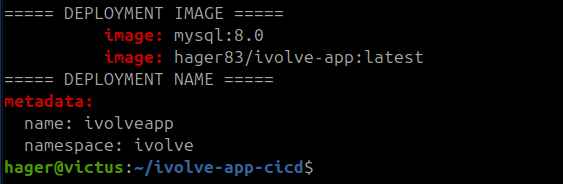

### Push the Project to GitHub

Push the application and configuration files to the new repository so Jenkins can retrieve them through Source Code Management (SCM).

Repository: [Hager-83/ivolve-app-cicd](https://github.com/Hager-83/ivolve-app-cicd)

## 4. Set Up Jenkins

### Start Jenkins

Start the Jenkins service and verify that it is running.

```bash
sudo systemctl start jenkins
sudo systemctl status jenkins --no-pager
```

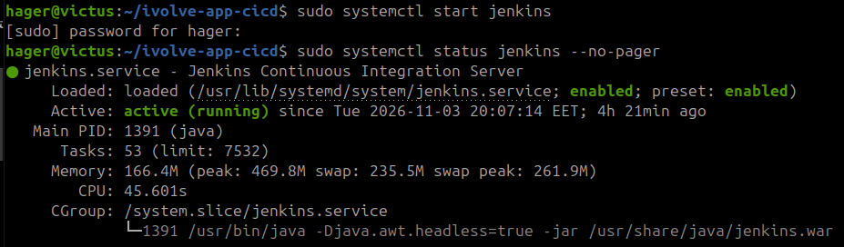

Access Jenkins at `http://localhost:8080` and sign in using the configured administrator account.

### Verify Required Tools

Ensure that Docker, Git, Trivy, and kubectl are installed on the Jenkins host.

```bash
echo "===== DOCKER ====="
docker --version

echo "===== GIT ====="
git --version

echo "===== TRIVY ====="
trivy --version

echo "===== KUBECTL ====="
kubectl version --client
```

These tools are required for source checkout, Docker image creation, vulnerability scanning, and Kubernetes deployment.

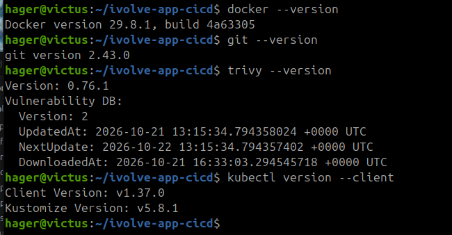

### Configure Docker Hub Credentials

Create a Docker Hub access token with Read & Write permissions so Jenkins can push the built images to the registry.

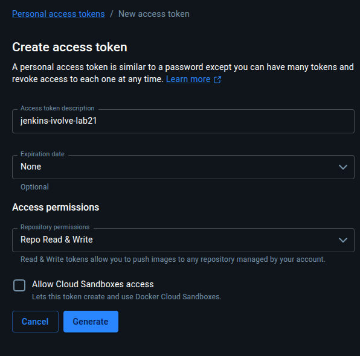

Add the Docker Hub credentials to Jenkins under **Manage Jenkins → Credentials**.

Use the credential ID `dockerhub-credentials`, which will be referenced in the Jenkinsfile.

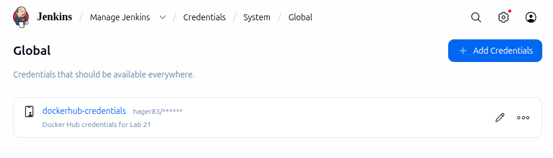

### Grant Jenkins Access to Docker

Add the Jenkins system user to the Docker group so the pipeline can execute Docker commands.

```bash
sudo usermod -aG docker jenkins
```

Restart Jenkins to apply the new group membership.

```bash
sudo systemctl restart jenkins

id jenkins
```

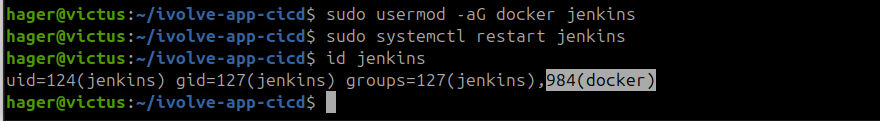

Verify that Jenkins can communicate with the Docker daemon and run a container.

```bash
sudo -u jenkins docker info

sudo -u jenkins docker run --rm hello-world
```

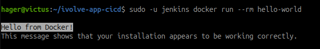

> **Note:** Docker group membership grants elevated access to the host. It is used here for the lab environment and should be carefully controlled in production.

---

## 5. Connect Jenkins to the AWS Kubernetes Cluster

Jenkins runs locally, while the Kubernetes cluster is hosted on AWS EC2. A secure connection is required so Jenkins can deploy the application remotely.

### Connect to the EC2 Control Plane

From the laptop, connect to the Kubernetes control-plane instance.

```bash
ssh -i ~/Downloads/k8s-lab-key.pem ubuntu@54.145.246.57
```

Verify that the Jenkins service account already exists in the `ivolve` namespace.

```bash
kubectl get serviceaccount jenkinssa -n ivolve
```

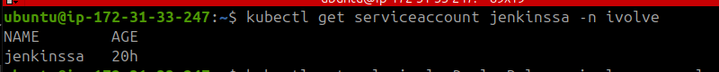

### Check Kubernetes RBAC Permissions

Inspect the permissions assigned to the Jenkins service account.

```bash
echo "===== PERMISSIONS ====="

for verb in get create update patch delete; do
  echo -n "$verb: "
  kubectl auth can-i "$verb" deployments \
    -n ivolve \
    --as=system:serviceaccount:ivolve:jenkinssa
done
```

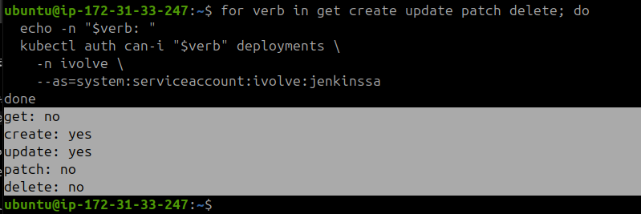

### Verify Deployment-Specific Permissions

Jenkins needs permission to update the application Deployment and monitor its rollout.

Check the existing permissions for `ivolveapp`.

```bash
echo "===== JENKINS PERMISSIONS ON ivolveapp ====="

for verb in get update patch delete; do
  echo -n "$verb ivolveapp: "
  kubectl auth can-i "$verb" deployment/ivolveapp \
    -n ivolve \
    --as=system:serviceaccount:ivolve:jenkinssa
done
```

The RBAC configuration was reviewed and adjusted during troubleshooting to allow the required deployment operations.

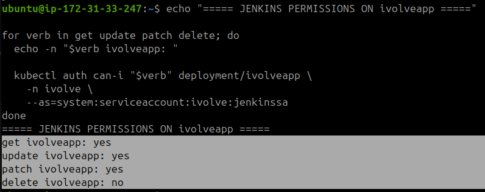

### Check kubectl Version Compatibility

Compare the kubectl versions on the EC2 control plane and the local laptop.

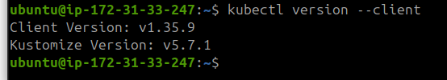

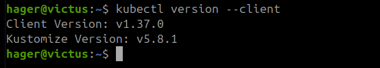

Install a compatible kubectl version locally and verify it.

```bash
sudo install -o root -g root -m 0755 \
  /tmp/kubectl /usr/local/bin/kubectl-1.35

/usr/local/bin/kubectl-1.35 version --client
```

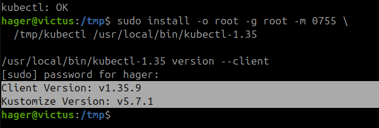

### Establish an SSH Tunnel

Because the Kubernetes API server is running on AWS, create an SSH tunnel from the laptop to the control-plane API endpoint.

Run this command on the laptop and keep the terminal open.

```bash
ssh -i ~/Downloads/k8s-lab-key.pem \
  -o ExitOnForwardFailure=yes \
  -N \
  -L 127.0.0.1:16443:172.31.33.247:6443 \
  ubuntu@54.145.246.57
```

This forwards local port `16443` to the Kubernetes API server on port `6443`.

### Test Kubernetes API Connectivity

Open another terminal on the laptop and verify that the API server is reachable.

```bash
curl -k --connect-timeout 5 \
  https://127.0.0.1:16443/readyz
```

A successful response confirms that the API server can be reached through the tunnel.

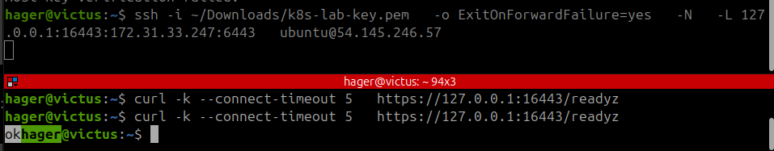

### Configure the Kubernetes CA Certificate

On the EC2 control-plane node, copy the Kubernetes Certificate Authority certificate.

```bash
sudo cp /etc/kubernetes/pki/ca.crt /tmp/ivolve-ca.crt
sudo chmod 644 /tmp/ivolve-ca.crt
```

On the laptop, copy the certificate to the local Kubernetes configuration directory.

```bash
mkdir -p ~/.kube/jenkins-lab21

scp -i ~/Downloads/k8s-lab-key.pem \
  ubuntu@54.145.246.57:/tmp/ivolve-ca.crt \
  ~/.kube/jenkins-lab21/ca.crt
```

Verify the TLS connection using the cluster CA certificate.

```bash
curl --cacert ~/.kube/jenkins-lab21/ca.crt \
  --resolve 172.31.33.247:16443:127.0.0.1 \
  https://172.31.33.247:16443/readyz
```

This verifies the API server certificate instead of bypassing TLS verification.

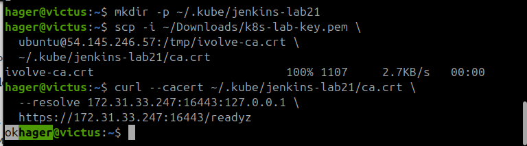

### Create a Jenkins Service Account Token

On the EC2 control plane, create a token Secret associated with the Jenkins service account.

```bash
cat <<'EOF' > jenkins-token-secret.yaml
apiVersion: v1
kind: Secret
metadata:
  name: jenkinssa-long-lived-token
  namespace: ivolve
  annotations:
    kubernetes.io/service-account.name: jenkinssa
type: kubernetes.io/service-account-token
EOF
```

Apply the Secret to Kubernetes.

```bash
kubectl apply -f jenkins-token-secret.yaml
```

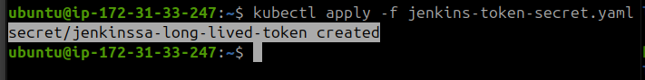

> **Note:** This lab uses a long-lived service-account token. For production environments, short-lived tokens or workload identity are preferable.

### Transfer the Token to the Laptop

Copy the previously generated service-account token securely to the local Kubernetes configuration directory.

```bash
scp -i ~/Downloads/k8s-lab-key.pem \
  ubuntu@54.145.246.57:~/jenkins-sa-token \
  ~/.kube/jenkins-lab21/token
```

The token will be used to authenticate Jenkins to the Kubernetes API server.

### Create the Jenkins kubeconfig

Create a dedicated kubeconfig file for Jenkins rather than using the cluster administrator's credentials.

```bash
KCFG="$HOME/.kube/jenkins-lab21/config"

kubectl config --kubeconfig="$KCFG" set-cluster ivolve-aws \
  --server=https://127.0.0.1:16443 \
  --certificate-authority="$HOME/.kube/jenkins-lab21/ca.crt" \
  --embed-certs=true \
  --tls-server-name=172.31.33.247

kubectl config --kubeconfig="$KCFG" set-credentials jenkinssa \
  --token="$(cat ~/.kube/jenkins-lab21/token)"

kubectl config --kubeconfig="$KCFG" set-context ivolve-jenkins \
  --cluster=ivolve-aws \
  --user=jenkinssa \
  --namespace=ivolve

kubectl config --kubeconfig="$KCFG" use-context ivolve-jenkins

chmod 600 "$KCFG"
```

This configuration allows Jenkins to authenticate as `jenkinssa` with the permissions assigned through Kubernetes RBAC.

### Verify Kubernetes Access

Test the connection using the new kubeconfig and confirm that Jenkins can access the required Deployment resources.

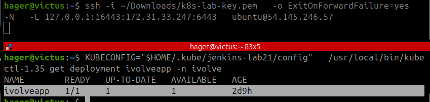

### Add Kubernetes Credentials to Jenkins

Upload the kubeconfig file to Jenkins as a **Secret file** credential.

Use the credential ID `kubeconfig-ivolve` so the pipeline can access it during deployment.

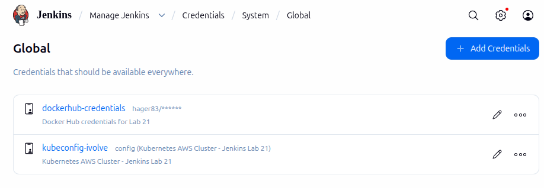

## 6. Define the Jenkins Pipeline

Create a `Jenkinsfile` to automate the complete application delivery process.

The pipeline will install dependencies, build the Docker image, scan it with Trivy, push it to Docker Hub, update the Kubernetes manifest, and deploy the new image.


<details>
<summary><strong>View Jenkins Pipeline (Jenkinsfile)</strong></summary>

```groovy
pipeline {
    agent any

    options {
        timestamps()
        disableConcurrentBuilds()
        skipDefaultCheckout(true)
    }

    environment {
        IMAGE_REPO = 'hager83/ivolve-app'
        KUBE_NAMESPACE = 'ivolve'
        DEPLOYMENT_NAME = 'ivolveapp'
        KUBECTL = '/usr/local/bin/kubectl-1.35'
    }

    stages {
        stage('Build App') {
            steps {
                checkout scm

                dir('app') {
                    sh 'npm ci'
                }

                script {
                    env.IMAGE_TAG = "${env.BUILD_NUMBER}-${env.GIT_COMMIT.take(7)}"
                    env.FULL_IMAGE = "${env.IMAGE_REPO}:${env.IMAGE_TAG}"
                }

                echo "Building image: ${env.FULL_IMAGE}"
            }
        }

        stage('Build Docker Image') {
            steps {
                sh 'docker build -t "$FULL_IMAGE" .'
            }
        }

        stage('Scan Docker Image') {
            steps {
                sh '''
                    trivy image \
                      --exit-code 1 \
                      --severity HIGH,CRITICAL \
                      --no-progress \
                      "$FULL_IMAGE"
                '''
            }
        }

        stage('Push Docker Image') {
            steps {
                withCredentials([
                    usernamePassword(
                        credentialsId: 'dockerhub-credentials',
                        usernameVariable: 'DOCKER_USER',
                        passwordVariable: 'DOCKER_TOKEN'
                    )
                ]) {
                    sh '''
                        set +x
                        echo "$DOCKER_TOKEN" | docker login \
                          --username "$DOCKER_USER" \
                          --password-stdin

                        docker push "$FULL_IMAGE"
                        docker logout
                    '''
                }
            }
        }

        stage('Remove Local Image') {
            steps {
                sh 'docker image rm "$FULL_IMAGE"'
            }
        }

        stage('Update Deployment YAML') {
            steps {
                sh '''
                    sed -i \
                      "s|image: hager83/ivolve-app:.*|image: $FULL_IMAGE|" \
                      kubernetes/deployment.yaml

                    grep -n 'image:' kubernetes/deployment.yaml
                '''
            }
        }

        stage('Deploy to Kubernetes') {
            steps {
                withCredentials([
                    file(
                        credentialsId: 'kubeconfig-ivolve',
                        variable: 'KUBECONFIG'
                    )
                ]) {
                    sh '''
                        "$KUBECTL" apply \
                          -f kubernetes/deployment.yaml \
                          -n "$KUBE_NAMESPACE"

                        "$KUBECTL" rollout status \
                          deployment/"$DEPLOYMENT_NAME" \
                          -n "$KUBE_NAMESPACE" \
                          --timeout=300s
                    '''
                }
            }
        }
    }

    post {
        always {
            echo "Pipeline finished. Build: ${env.BUILD_NUMBER}"
            sh 'docker logout >/dev/null 2>&1 || true'
            cleanWs()
        }

        success {
            echo "SUCCESS: ${env.FULL_IMAGE} deployed to Kubernetes."
        }

        failure {
            echo "FAILURE: Check the Jenkins console output."
        }
    }
}
```

</details>

Commit and push the `Jenkinsfile` to GitHub so Jenkins can load the pipeline directly from the repository.

## 7. Create and Test the Jenkins Job

### Create a Pipeline Job

Create a new Jenkins Pipeline job named `ivolve-app-cicd`.

Configure it to use **Pipeline script from SCM**, select Git, and provide the GitHub repository URL.

Set the script path to `Jenkinsfile` and start the initial build.

### Troubleshoot the Initial Build

The first pipeline execution failed during the image build and security validation process.

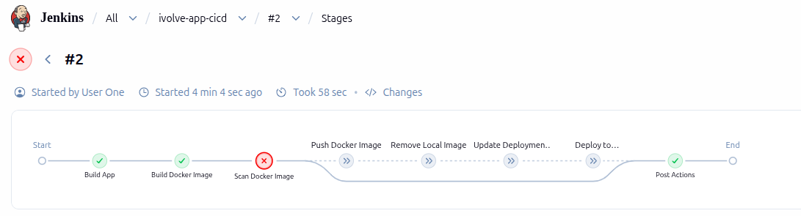

### Update and Test the Docker Image

Update the Dockerfile and dependencies to address the issues identified during the initial build.

Before pushing the changes, build the updated image locally and verify it with Trivy.

Run the vulnerability scan:

```bash
trivy image \
  --scanners vuln \
  --severity HIGH,CRITICAL \
  --format table \
  --exit-code 0 \
  ivolve-app:security-test
```

After several adjustments, the updated image passed the local security check without reported HIGH or CRITICAL vulnerabilities.

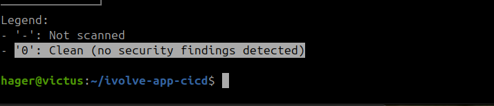

### Rerun the Jenkins Pipeline

Push the corrected files to GitHub and run the Jenkins Pipeline again.

The pipeline progressed further but encountered another failure during Kubernetes deployment.

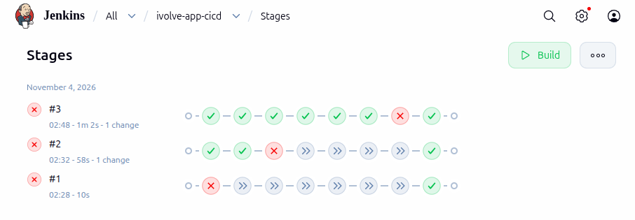

### Restore Kubernetes Connectivity

The deployment failed because Jenkins could not reach the Kubernetes API server through the local SSH tunnel.

Restore the SSH tunnel to the EC2 control plane and verify that port `16443` is reachable before rerunning the pipeline.

### Verify the Deployment Attempt

Rerun the Jenkins Pipeline after restoring the connection and review the deployment stage output.

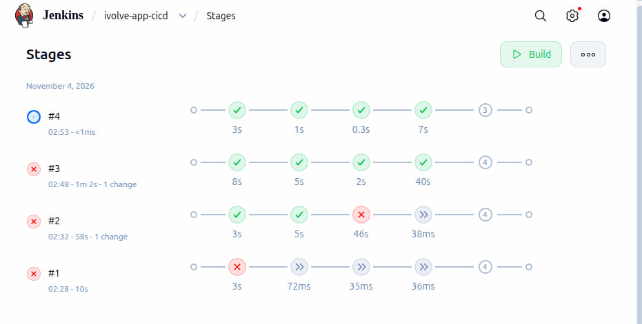

### Resolve Kubernetes RBAC Issues

During the next deployment attempt, Jenkins encountered insufficient Kubernetes permissions when checking the Deployment rollout.

Update the existing RBAC Role to include the required Deployment permissions, including `get`, `list`, and `watch`, and verify that they are assigned to `jenkinssa`.

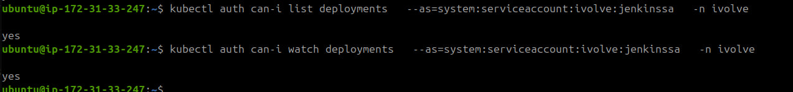

### Successful Pipeline Execution

After all this time? the Jenkins Pipeline completed successfully.

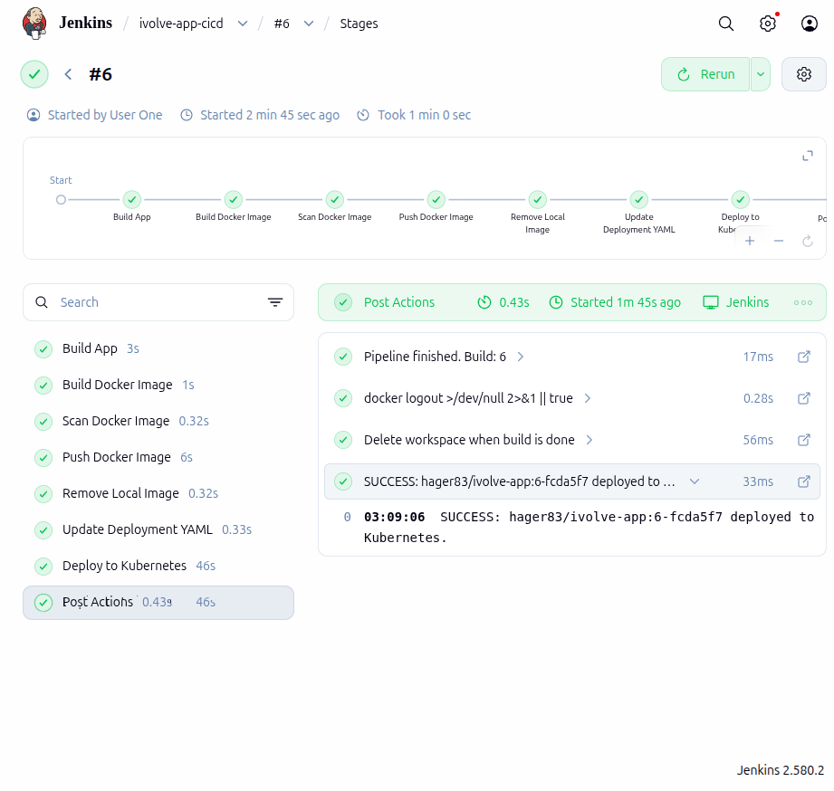

## 8. Verify the Deployment

### Verify the Docker Hub Image

Check Docker Hub to confirm that Jenkins successfully pushed the new versioned Docker image.

Each image tag contains the Jenkins build number and a short Git commit hash, making it easier to identify the deployed version.

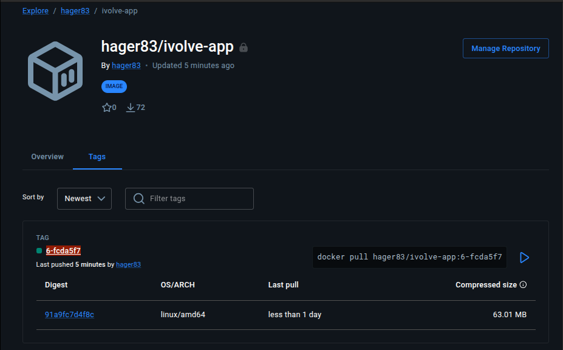

### Verify the Kubernetes Deployment

Confirm that the application Deployment has been updated to use the new Docker image.

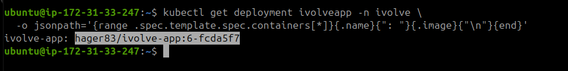

## 9. Enable Automatic Builds with Poll SCM

### Configure the Jenkins Trigger

To automate the pipeline execution after code changes, enable **Poll SCM** in the Jenkins job configuration.

Use the following schedule:

```text
* * * * *
```

This instructs Jenkins to check the Git repository every minute for new commits.

When a relevant change is detected, Jenkins automatically starts a new pipeline execution without requiring a manual build.

## 10. Demonstrate the CI/CD Workflow

### Make an Application Change

To test the automatic workflow, modify a visible element in the application frontend.

For this test, the location displayed in the application was updated from `Egypt` to `Egypt - Cairo`.

Commit and push the change to GitHub.

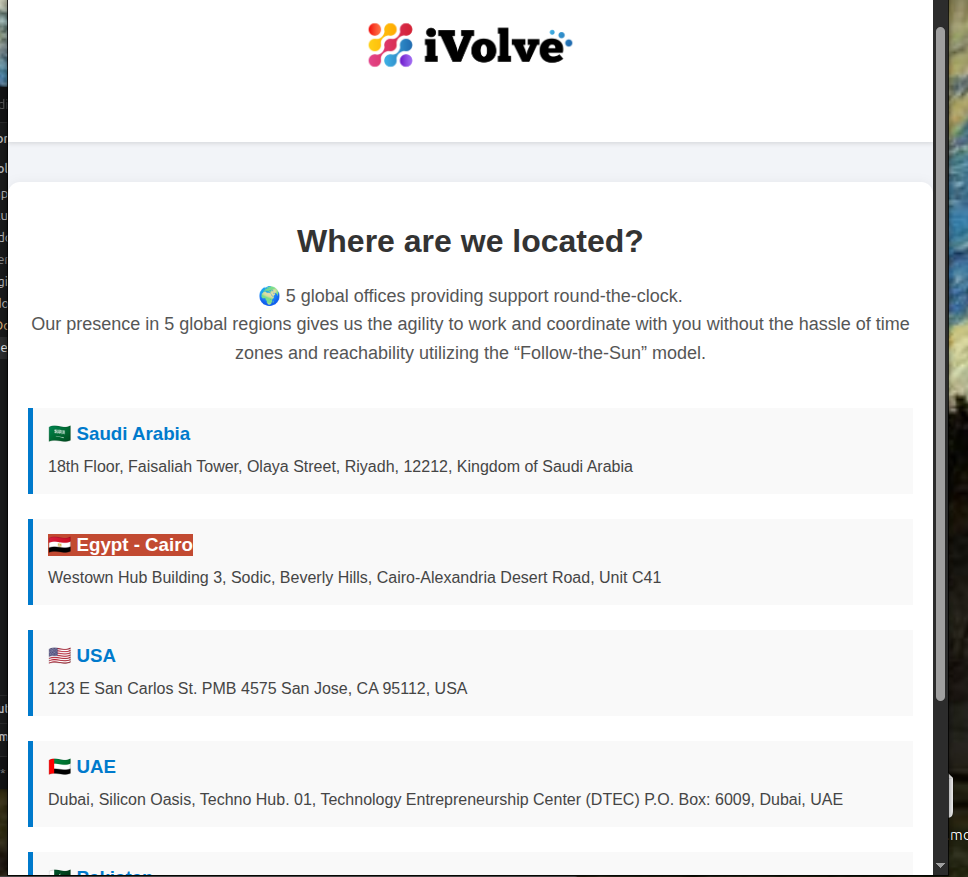

### Verify Automatic Pipeline Execution

After Jenkins detects the new commit through Poll SCM, it automatically starts the CI/CD pipeline.

The pipeline repeats the required stages:

1. Checkout the latest source code and install dependencies.
2. Build a new Docker image.
3. Scan the image for HIGH and CRITICAL vulnerabilities using Trivy.
4. Push the versioned image to Docker Hub.
5. Update the Kubernetes Deployment manifest.
6. Deploy the new image to the AWS Kubernetes cluster.

This demonstrates how application updates can be delivered through an automated workflow rather than manually rebuilding and redeploying the application after each code change.

---

## Conclusion

In this lab, we implemented a Jenkins CI/CD pipeline to automate the deployment of a containerized Node.js application to Kubernetes on AWS EC2.

By integrating **GitHub, Jenkins, Docker, Trivy, Docker Hub, and Kubernetes**, we created a workflow that connects source code changes to application deployment.

### Results

- Successfully configured Jenkins to build and publish Docker images.
- Integrated Trivy to check images for HIGH and CRITICAL vulnerabilities before publishing.
- Connected local Jenkins to the AWS Kubernetes cluster using an SSH tunnel and a dedicated service account.
- Deployed the application to Kubernetes using an automated pipeline.
- Enabled Poll SCM to detect new GitHub commits and trigger builds automatically.

### Why CI/CD?

Without CI/CD, each application update would require manually building the Docker image, scanning it, pushing it to the registry, and updating the Kubernetes Deployment.

With Jenkins, these steps are automated, making the deployment process more consistent, repeatable, and easier to maintain.

**Note:** This lab uses a temporary SSH tunnel for Kubernetes access. A production setup would require a persistent, secure connection between Jenkins and the cluster.