create a new repo for  private shared lib 
repo link --> [text](https://github.com/Hager-83/iVolve-jenkins-shared-library.git)

Create the Shared Library Structure

```
iVolve-jenkins-shared-library/
├── vars/
│   ├── buildApp.groovy
│   ├── buildImage.groovy
│   └── deployOnK8s.groovy
└── README.md
```

Create the Shared Library Functions

- BuildApp

```


def call(Map config = [:]) {

    String appDir = config.get('appDir', '.')
    String buildCommand = config.get('buildCommand', 'npm ci')

    checkout scm

    dir(appDir) {
        sh buildCommand
    }

    String shortCommit = sh(
        script: 'git rev-parse --short=7 HEAD',
        returnStdout: true
    ).trim()

    env.IMAGE_TAG = "${env.BUILD_NUMBER}-${shortCommit}"

    echo "Application build completed."
    echo "Image tag: ${env.IMAGE_TAG}"
}

```

build image 
```

def call(Map config = [:]) {
    String imageRepo = config.imageRepo
    String dockerfile = config.get('dockerfile', 'Dockerfile')
    String context = config.get('context', '.')
    String credentialsId = config.get(
        'registryCredentials',
        'dockerhub-credentials'
    )
    String severity = config.get(
        'scanSeverity',
        'HIGH,CRITICAL'
    )

    if (!imageRepo?.trim()) {
        error('imageRepo is required')
    }

    env.FULL_IMAGE = "${imageRepo}:${env.IMAGE_TAG}"

    sh """
        docker build \
          -f '${dockerfile}' \
          -t "\$FULL_IMAGE" \
          '${context}'
    """

    sh """
        trivy image \
          --exit-code 1 \
          --severity '${severity}' \
          --no-progress \
          "\$FULL_IMAGE"
    """

    withCredentials([
        usernamePassword(
            credentialsId: credentialsId,
            usernameVariable: 'DOCKER_USER',
            passwordVariable: 'DOCKER_TOKEN'
        )
    ]) {
        sh '''
            set +x

            echo "$DOCKER_TOKEN" | docker login \
              --username "$DOCKER_USER" \
              --password-stdin

            docker push "$FULL_IMAGE"
            docker logout
        '''
    }

    sh 'docker image rm "$FULL_IMAGE"'

    echo "Image published: ${env.FULL_IMAGE}"
}


```

deploy 

```
def call(Map config = [:]) {

    String namespace = config.get('namespace', 'default')
    String deployment = config.deployment
    String container = config.container
    String manifest = config.get('manifest', 'kubernetes/deployment.yaml')
    String credentialsId = config.get('kubeCredentials', 'kubeconfig-ivolve')
    String kubectl = config.get('kubectl', 'kubectl')

    if (!deployment?.trim() || !container?.trim()) {
        error('deployment and container are required')
    }

    if (!env.FULL_IMAGE?.trim()) {
        error('FULL_IMAGE is missing')
    }

    withEnv([
        "DEPLOY_NAMESPACE=${namespace}",
        "DEPLOY_NAME=${deployment}",
        "DEPLOY_CONTAINER=${container}",
        "DEPLOY_MANIFEST=${manifest}",
        "KUBECTL_BIN=${kubectl}"
    ]) {

        withCredentials([
            file(
                credentialsId: credentialsId,
                variable: 'KUBECONFIG'
            )
        ]) {

            sh '''
                set -e

                echo "Updating deployment image..."

                python3 - <<'PY'
import os
import re
from pathlib import Path

path = Path(os.environ["DEPLOY_MANIFEST"])
content = path.read_text()

container = re.escape(os.environ["DEPLOY_CONTAINER"])
image = os.environ["FULL_IMAGE"]

pattern = (
    r"(?m)^(\\s*-\\s*name:\\s*" + container +
    r"\\s*\\n\\s*image:\\s*)\\S+"
)

updated, count = re.subn(
    pattern,
    lambda match: match.group(1) + image,
    content
)

if count != 1:
    raise SystemExit(
        f"Expected one matching container, found {count}"
    )

path.write_text(updated)
print(f"Updated {path} with {image}")
PY

                echo "Applying Kubernetes deployment..."

                "$KUBECTL_BIN" apply \
                  -f "$DEPLOY_MANIFEST" \
                  -n "$DEPLOY_NAMESPACE"

                echo "Checking rollout..."

                "$KUBECTL_BIN" rollout status \
                  deployment/"$DEPLOY_NAME" \
                  -n "$DEPLOY_NAMESPACE" \
                  --timeout=300s
            '''
        }
    }

    echo "Deployment completed: ${deployment}"
}

```

GitHub Personal Access Token

create one for access the private repos --> jenkins-ivolve-private-repos

add the 2 lib only to access 
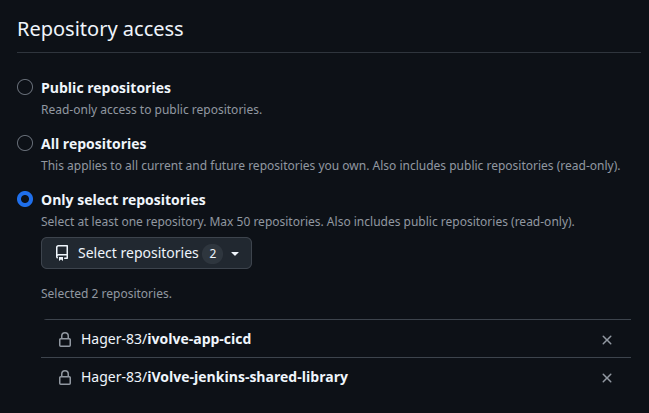

sign with user1
admin


add the token to jenkins

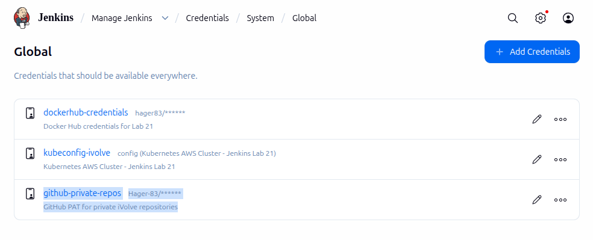

add the files and push to the private repo iVolve-jenkins-shared-library


Register the Shared Library in Jenkins

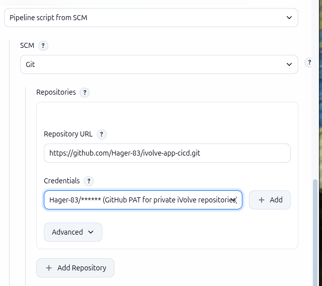

Update the Jenkinsfile in the Application Repo

```

@Library('ivolve-shared-library@main') _

pipeline {
    agent any

    options {
        timestamps()
        disableConcurrentBuilds()
        skipDefaultCheckout(true)
    }

    environment {
        KUBECTL = '/usr/local/bin/kubectl-1.35'
    }

    stages {

        stage('Build App') {
            steps {
                buildApp(
                    appDir: 'app',
                    buildCommand: 'npm ci'
                )
            }
        }

        stage('Build Docker Image') {
            steps {
                buildImage(
                    imageRepo: 'hager83/ivolve-app',
                    dockerfile: 'Dockerfile',
                    context: '.',
                    registryCredentials: 'dockerhub-credentials',
                    scanSeverity: 'HIGH,CRITICAL'
                )
            }
        }

        stage('Deploy to Kubernetes') {
            steps {
                deployOnK8s(
                    namespace: 'ivolve',
                    deployment: 'ivolveapp',
                    container: 'ivolve-app',
                    manifest: 'kubernetes/deployment.yaml',
                    kubeCredentials: 'kubeconfig-ivolve',
                    kubectl: env.KUBECTL
                )
            }
        }
    }

    post {
        success {
            echo "SUCCESS: ${env.FULL_IMAGE} deployed to Kubernetes."
        }

        failure {
            echo 'FAILURE: Check Jenkins console output.'
        }

        always {
            echo "Pipeline finished. Build: ${env.BUILD_NUMBER}"

            sh 'docker logout >/dev/null 2>&1 || true'

            cleanWs()
        }
    }
}

```

connect to the master and worker nodes 

master
```
 ssh -i ~/Downloads/k8s-lab-key.pem   -L 127.0.0.1:3000:127.0.0.1:3000   ubuntu@54.88.89.59
```

worker
```
 ssh -i ~/Downloads/k8s-lab-key.pem   -L 127.0.0.1:3000:127.0.0.1:3000   ubuntu@3.90.169.155
```

open ssh tunenel from local to master

```
ssh -i ~/Downloads/k8s-lab-key.pem \
  -o ExitOnForwardFailure=yes \
  -N \
  -L 127.0.0.1:16443:172.31.33.247:6443 \
  ubuntu@54.88.89.59

```

check the port 
```
nc -zv 127.0.0.1 16443
```

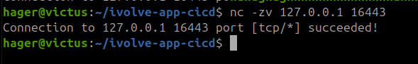

build the pibeline  --> part 1 sucess 

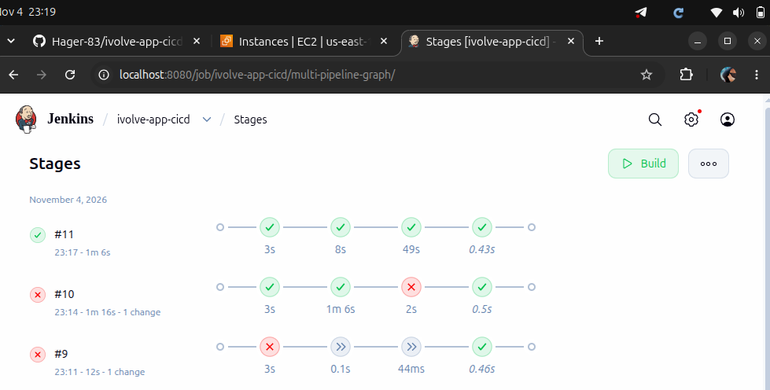

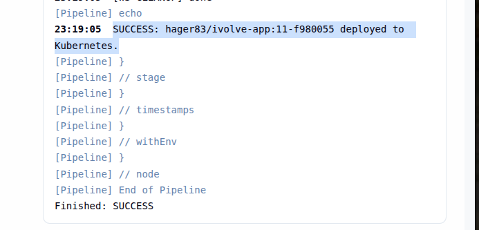

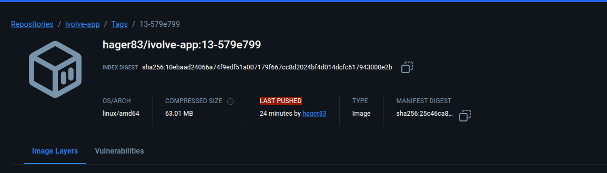


---
part 2 --> jenkins agent 

create new EC2 to act as a agent --> ivolve-jenkins-agent

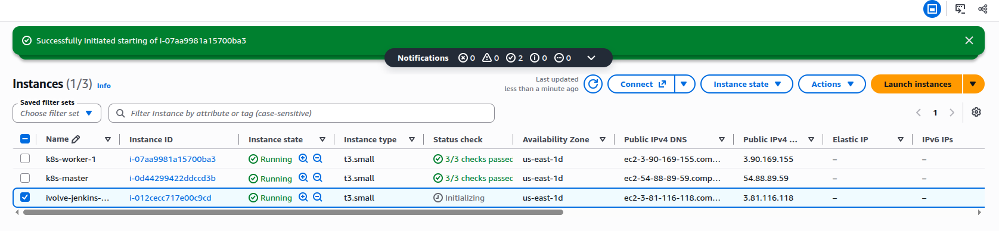

ssh to it 

```
ssh -i ~/Downloads/k8s-lab-key.pem ubuntu@3.81.116.118

```

update and install depen---

```
sudo apt update && sudo apt upgrade -y

sudo apt install -y \
  git curl wget unzip ca-certificates \
  gnupg lsb-release python3 \
  openjdk-21-jre-headless

java -version
git --version
python3 --version
```

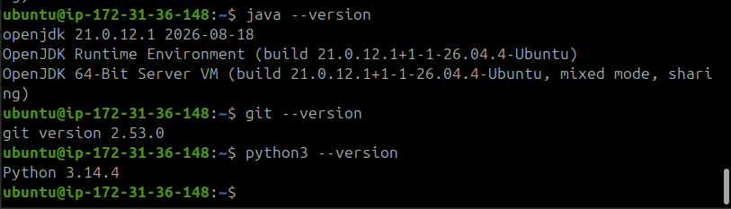


install docker 
```
sudo apt install -y docker.io

sudo systemctl enable --now docker

sudo docker run --rm hello-world

docker --version
```

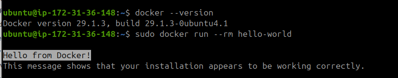


nodejs and npm 

```
curl -fsSL https://deb.nodesource.com/setup_24.x | sudo -E bash -

sudo apt install -y nodejs

node --version
npm --version
```

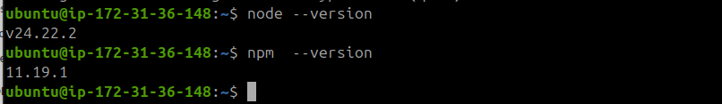

kubectl
```
curl -fsSLo kubectl \
  https://dl.k8s.io/release/v1.35.0/bin/linux/amd64/kubectl

curl -fsSLo kubectl.sha256 \
  https://dl.k8s.io/release/v1.35.0/bin/linux/amd64/kubectl.sha256

echo "$(cat kubectl.sha256)  kubectl" | sha256sum --check

sudo install -o root -g root -m 0755 kubectl /usr/local/bin/kubectl

rm kubectl kubectl.sha256

kubectl version --client
```

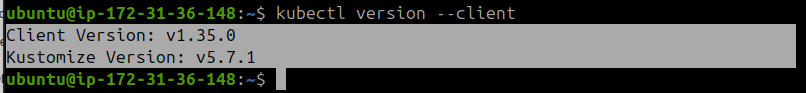

trivy 

```

sudo apt update
sudo apt install -y trivy

trivy --version

```

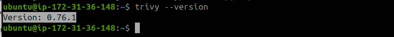


create user for Jenkins Agent

```
sudo useradd -m -s /bin/bash jenkins

sudo mkdir -p /home/jenkins/agent

sudo chown -R jenkins:jenkins /home/jenkins/agent

sudo usermod -aG docker jenkins
```
check 
```
sudo -u jenkins docker info >/dev/null && echo "Docker access OK"
```

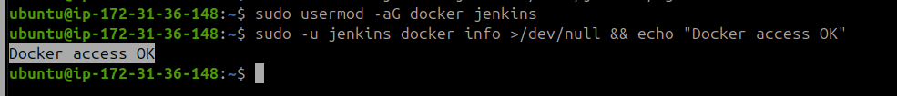


make Reverse SSH Tunnel to connect Jenkins Agent to jenkins Controller using port 18080 on EC2

Laptop — Jenkins Controller
127.0.0.1:8080
|

SSH Reverse Tunnel
EC2 127.0.0.1:18080 → Laptop 127.0.0.1:8080
|
AWS EC2 — Jenkins Agent
Java 21 + Docker + Trivy + kubectl


on new terminal
```
ssh -i ~/Downloads/k8s-lab-key.pem \
  -o ExitOnForwardFailure=yes \
  -o ServerAliveInterval=30 \
  -N \
  -R 127.0.0.1:18080:127.0.0.1:8080 \
  ubuntu@3.81.116.118
```

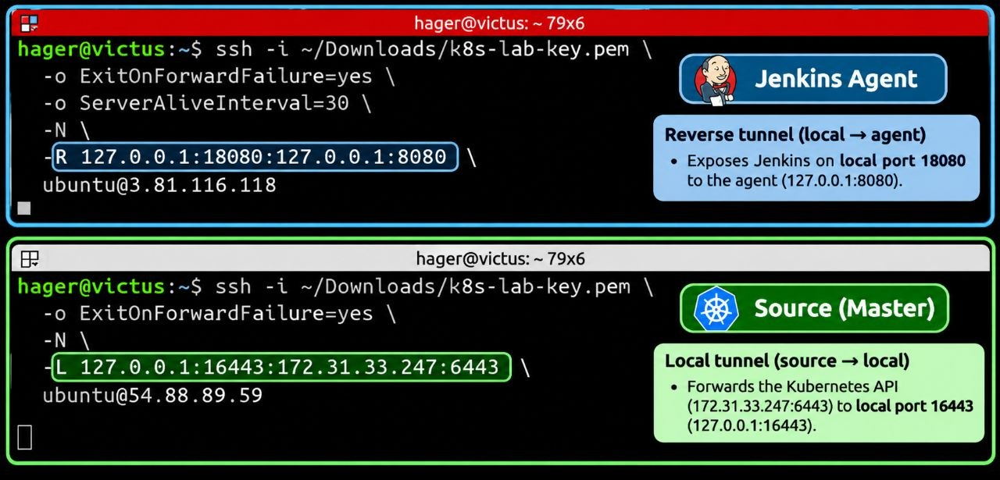

check the connection 

on the jenkins agent 

```
curl -I http://127.0.0.1:18080/login
```
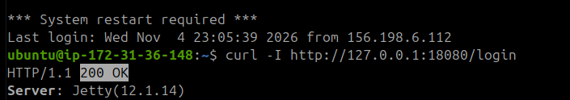

add agent to ginkins nodes  --> 
name --> ivolve-pipeline-agent
label --> docker-k8s
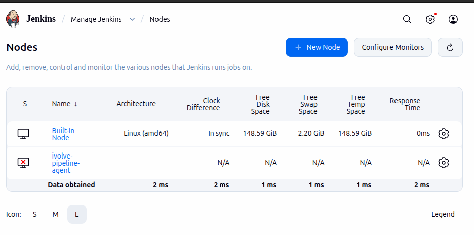

insatll agent app on ec2 

```
sudo -u jenkins bash -c '
cd /home/jenkins/agent
curl -fsSLo agent.jar http://127.0.0.1:18080/jnlpJars/agent.jar
ls -lh agent.jar
'
```

work the agent 

```
sudo -iu jenkins
cd /home/jenkins/agent
```

```
java -jar agent.jar \
  -url http://127.0.0.1:18080/ \
  -secret 'YOUR_AGENT_SECRET' \
  -name "ivolve-pipeline-agent" \
  -webSocket \
  -workDir "/home/jenkins/agent"
```
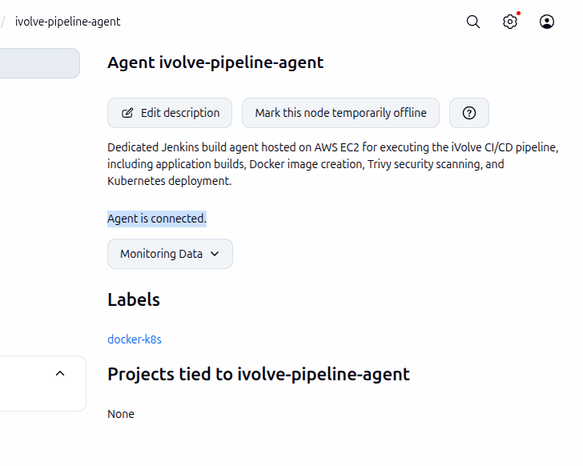

update the jjenkins pibeline to match the agent 

```
agent {
    label 'docker-k8s'
}
```

```
environment {
    KUBECTL = '/usr/local/bin/kubectl'
}
```

add a new sg for master node with port range 6443 to Allow Jenkins Agent to access Kubernetes API

Kubeconfig for agent 

```
mkdir -p ~/.kube/jenkins-agent
chmod 700 ~/.kube/jenkins-agent

cp ~/.kube/jenkins-lab21/config ~/.kube/jenkins-agent/config

chmod 600 ~/.kube/jenkins-agent/config
```

update  the api add 

```
python3 - <<'PY'
from pathlib import Path

path = Path.home() / ".kube/jenkins-agent/config"
content = path.read_text()

old = "https://127.0.0.1:16443"
new = "https://172.31.33.247:6443"

assert content.count(old) == 1, "Expected API address not found exactly once"

path.write_text(content.replace(old, new))
print("Agent kubeconfig updated successfully.")
PY
```


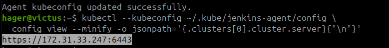

Credential

add the config file as a secret  

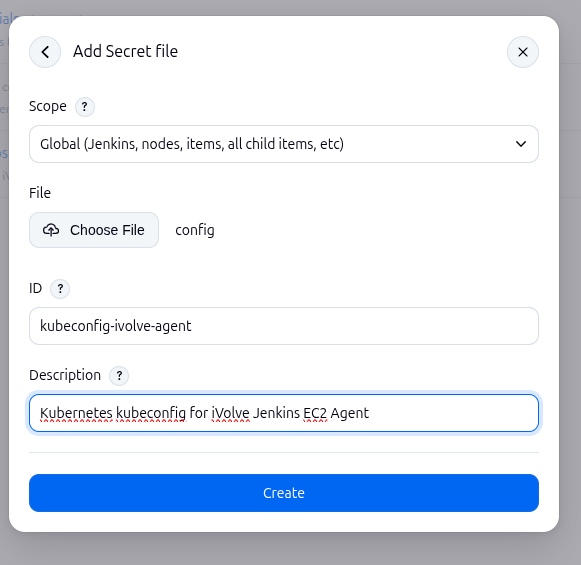

push the last updae to the cicd repo and wait the atomatic build 


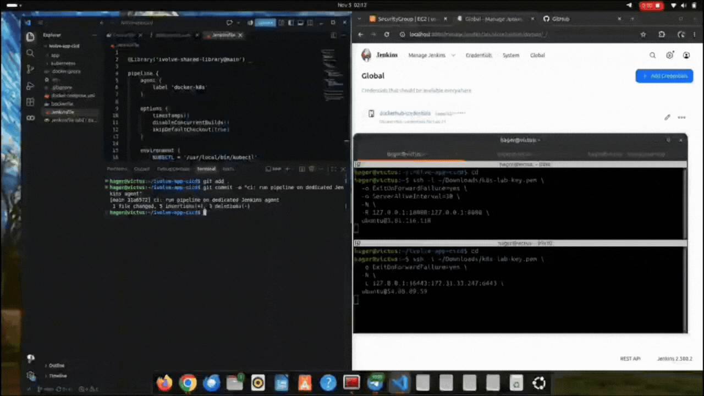

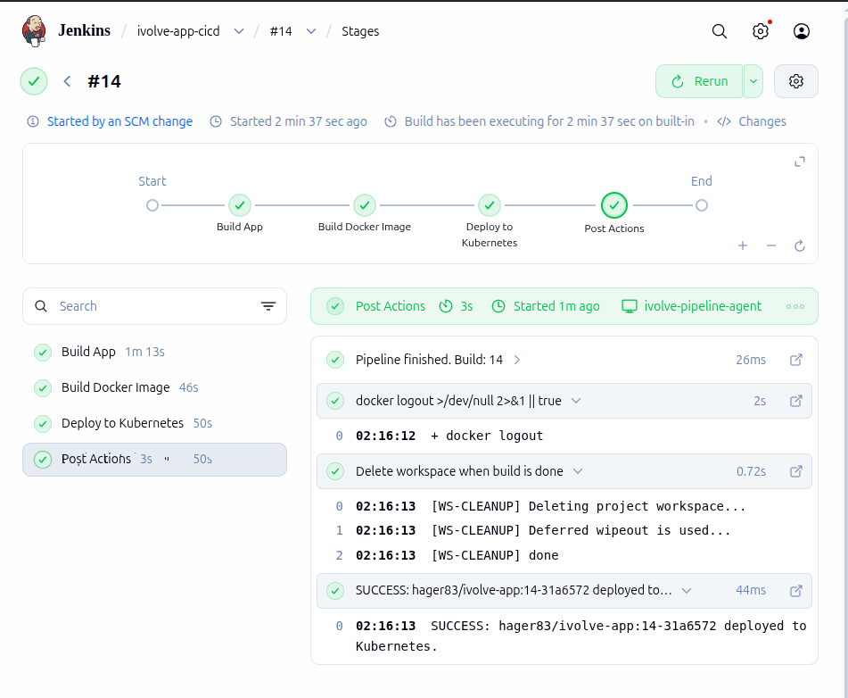


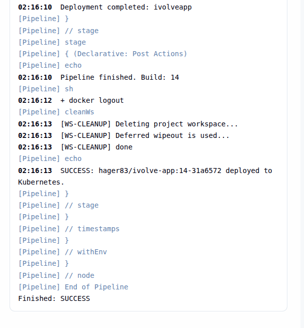
-------------------------------------------------------------------------------------------------------------------------------------------------------------------------------------------------------------


# Lab 22 — Jenkins Shared Library & AWS EC2 Build Agent

**iVolve DevOps Training | CI/CD Automation | Jenkins · Groovy · Docker · Trivy · Kubernetes · AWS EC2**

This lab refactors an existing Jenkins pipeline into reusable **Groovy Shared Library** functions, then moves its execution from the local Jenkins controller to a **dedicated AWS EC2 agent**. A Git push triggers the application build, image security scan, Docker Hub publication, and Kubernetes deployment.

> **Final outcome:** The pipeline ran on `ivolve-pipeline-agent`, published a tagged Docker image, and successfully rolled out the application to the existing Kubernetes cluster. The controller remains on the local laptop; build and deployment commands run on EC2.

## Contents

1. [Architecture](#architecture)
2. [Part 1 — Jenkins Shared Library](#part-1--jenkins-shared-library)
3. [Part 2 — Dedicated AWS EC2 Jenkins Agent](#part-2--dedicated-aws-ec2-jenkins-agent)
4. [Final Results & Evidence](#final-results--evidence)
5. [Lab Report & Key Takeaways](#lab-report--key-takeaways)

## Architecture

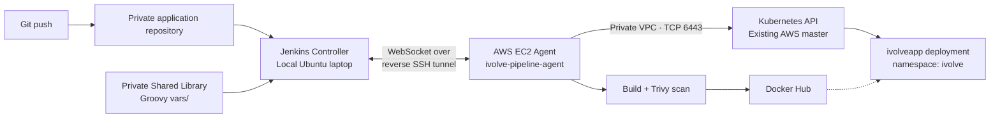

**Two distinct connections:** The **reverse SSH tunnel** allows the remote EC2 agent to reach the Jenkins controller on the laptop. The **Kubernetes API connection** goes directly from the EC2 agent to the master's private IP (`172.31.33.247:6443`) through AWS networking.

| Component | Configuration / purpose |
| --- | --- |
| Jenkins controller | Local Ubuntu laptop, `localhost:8080` |
| Jenkins agent EC2 | AWS instance `ivolve-jenkins-agent` |
| Jenkins node / label | `ivolve-pipeline-agent` / `docker-k8s` |
| Application repository | [`ivolve-app-cicd`](https://github.com/Hager-83/ivolve-app-cicd) — private |
| Shared library repository | [`iVolve-jenkins-shared-library`](https://github.com/Hager-83/iVolve-jenkins-shared-library) — private |
| Container registry | Docker Hub: `hager83/ivolve-app` |
| Kubernetes target | `ivolve` namespace, `ivolveapp` deployment |

> Repository links require authorization because both repositories are private.

---

## Part 1 — Jenkins Shared Library

### 1. Create a private repository for reusable pipeline logic

A separate private GitHub repository stores Groovy pipeline functions independently of the application. This avoids repeating CI/CD logic across Jenkinsfiles.

**Repository:** [`Hager-83/iVolve-jenkins-shared-library`](https://github.com/Hager-83/iVolve-jenkins-shared-library)

```text
iVolve-jenkins-shared-library/

├── vars/

│   ├── buildApp.groovy

│   ├── buildImage.groovy

│   └── deployOnK8s.groovy

└── README.md
```

### 2. Implement the three Shared Library functions

Each file under `vars/` exposes a callable pipeline step. The application Jenkinsfile can invoke these functions by name after importing the library.

#### `buildApp.groovy` — checkout, dependencies and image tagging

Checks out the application repository, runs `npm ci`, and generates a traceable image tag from the Jenkins build number and short Git commit (`BUILD_NUMBER-SHA`).

<details>
<summary><strong>View buildApp.groovy</strong> — click to expand</summary>

```groovy
def call(Map config = [:]) {

    String appDir = config.get('appDir', '.')

    String buildCommand = config.get('buildCommand', 'npm ci')

    checkout scm

    dir(appDir) {

        sh buildCommand

    }

    String shortCommit = sh(

        script: 'git rev-parse --short=7 HEAD',

        returnStdout: true

    ).trim()

    env.IMAGE_TAG = "${env.BUILD_NUMBER}-${shortCommit}"

    echo "Application build completed."

    echo "Image tag: ${env.IMAGE_TAG}"

}
```

</details>

#### `buildImage.groovy` — build, scan and publish

Builds the Docker image, runs **Trivy** with a failure threshold for HIGH/CRITICAL vulnerabilities, logs into Docker Hub with Jenkins-managed credentials, pushes the image, and removes the local tag afterward.

<details>
<summary><strong>View buildImage.groovy</strong> — click to expand</summary>

```groovy
def call(Map config = [:]) {

    String imageRepo = config.imageRepo

    String dockerfile = config.get('dockerfile', 'Dockerfile')

    String context = config.get('context', '.')

    String credentialsId = config.get(

        'registryCredentials',

        'dockerhub-credentials'

    )

    String severity = config.get(

        'scanSeverity',

        'HIGH,CRITICAL'

    )

    if (!imageRepo?.trim()) {

        error('imageRepo is required')

    }

    env.FULL_IMAGE = "${imageRepo}:${env.IMAGE_TAG}"

    sh """

        docker build \
          -f '${dockerfile}' \
          -t "\$FULL_IMAGE" \
          '${context}'

    """

    sh """

        trivy image \
          --exit-code 1 \
          --severity '${severity}' \
          --no-progress \
          "\$FULL_IMAGE"

    """

    withCredentials([

        usernamePassword(

            credentialsId: credentialsId,

            usernameVariable: 'DOCKER_USER',

            passwordVariable: 'DOCKER_TOKEN'

        )

    ]) {

        sh '''

            set +x

            echo "$DOCKER_TOKEN" | docker login \
              --username "$DOCKER_USER" \
              --password-stdin

            docker push "$FULL_IMAGE"

            docker logout

        '''

    }

    sh 'docker image rm "$FULL_IMAGE"'

    echo "Image published: ${env.FULL_IMAGE}"

}
```

</details>

#### `deployOnK8s.groovy` — update manifest and roll out

Loads the kubeconfig from a Jenkins **Secret file**, updates the container image in the Kubernetes deployment manifest, applies it, and waits for `kubectl rollout status` to complete.

<details>
<summary><strong>View deployOnK8s.groovy</strong> — click to expand</summary>

```groovy
def call(Map config = [:]) {

    String namespace = config.get('namespace', 'default')

    String deployment = config.deployment

    String container = config.container

    String manifest = config.get('manifest', 'kubernetes/deployment.yaml')

    String credentialsId = config.get('kubeCredentials', 'kubeconfig-ivolve')

    String kubectl = config.get('kubectl', 'kubectl')

    if (!deployment?.trim() || !container?.trim()) {

        error('deployment and container are required')

    }

    if (!env.FULL_IMAGE?.trim()) {

        error('FULL_IMAGE is missing')

    }

    withEnv([

        "DEPLOY_NAMESPACE=${namespace}",

        "DEPLOY_NAME=${deployment}",

        "DEPLOY_CONTAINER=${container}",

        "DEPLOY_MANIFEST=${manifest}",

        "KUBECTL_BIN=${kubectl}"

    ]) {

        withCredentials([

            file(

                credentialsId: credentialsId,

                variable: 'KUBECONFIG'

            )

        ]) {

            sh '''

                set -e

                echo "Updating deployment image..."

                python3 - <<'PY'

import os

import re

from pathlib import Path

path = Path(os.environ["DEPLOY_MANIFEST"])

content = path.read_text()

container = re.escape(os.environ["DEPLOY_CONTAINER"])

image = os.environ["FULL_IMAGE"]

pattern = (
    r"(?m)^(\s*-\s*name:\s*" + container +
    r"\s*\n\s*image:\s*)\S+"
)

updated, count = re.subn(

    pattern,

    lambda match: match.group(1) + image,

    content

)

if count != 1:

    raise SystemExit(

        f"Expected one matching container, found {count}"

    )

path.write_text(updated)

print(f"Updated {path} with {image}")

PY

                echo "Applying Kubernetes deployment..."

                "$KUBECTL_BIN" apply \
                  -f "$DEPLOY_MANIFEST" \
                  -n "$DEPLOY_NAMESPACE"

                echo "Checking rollout..."

                "$KUBECTL_BIN" rollout status \
                  deployment/"$DEPLOY_NAME" \
                  -n "$DEPLOY_NAMESPACE" \
                  --timeout=300s

            '''

        }

    }

    echo "Deployment completed: ${deployment}"

}
```

</details>

### 3. Configure secure access to the private repositories

A GitHub **Personal Access Token (PAT)** was created with access restricted to the required private repositories. The token was stored in Jenkins credentials as `github-private-repos` rather than embedded in source code. The library is then registered in Jenkins as `ivolve-shared-library`, using branch `main`.

> **Security:** Never commit PATs, Docker Hub tokens, agent connection secrets, or kubeconfig files to Git. Screenshots should conceal credential values.

**GitHub PAT — repository-scoped access**


**Jenkins credential for private Git repositories**


**Global Shared Library registration in Jenkins**


### 4. Refactor the application Jenkinsfile to use the library

The pipeline imports `ivolve-shared-library@main` and calls the three reusable steps in order: **Build App → Build Docker Image → Deploy to Kubernetes**. This is the **Part 1 version** (before moving execution to the EC2 agent).


<details>
<summary><strong>View Jenkinsfile </strong> — click to expand</summary>

```groovy
@Library('ivolve-shared-library@main') _

pipeline {

    agent any

    options {

        timestamps()

        disableConcurrentBuilds()

        skipDefaultCheckout(true)

    }

    environment {

        KUBECTL = '/usr/local/bin/kubectl-1.35'

    }

    stages {

        stage('Build App') {

            steps {

                buildApp(

                    appDir: 'app',

                    buildCommand: 'npm ci'

                )

            }

        }

        stage('Build Docker Image') {

            steps {

                buildImage(

                    imageRepo: 'hager83/ivolve-app',

                    dockerfile: 'Dockerfile',

                    context: '.',

                    registryCredentials: 'dockerhub-credentials',

                    scanSeverity: 'HIGH,CRITICAL'

                )

            }

        }

        stage('Deploy to Kubernetes') {

            steps {

                deployOnK8s(

                    namespace: 'ivolve',

                    deployment: 'ivolveapp',

                    container: 'ivolve-app',

                    manifest: 'kubernetes/deployment.yaml',

                    kubeCredentials: 'kubeconfig-ivolve',

                    kubectl: env.KUBECTL

                )

            }

        }

    }

    post {

        success {

            echo "SUCCESS: ${env.FULL_IMAGE} deployed to Kubernetes."

        }

        failure {

            echo 'FAILURE: Check Jenkins console output.'

        }

        always {

            echo "Pipeline finished. Build: ${env.BUILD_NUMBER}"

            sh 'docker logout >/dev/null 2>&1 || true'

            cleanWs()

        }

    }

}
```
</details>

### 5. Connect the local controller to the existing Kubernetes cluster

During Part 1, Jenkins ran locally, so an SSH **local port forward** made the private Kubernetes API reachable through `127.0.0.1:16443`. This was a temporary local-controller approach and was replaced by direct private-VPC access in Part 2.

```bash
ssh -i ~/Downloads/k8s-lab-key.pem   -L 127.0.0.1:3000:127.0.0.1:3000   ubuntu@54.88.89.59
 ssh -i ~/Downloads/k8s-lab-key.pem   -L 127.0.0.1:3000:127.0.0.1:3000   ubuntu@3.90.169.155
```

```bash
ssh -i ~/Downloads/k8s-lab-key.pem \
  -o ExitOnForwardFailure=yes \
  -N \
  -L 127.0.0.1:16443:172.31.33.247:6443 \
  ubuntu@54.88.89.59
```

```bash
nc -zv 127.0.0.1 16443
```

**Local Kubernetes API tunnel verification**


### 6. Validate Part 1

The refactored pipeline was run successfully using the Shared Library, with the application image published and deployed to the existing Kubernetes cluster.

**Part 1 — Jenkins pipeline stages**


**Part 1 — pipeline output**


**Docker Hub — published application image**


---

## Part 2 — Dedicated AWS EC2 Jenkins Agent

### 7. Provision an EC2 instance for pipeline execution

A new AWS EC2 instance, **`ivolve-jenkins-agent`**, was provisioned to host the build tools. The existing Kubernetes master and worker were kept unchanged. The agent is a Jenkins execution node, **not** a Kubernetes worker node.

**AWS EC2 — dedicated Jenkins agent instance**


```bash
ssh -i ~/Downloads/k8s-lab-key.pem ubuntu@3.81.116.118
```

### 8. Install the agent's required tools

Install the runtime and utilities on the **EC2 agent**, so Jenkins can execute every pipeline stage remotely. Each section below expands to show the exact installation or verification commands.

#### Java 21, Git and Python

Java runs `agent.jar`; Git fetches repositories; Python is used by the deployment step to update the Kubernetes manifest.

```bash
sudo apt update && sudo apt upgrade -y

sudo apt install -y \
  git curl wget unzip ca-certificates \
  gnupg lsb-release python3 \
  openjdk-21-jre-headless

java -version

git --version

python3 --version
```

**Java, Git and Python installed**


#### Docker Engine

Docker builds the application image and publishes it to Docker Hub.

```bash
sudo apt install -y docker.io

sudo systemctl enable --now docker

sudo docker run --rm hello-world

docker --version
```

**Docker installation verification**


#### Node.js and npm

Node.js and npm are needed for the application dependency-install stage (`npm ci`).

```bash
curl -fsSL https://deb.nodesource.com/setup_24.x | sudo -E bash -

sudo apt install -y nodejs

node --version

npm --version
```

**Node.js and npm versions**


#### kubectl

The Kubernetes CLI allows the agent to apply manifests and verify rollouts against the existing cluster.

```bash
curl -fsSLo kubectl \
  https://dl.k8s.io/release/v1.35.0/bin/linux/amd64/kubectl

curl -fsSLo kubectl.sha256 \
  https://dl.k8s.io/release/v1.35.0/bin/linux/amd64/kubectl.sha256

echo "$(cat kubectl.sha256)  kubectl" | sha256sum --check

sudo install -o root -g root -m 0755 kubectl /usr/local/bin/kubectl

rm kubectl kubectl.sha256

kubectl version --client
```

**kubectl client installation**


#### Trivy

Trivy scans the built image before publication, blocking the pipeline if HIGH or CRITICAL vulnerabilities are detected.

```bash
sudo apt update

sudo apt install -y trivy

trivy --version
```

**Trivy installation verification**


### 9. Create a dedicated Linux account for the Jenkins agent

The `jenkins` Linux user owns `/home/jenkins/agent` and is granted Docker group membership so build commands can run without `sudo` in the pipeline.

```bash
sudo useradd -m -s /bin/bash jenkins

sudo mkdir -p /home/jenkins/agent

sudo chown -R jenkins:jenkins /home/jenkins/agent

sudo usermod -aG docker jenkins
```

```bash
sudo -u jenkins docker info >/dev/null && echo "Docker access OK"
```

**Docker permissions verified for the jenkins user**


### 10. Connect the EC2 agent to the local Jenkins controller

Because the Jenkins controller runs on a laptop rather than a publicly reachable server, a **reverse SSH tunnel** exposes the local Jenkins web endpoint to the EC2 agent on `127.0.0.1:18080`. This keeps the controller's HTTP port private.

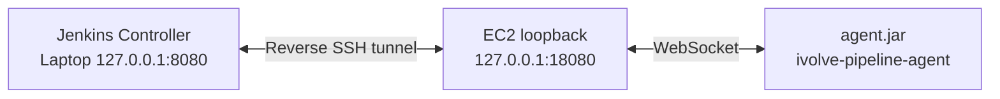

**Run the tunnel on the laptop** and keep its SSH session open while the agent is connected.

```bash
ssh -i ~/Downloads/k8s-lab-key.pem \
  -o ExitOnForwardFailure=yes \
  -o ServerAliveInterval=30 \
  -N \
  -R 127.0.0.1:18080:127.0.0.1:8080 \
  ubuntu@3.81.116.118
```

**Reverse SSH tunnel — controller-to-agent connectivity**


```bash
curl -I http://127.0.0.1:18080/login
```

**EC2 can reach the Jenkins controller through the tunnel**


### 11. Register and launch the Jenkins node

In **Manage Jenkins → Nodes**, create the node with name `ivolve-pipeline-agent`, label `docker-k8s`, and remote root `/home/jenkins/agent`. Configure an inbound agent using **WebSocket**, download `agent.jar`, and launch it under the `jenkins` Linux account.

**Node configuration:** `ivolve-pipeline-agent` · label `docker-k8s` · one executor.

**Jenkins node registration and label**


```bash
sudo -u jenkins bash -c '

cd /home/jenkins/agent

curl -fsSLo agent.jar http://127.0.0.1:18080/jnlpJars/agent.jar

ls -lh agent.jar

'
```

```bash
sudo -iu jenkins

cd /home/jenkins/agent
```

```bash
java -jar agent.jar \
  -url http://127.0.0.1:18080/ \
  -secret 'YOUR_AGENT_SECRET' \
  -name "ivolve-pipeline-agent" \
  -webSocket \
  -workDir "/home/jenkins/agent"
```

**Jenkins agent connected to the controller**


> **Operational note:** In this lab, the reverse SSH tunnel and Java agent were launched manually. Their sessions must remain active; persistent unattended execution would require managed services or another reliable private connection.

### 12. Update the Jenkinsfile to select the remote agent

The pipeline now targets the EC2 node by label. The kubectl executable path and Kubernetes credential ID were also updated. **The three Shared Library functions did not need to change.**

```groovy
agent {

    label 'docker-k8s'

}
```

```groovy
environment {

    KUBECTL = '/usr/local/bin/kubectl'

}
```

**Deployment credential change:** `kubeCredentials: 'kubeconfig-ivolve-agent'` replaces the earlier local-controller credential `kubeconfig-ivolve`.

### 13. Allow private Kubernetes API connectivity

The Kubernetes master's AWS security group was updated to allow **TCP 6443 from the Jenkins agent security group**. This grants EC2-to-master API connectivity inside the VPC without exposing the Kubernetes API to the public internet.

**Connectivity check on EC2:**

```bash
curl -k --connect-timeout 5 --max-time 10 \
  -sS -o /dev/null \
  -w "HTTP Status: %{http_code}\n" \
  https://172.31.33.247:6443/version
```

**Observed result:** `HTTP Status: 200` (network/API reachability confirmed). The `-k` flag was used for this connectivity probe only, not as a replacement for kubeconfig certificate validation.

### 14. Create a separate kubeconfig credential for the agent

The previous kubeconfig used the laptop's forwarded endpoint (`https://127.0.0.1:16443`). A **copy** was created for the EC2 agent, changing only the Kubernetes API server to `https://172.31.33.247:6443`, while retaining the existing cluster CA and service-account authorization.

```bash
mkdir -p ~/.kube/jenkins-agent

chmod 700 ~/.kube/jenkins-agent

cp ~/.kube/jenkins-lab21/config ~/.kube/jenkins-agent/config

chmod 600 ~/.kube/jenkins-agent/config
```

```bash
python3 - <<'PY'

from pathlib import Path

path = Path.home() / ".kube/jenkins-agent/config"

content = path.read_text()

old = "https://127.0.0.1:16443"

new = "https://172.31.33.247:6443"

assert content.count(old) == 1, "Expected API address not found exactly once"

path.write_text(content.replace(old, new))

print("Agent kubeconfig updated successfully.")

PY
```

**Agent kubeconfig — private Kubernetes API endpoint**


The updated kubeconfig was uploaded to Jenkins as a **Secret file** with ID `kubeconfig-ivolve-agent`, so the pipeline accesses it through Jenkins credential binding rather than storing it in Git.

**Jenkins Secret file credential for EC2 Kubernetes deployment**


### 15. Push and verify the automatic CI/CD run

After committing the updated Jenkinsfile, a Git push to the private application repository was detected by Jenkins **Poll SCM**. The pipeline ran on `ivolve-pipeline-agent`, built the application, scanned and pushed the Docker image, and successfully deployed to Kubernetes.

```bash
# Run on the local laptop, inside the application repository
git add Jenkinsfile
git commit -m "ci: run pipeline on dedicated Jenkins agent"
git push origin main
```

**Observed build evidence:** The run used Git commit `31a6572`, the EC2 workspace `/home/jenkins/agent/workspace/ivolve-app-cicd`, and generated a traceable Docker image tag such as `15-31a6572`.

---

## Final Results & Evidence

### Automatic pipeline demonstration

The GIF shows the Jenkins pipeline running through the automated CI/CD stages. Select the GIF to view the animation at full size.

[](images/Lab22.gif)

### Successful pipeline execution

**Jenkins pipeline — successful stages on the EC2 agent**


| Validation | Observed outcome |
| --- | --- |
| Private application and Shared Library repositories | Configured with Jenkins GitHub credentials |
| Shared Library functions | `buildApp`, `buildImage`, `deployOnK8s` invoked by Jenkinsfile |
| EC2 Jenkins agent | Connected and selected through label `docker-k8s` |
| Build location | `/home/jenkins/agent/workspace/ivolve-app-cicd` |
| Application dependencies | `npm ci` succeeded |
| Docker image build | Completed successfully |
| Trivy security scan | No HIGH/CRITICAL vulnerabilities reported for the demonstrated image |
| Docker Hub publication | Tagged image pushed successfully |
| Kubernetes API reachability | `HTTP 200` from the EC2 agent |
| Kubernetes deployment | Applied and rollout completed successfully |
| Automatic trigger | Git change detected by Poll SCM |


---

## Lab Report & Key Takeaways

### Objective

Build a reusable, secure CI/CD workflow using a **Jenkins Shared Library** and a **dedicated AWS EC2 Jenkins agent**, with automated Docker image publishing and Kubernetes deployment.

### What was implemented

1. **Reusable pipeline design:** Moved checkout/build, Docker build-and-scan, and Kubernetes deployment logic into three Groovy files in a separate private Shared Library repository.
2. **Private repository access:** Configured a scoped GitHub PAT and Jenkins credentials for accessing the private application and Shared Library repositories.
3. **Jenkins integration:** Registered the Shared Library globally and simplified the application Jenkinsfile to invoke its functions.
4. **Dedicated AWS build agent:** Provisioned the `ivolve-jenkins-agent` EC2 instance, installed Java, Node.js, Docker, Trivy, kubectl, Git and Python, and configured the `jenkins` Linux user.
5. **Secure connectivity:** Connected the EC2 agent to the laptop-hosted Jenkins controller through a reverse SSH tunnel and WebSocket; enabled private-VPC access to the Kubernetes API.
6. **Credential separation:** Used Jenkins credentials for GitHub, Docker Hub and Kubernetes; created `kubeconfig-ivolve-agent` for deployment from EC2.
7. **End-to-end automation:** Verified SCM-triggered builds, traceable image tagging, Trivy scanning, Docker Hub push and successful Kubernetes rollout.

### Main lessons

- **Controller vs. agent:** Jenkins orchestrates the job on the controller, while the EC2 agent performs the compute-intensive steps.
- **Shared Library:** Reusable Groovy functions keep the Jenkinsfile shorter and easier to maintain.
- **Security:** Private repositories and credentials remain separate from application source; Kubernetes API access is restricted to the agent's security group.
- **Traceability:** Image tags combine the Jenkins build number and Git commit, making each deployment identifiable.
- **Reliability:** The manual reverse SSH tunnel and agent session are suitable for a lab demonstration but need a persistent connection strategy for production use.

**Result:** Lab 22 achieved an end-to-end Jenkins Shared Library + AWS EC2 agent CI/CD workflow, from Git change detection to Kubernetes deployment.


