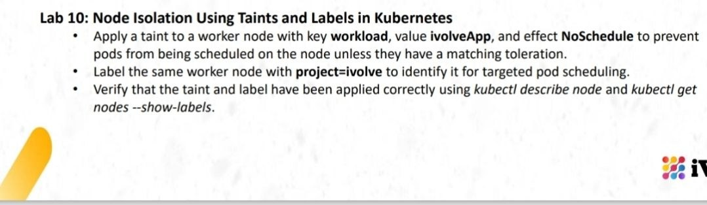
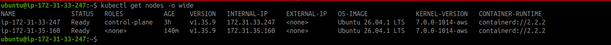
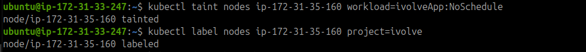
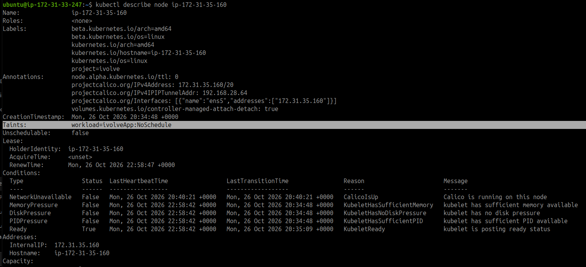
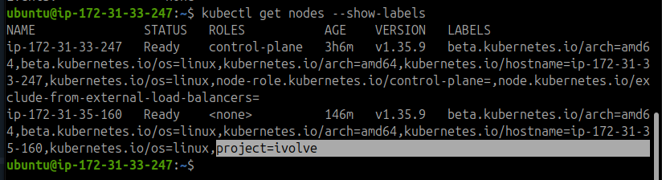

# Lab 10: Node Isolation Using Taints and Labels in Kubernetes

## Objective

- Apply a `NoSchedule` taint to a worker node to control pod scheduling.
- Add a label to identify the worker node for targeted scheduling.
- Verify the taint and label using Kubernetes commands.



## 1. Identify the Worker Node

List the cluster nodes and their details to identify the worker node.

```bash
kubectl get nodes -o wide
```



## 2. Apply the Taint

Apply a taint to the worker node using the key `workload`, value `ivolveApp`, and effect `NoSchedule`.

```bash
kubectl taint nodes ip-172-31-35-160 workload=ivolveApp:NoSchedule
```

The `NoSchedule` effect prevents new pods from being scheduled on this node unless they have a matching toleration.



## 3. Apply the Label

Add the label `project=ivolve` to the same worker node.

```bash
kubectl label nodes ip-172-31-35-160 project=ivolve
```

This label can be used to identify the node and target it for pod scheduling.

## 4. Verify the Taint

Inspect the worker node details and confirm that the taint has been applied.

```bash
kubectl describe node ip-172-31-35-160
```

Expected taint:

```text
workload=ivolveApp:NoSchedule
```



## 5. Verify the Label

Display all nodes with their labels and confirm that the worker node has `project=ivolve`.

```bash
kubectl get nodes --show-labels
```



## Result

Successfully applied and verified the `workload=ivolveApp:NoSchedule` taint and the `project=ivolve` label on the worker node.