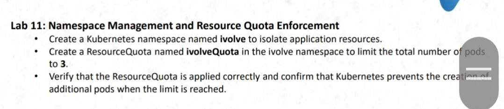
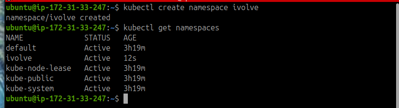
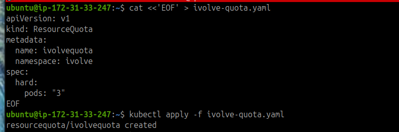
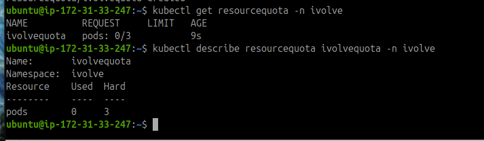
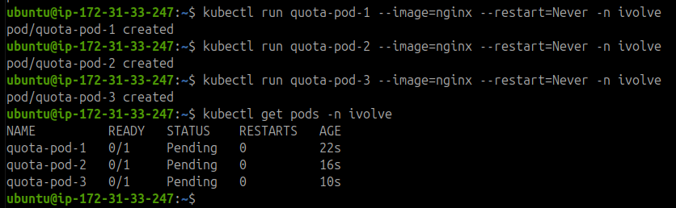
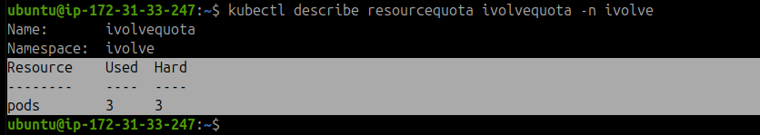
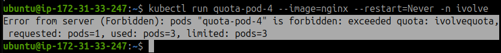
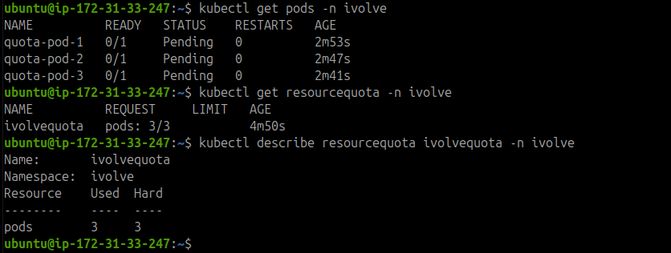

# Lab 11: Namespace Management and Resource Quota Enforcement

## Objective

- Create a Kubernetes namespace named `ivolve` to isolate application resources.
- Create a ResourceQuota named `ivolvequota` to limit the number of Pods to three.
- Verify the quota and test that Kubernetes rejects additional Pods when the limit is reached.




## 1. Create the Namespace

Create the `ivolve` namespace and verify that it exists.

```bash
kubectl create namespace ivolve
kubectl get namespaces
```



## 2. Create the ResourceQuota

Create a YAML file named `ivolve-quota.yaml` to define the resource quota.

```bash
cat <<'EOF' > ivolve-quota.yaml
apiVersion: v1
kind: ResourceQuota
metadata:
  name: ivolvequota
  namespace: ivolve
spec:
  hard:
    pods: "3"
EOF
```

The quota limits the total number of Pods in the `ivolve` namespace to three.

## 3. Apply the ResourceQuota

Apply the YAML configuration to the cluster.

```bash
kubectl apply -f ivolve-quota.yaml
```



## 4. Verify the ResourceQuota

Check the quota and its current usage.

```bash
kubectl get resourcequota -n ivolve
kubectl describe resourcequota ivolvequota -n ivolve
```



## 5. Create Three Test Pods

Create three NGINX Pods in the `ivolve` namespace.

```bash
kubectl run quota-pod-1 --image=nginx --restart=Never -n ivolve
kubectl run quota-pod-2 --image=nginx --restart=Never -n ivolve
kubectl run quota-pod-3 --image=nginx --restart=Never -n ivolve
```

List the Pods to verify their creation.

```bash
kubectl get pods -n ivolve
```



Check the quota usage again.

```bash
kubectl describe resourcequota ivolvequota -n ivolve
```



The expected quota usage is `3` Pods out of the allowed `3`.

## 6. Attempt to Create a Fourth Pod

Try to create another Pod to verify that the quota is enforced.

```bash
kubectl run quota-pod-4 --image=nginx --restart=Never -n ivolve
```

Kubernetes should reject the request with a `Forbidden` error because the quota limit has been reached.



## 7. Final Verification

Run the following commands to verify the Pods and ResourceQuota.

```bash
kubectl get pods -n ivolve
kubectl get resourcequota -n ivolve
kubectl describe resourcequota ivolvequota -n ivolve
```



## Result

Successfully created the `ivolve` namespace, configured a ResourceQuota limiting the namespace to three Pods, and verified that Kubernetes prevents the creation of additional Pods after the quota is reached.

**Note:** The requested name `ivolveQuota` was changed to `ivolvequota` because Kubernetes resource names must use lowercase characters.
