# Lab 12: Managing Configuration and Sensitive Data with ConfigMaps and Secrets

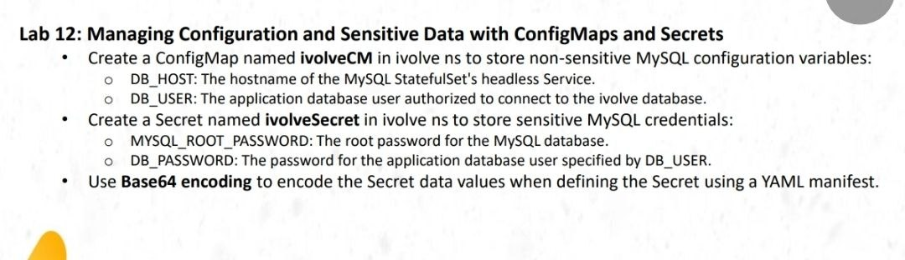

## Objective

- Create a ConfigMap to store non-sensitive MySQL configuration.
- Create a Secret to store MySQL credentials.
- Understand Base64 encoding for Kubernetes Secret values.
- Deploy MySQL using a StatefulSet and persistent storage.
- Configure MySQL using values from a ConfigMap and Secret.
- Verify the database, Service, storage, and Kubernetes resources in the `ivolve` namespace.

## 1. Check the Namespace and Existing Resources

Verify that the `ivolve` namespace exists and inspect its current resources.

```bash
kubectl get namespace ivolve
kubectl get statefulsets,services -n ivolve
kubectl get configmaps,secrets -n ivolve
```

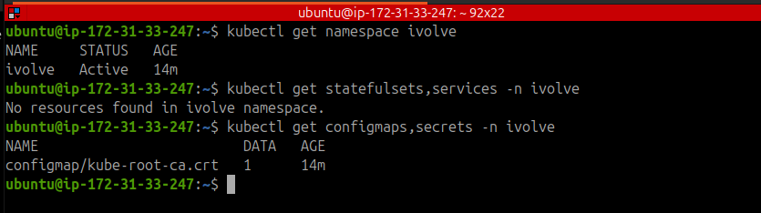

## 2. Create the ConfigMap

Create `ivolveCM.yaml` to store the MySQL host and application username.

```yaml
apiVersion: v1
kind: ConfigMap
metadata:
  name: ivolvecm
  namespace: ivolve
data:
  DB_HOST: "mysql-headless"
  DB_USER: "ivolve_user"
```

Apply the manifest and verify the ConfigMap.

```bash
kubectl apply -f ivolveCM.yaml
kubectl get configmap ivolvecm -n ivolve
kubectl describe configmap ivolvecm -n ivolve
```

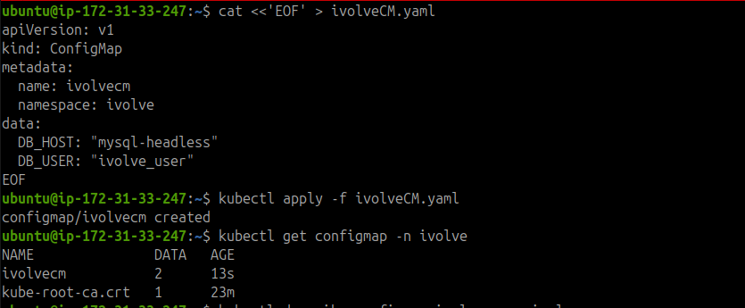

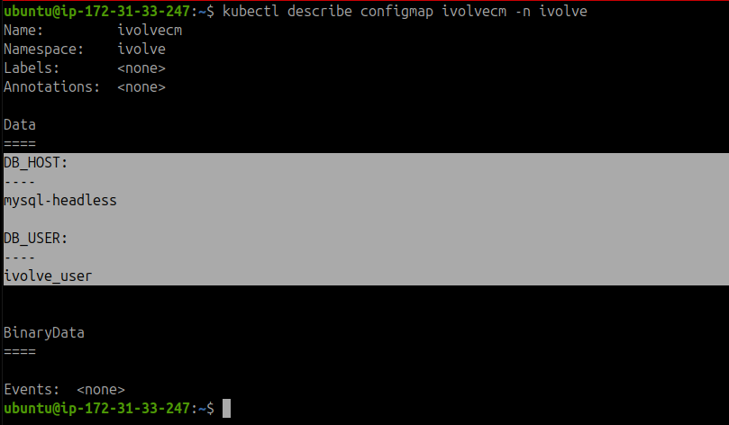

**Note:** The `mysql-headless` Service is created later in this lab. It provides a stable DNS name for the MySQL StatefulSet.

## 3. Encode the Secret Values Using Base64

Kubernetes Secrets can use Base64-encoded values in a YAML manifest.

To demonstrate the encoding process, run:

```bash
printf '%s' 'YOUR_ROOT_PASSWORD' | base64
printf '%s' 'YOUR_DB_PASSWORD' | base64
```

Replace the example values with your actual credentials locally.


**Security note:** Base64 is encoding, not encryption. Anyone who obtains the encoded values can decode them. Never commit real passwords or their Base64 representations to a public repository.

## 4. Create the Secret

Create `ivolvesecret.yaml` with the following structure. Replace the placeholders locally with the Base64-encoded values before applying the manifest.

```yaml
apiVersion: v1
kind: Secret
metadata:
  name: ivolvesecret
  namespace: ivolve
type: Opaque
data:
  MYSQL_ROOT_PASSWORD: "REPLACE_WITH_ROOT_PASSWORD_BASE64"
  DB_PASSWORD: "REPLACE_WITH_DB_PASSWORD_BASE64"
```

Apply the Secret:

```bash
kubectl apply -f ivolvesecret.yaml
kubectl get secret ivolvesecret -n ivolve
kubectl describe secret ivolvesecret -n ivolve
```

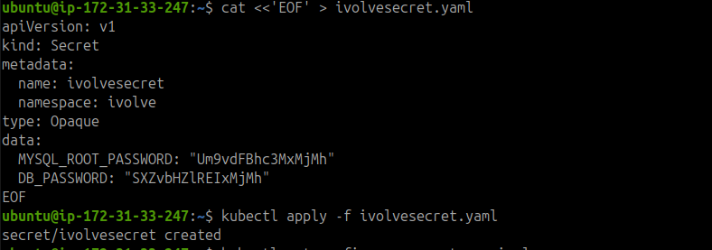

The Secret contains two keys:

- `MYSQL_ROOT_PASSWORD`: MySQL root account password.
- `DB_PASSWORD`: Application database user password.

The `describe secret` command displays the data keys and their sizes without displaying the password values.

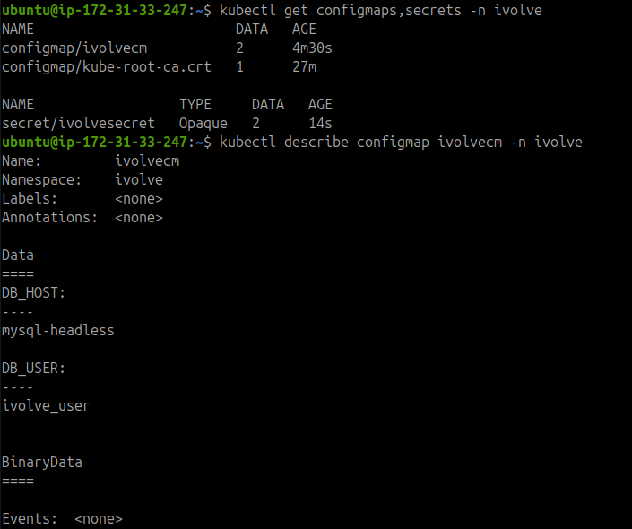

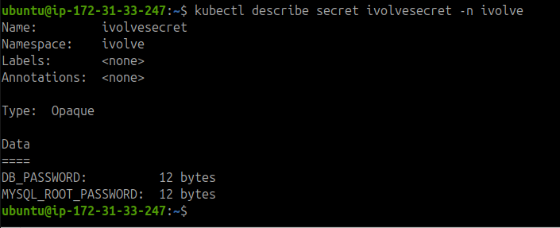

## 5. Prepare Persistent Storage on the Worker Node

The MySQL PersistentVolume uses a `hostPath` directory on the Worker node.

Connect to the Worker and run:

```bash
sudo mkdir -p /mnt/data/mysql
sudo chmod 777 /mnt/data/mysql
ls -ld /mnt/data/mysql
```

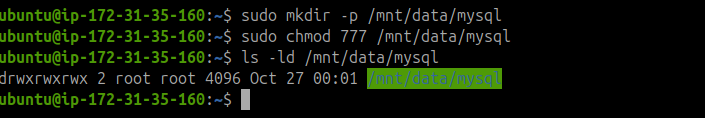

**Note:** The directory must be available on the Worker because the PersistentVolume is configured with node affinity for `ip-172-31-35-160`.

## 6. Create the MySQL PersistentVolume, Service, and StatefulSet

Before deploying MySQL, inspect the current Pods and ResourceQuota.

```bash
kubectl get pods -n ivolve
kubectl describe resourcequota ivolvequota -n ivolve
```

Create `mysql-resources.yaml` on the Master node:

```bash
cat <<'EOF' > mysql-resources.yaml
apiVersion: v1
kind: PersistentVolume
metadata:
  name: mysql-pv
spec:
  capacity:
    storage: 1Gi
  accessModes:
    - ReadWriteOnce
  persistentVolumeReclaimPolicy: Retain
  storageClassName: manual
  hostPath:
    path: /mnt/data/mysql
    type: DirectoryOrCreate
  nodeAffinity:
    required:
      nodeSelectorTerms:
        - matchExpressions:
            - key: kubernetes.io/hostname
              operator: In
              values:
                - ip-172-31-35-160
---
apiVersion: v1
kind: PersistentVolumeClaim
metadata:
  name: mysql-pvc
  namespace: ivolve
spec:
  accessModes:
    - ReadWriteOnce
  storageClassName: manual
  resources:
    requests:
      storage: 1Gi
---
apiVersion: v1
kind: Service
metadata:
  name: mysql-headless
  namespace: ivolve
spec:
  clusterIP: None
  selector:
    app: mysql
  ports:
    - name: mysql
      port: 3306
      targetPort: 3306
---
apiVersion: apps/v1
kind: StatefulSet
metadata:
  name: mysql
  namespace: ivolve
spec:
  serviceName: mysql-headless
  replicas: 1
  selector:
    matchLabels:
      app: mysql
  template:
    metadata:
      labels:
        app: mysql
    spec:
      nodeSelector:
        kubernetes.io/hostname: ip-172-31-35-160
      tolerations:
        - key: workload
          operator: Equal
          value: ivolveApp
          effect: NoSchedule
      containers:
        - name: mysql
          image: mysql:8.0
          ports:
            - containerPort: 3306
          env:
            - name: MYSQL_ROOT_PASSWORD
              valueFrom:
                secretKeyRef:
                  name: ivolvesecret
                  key: MYSQL_ROOT_PASSWORD
            - name: MYSQL_DATABASE
              value: ivolve
            - name: MYSQL_USER
              valueFrom:
                configMapKeyRef:
                  name: ivolvecm
                  key: DB_USER
            - name: MYSQL_PASSWORD
              valueFrom:
                secretKeyRef:
                  name: ivolvesecret
                  key: DB_PASSWORD
          resources:
            requests:
              cpu: 250m
              memory: 384Mi
            limits:
              cpu: "1"
              memory: 650Mi
          volumeMounts:
            - name: mysql-storage
              mountPath: /var/lib/mysql
      volumes:
        - name: mysql-storage
          persistentVolumeClaim:
            claimName: mysql-pvc
EOF
```

The manifest defines four resources:

1. **PersistentVolume (`mysql-pv`)**: Provides 1Gi of local storage on the Worker.
2. **PersistentVolumeClaim (`mysql-pvc`)**: Requests the storage required by MySQL.
3. **Headless Service (`mysql-headless`)**: Provides stable network identity for the StatefulSet.
4. **StatefulSet (`mysql`)**: Runs MySQL and injects configuration from the ConfigMap and Secret.

Apply the resources:

```bash
# Remove any remaining Lab 11 test Pods
kubectl delete pod quota-pod-1 quota-pod-2 quota-pod-3 \
  -n ivolve --ignore-not-found=true

# Deploy storage, Service, and StatefulSet
kubectl apply -f mysql-resources.yaml

# Check storage binding
kubectl get pv mysql-pv
kubectl get pvc -n ivolve

# Check the StatefulSet, Service, and Pods
kubectl get statefulsets,services -n ivolve
kubectl get pods -n ivolve -o wide
```

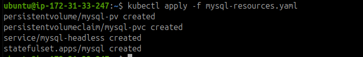

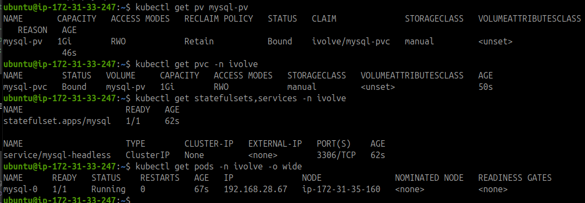

## 7. Wait for MySQL to Start

Wait for the StatefulSet rollout to complete:

```bash
kubectl rollout status statefulset/mysql -n ivolve --timeout=180s
```

Verify the Pod:

```bash
kubectl get pod mysql-0 -n ivolve -o wide
kubectl describe pod mysql-0 -n ivolve
```

The expected Pod status is `Running`, with the container ready.

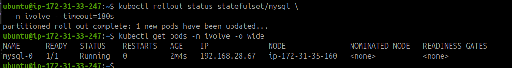

### Troubleshooting kubelet Connectivity

During verification, connections from the Master to the Worker on TCP port `10250` initially timed out.

Test the connection from the Master:

```bash
nc -vz -w 5 172.31.35.160 10250
```

Port `10250` is used for kubelet communication. If the connection times out, inspect the AWS Security Group and the kubelet service on the Worker. Allow TCP `10250` from the Master’s Security Group rather than opening the port to all IP addresses.

After correcting connectivity, Kubernetes commands such as `kubectl logs` and `kubectl exec` can be used to inspect the MySQL container.


## 8. Verify the MySQL Service

Check whether the MySQL server is responding:

```bash
kubectl exec mysql-0 -n ivolve -- \
  sh -c 'mysqladmin ping -uroot -p"$MYSQL_ROOT_PASSWORD"'
```

Expected output:

```text
mysqld is alive
```

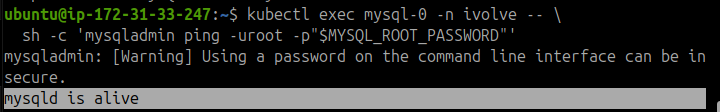

The output confirms that the MySQL server is responding to the health check.

## 9. Verify the Database and MySQL Users

Use the root account to inspect the databases and configured users:

```bash
kubectl exec mysql-0 -n ivolve -- sh -c \
  'MYSQL_PWD="$MYSQL_ROOT_PASSWORD" mysql -uroot -e "SHOW DATABASES; SELECT User, Host FROM mysql.user;"'
```

Confirm that the `ivolve` database exists and that the expected application user is present.

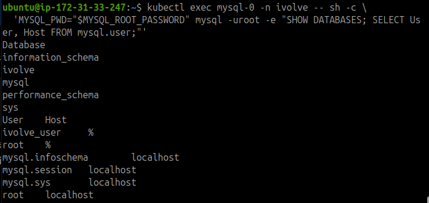

Test the application user separately:

```bash
kubectl exec mysql-0 -n ivolve -- sh -c \
  'MYSQL_PWD="$MYSQL_PASSWORD" mysql -u"$MYSQL_USER" -D ivolve -e "SELECT DATABASE(), CURRENT_USER();"'
```

This verifies that the application credentials can connect to the `ivolve` database.

## 10. Verify Configuration and Kubernetes Resources

Inspect the ConfigMap:

```bash
kubectl get configmap ivolvecm -n ivolve -o yaml
```

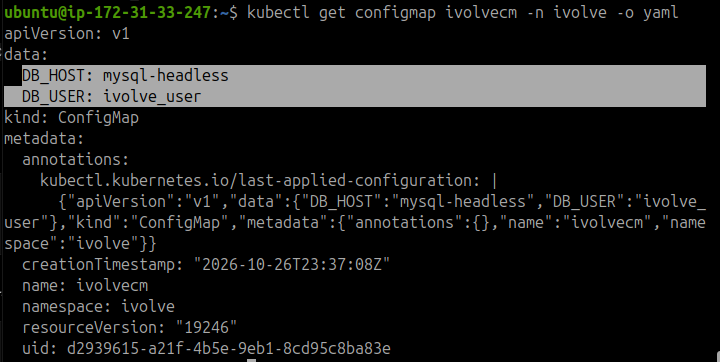

Verify the final workload, storage, and networking resources:

```bash
kubectl get statefulset,services,pods -n ivolve -o wide
kubectl get pv,pvc
kubectl get endpointslice -n ivolve
kubectl describe resourcequota ivolvequota -n ivolve
```

Check that:

- The MySQL StatefulSet is ready.
- The MySQL Pod is `Running` and ready.
- The PVC is `Bound` to `mysql-pv`.
- The headless Service has an endpoint for the MySQL Pod.
- The ResourceQuota remains within its configured limits.

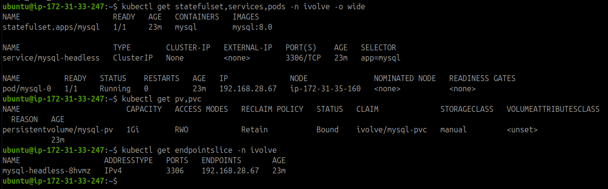

## Result

Successfully configured a MySQL deployment in the `ivolve` namespace using a ConfigMap for non-sensitive configuration and a Secret for credentials.

The deployment includes a PersistentVolume, PersistentVolumeClaim, headless Service, and StatefulSet. The MySQL server responds to its health check, and database access can be verified using both root and application credentials.

### Security Notes

- Base64 encoding does not encrypt Secret values.
- Never commit real passwords or Base64-encoded credentials to a public repository.
- Keep the actual Secret manifest out of version control and use placeholders in documented examples.
- The `hostPath` volume stores data on a specific node, so it is not equivalent to portable, replicated storage.
- The `chmod 777` command grants broad filesystem permissions. For a production environment, use more restrictive ownership and permissions appropriate to the MySQL container.