# Lab 13: Persistent Storage Setup for Application Logging

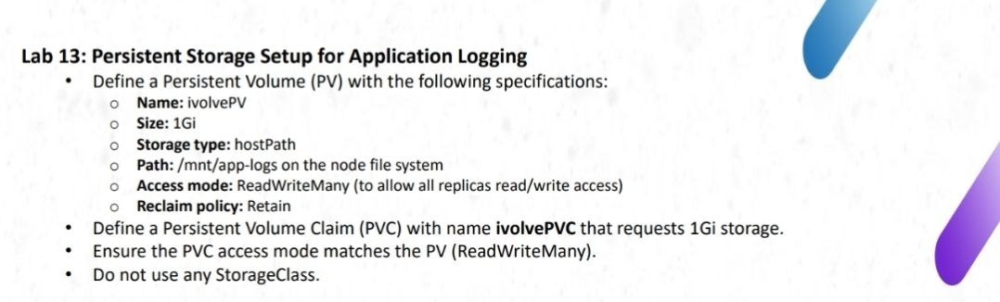

## Objective

Create a PersistentVolume (PV) and PersistentVolumeClaim (PVC) using `hostPath`, then deploy a test Pod to verify that application logs are stored on the Worker node and remain available after the Pod is deleted.

## Environment

- Kubernetes cluster with one Master and one Worker node.
- Worker hostname: `ip-172-31-35-160`
- Storage capacity: `1Gi`
- Access mode: `ReadWriteMany`
- Reclaim policy: `Retain`
- Storage type: `hostPath`
- Host directory: `/mnt/app-logs`
- StorageClass: none

## 1. Start the EC2 Instances

Start both EC2 instances from the AWS Console.

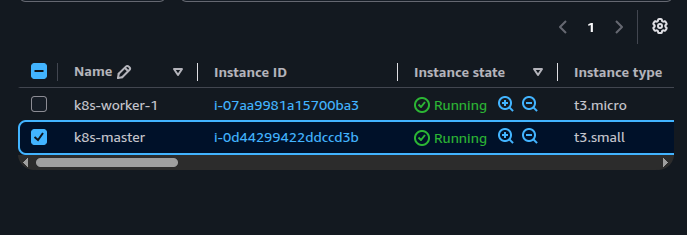

## 2. Connect to the Nodes

Connect to the Master and Worker using their current public IP addresses. These IP addresses may change after an instance is stopped and started.

```bash
ssh -i ~/Downloads/k8s-lab-key.pem ubuntu@<MASTER_PUBLIC_IP>
ssh -i ~/Downloads/k8s-lab-key.pem ubuntu@<WORKER_PUBLIC_IP>
```

Verify the cluster nodes from the Master:

```bash
kubectl get nodes -o wide
```

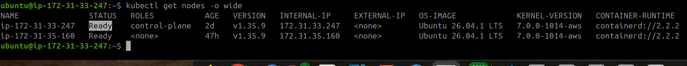

## 3. Prepare the Log Directory on the Worker

Run the following commands on the Worker node:

```bash
sudo mkdir -p /mnt/app-logs
sudo chmod 777 /mnt/app-logs
ls -ld /mnt/app-logs
```

The directory will be used to store the test application's log file.

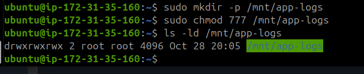

> **Lab note:** `chmod 777` is used here for simplicity in this lab only. Production environments should use more restrictive permissions.

## 4. Create the PersistentVolume and PersistentVolumeClaim

On the Master, create `lab13-storage.yaml`:

```yaml
apiVersion: v1
kind: PersistentVolume
metadata:
  name: ivolvepv
spec:
  capacity:
    storage: 1Gi
  accessModes:
    - ReadWriteMany
  persistentVolumeReclaimPolicy: Retain
  storageClassName: ""
  hostPath:
    path: /mnt/app-logs
    type: DirectoryOrCreate
  nodeAffinity:
    required:
      nodeSelectorTerms:
        - matchExpressions:
            - key: kubernetes.io/hostname
              operator: In
              values:
                - ip-172-31-35-160
---
apiVersion: v1
kind: PersistentVolumeClaim
metadata:
  name: ivolvepvc
  namespace: default
spec:
  accessModes:
    - ReadWriteMany
  storageClassName: ""
  resources:
    requests:
      storage: 1Gi
```

Kubernetes resource names must be lowercase. The PV is named `ivolvepv`, and the PVC is named `ivolvepvc`.

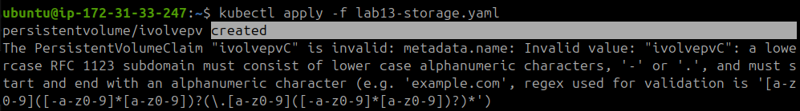

Apply the manifest:

```bash
kubectl apply -f lab13-storage.yaml
```

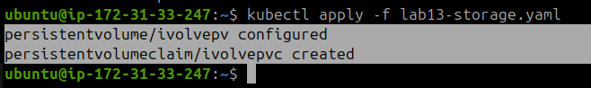

## 5. Verify the PV and PVC

```bash
kubectl get pv ivolvepv
kubectl get pvc ivolvepvc
```

Both resources should have the status `Bound`.

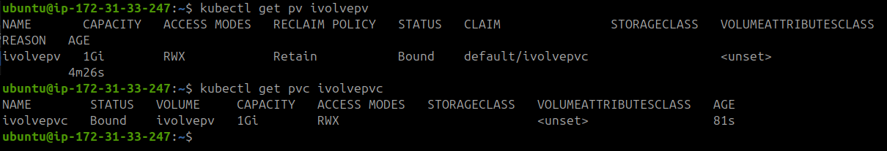

Inspect their configuration and events:

```bash
kubectl describe pvc ivolvepvc
kubectl describe pv ivolvepv
```

Verify that the PV uses `/mnt/app-logs`, has a capacity of `1Gi`, uses the `Retain` reclaim policy, and is restricted to the intended Worker node.

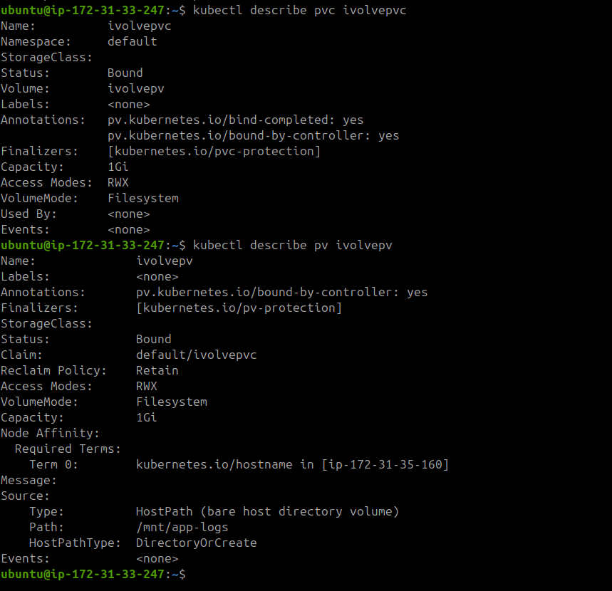

## 6. Create a Test Pod

Create `lab13-test-pod.yaml` on the Master:

```yaml
apiVersion: v1
kind: Pod
metadata:
  name: log-test-pod
spec:
  nodeSelector:
    kubernetes.io/hostname: ip-172-31-35-160
  tolerations:
    - key: workload
      operator: Equal
      value: ivolveApp
      effect: NoSchedule
  containers:
    - name: log-writer
      image: busybox:1.36
      command:
        - sh
        - -c
        - |
          while true; do
            echo "$(date) - Lab 13 test log" >> /var/log/app/test.log
            sleep 10
          done
      volumeMounts:
        - name: app-logs
          mountPath: /var/log/app
  volumes:
    - name: app-logs
      persistentVolumeClaim:
        claimName: ivolvepvc
```

The Pod is scheduled on the Worker node and mounts the PVC at `/var/log/app`. It appends a new log entry every 10 seconds.

Apply the manifest and check the Pod:

```bash
kubectl apply -f lab13-test-pod.yaml
kubectl get pod log-test-pod -o wide
kubectl describe pod log-test-pod
```

Wait until the Pod status is `Running`.

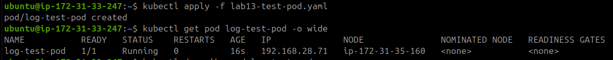

## 7. Verify the Logs

### From the Master

Read the log file inside the Pod:

```bash
kubectl exec log-test-pod -- cat /var/log/app/test.log
```

### From the Worker

Check the host directory:

```bash
sudo ls -l /mnt/app-logs
sudo cat /mnt/app-logs/test.log
```

The log entries should be visible both inside the Pod and in the Worker node's `/mnt/app-logs/test.log` file.

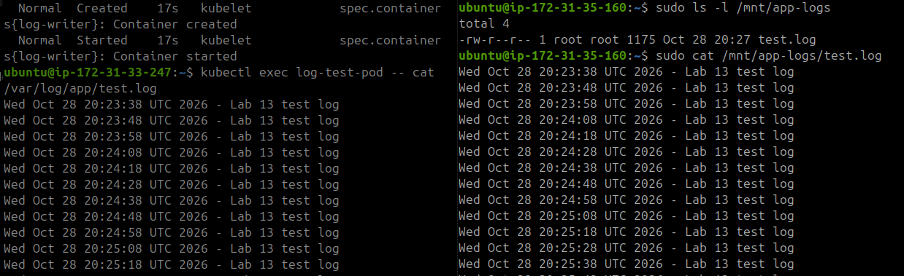

## 8. Delete the Test Pod and Verify Storage Resources

Delete the test Pod:

```bash
kubectl delete -f lab13-test-pod.yaml
```

Verify the remaining resources:

```bash
kubectl get pods
kubectl get pv ivolvepv
kubectl get pvc ivolvepvc
```

The PV and PVC should remain `Bound`. Because the reclaim policy is `Retain`, deleting a Pod does not delete the PV, PVC, or the host log file.

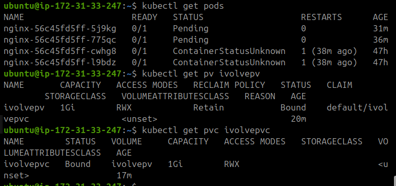

## Result

- Created a `1Gi` PersistentVolume using `hostPath`.
- Created a matching PersistentVolumeClaim.
- Confirmed that the PV and PVC reached the `Bound` state.
- Mounted the PVC in a test Pod and wrote log entries.
- Verified the log file directly on the Worker node.
- Deleted the test Pod while retaining the storage resources and log file.

## Important Limitation

Although the PV declares `ReadWriteMany`, `hostPath` storage is local to a specific node and does not provide shared storage across different nodes. For logs that must be shared across multiple nodes, use a suitable shared storage backend such as NFS.
