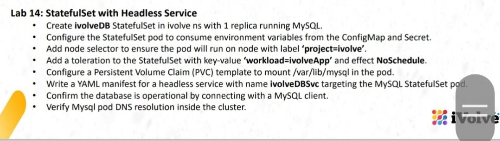
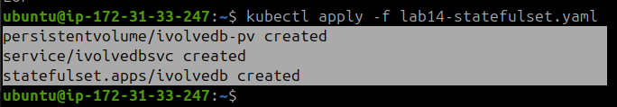
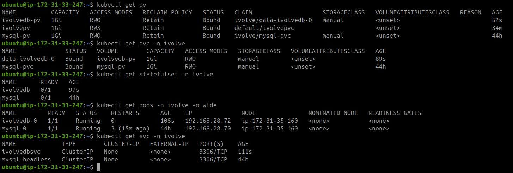
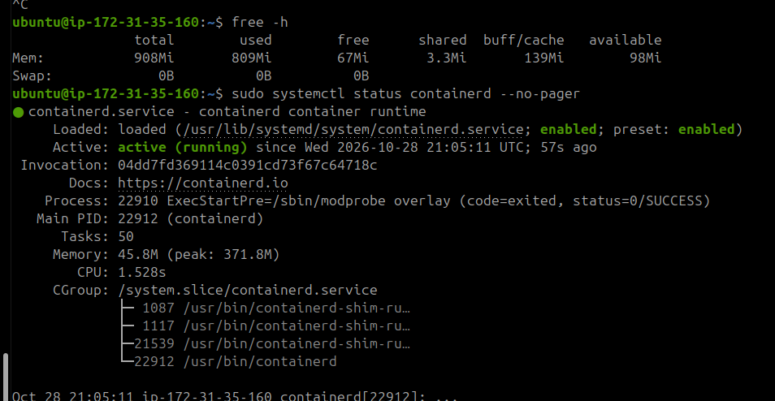
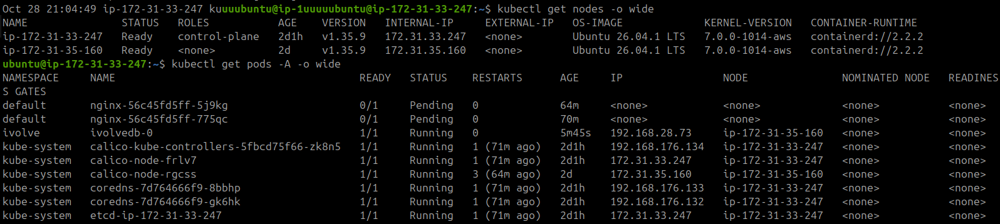
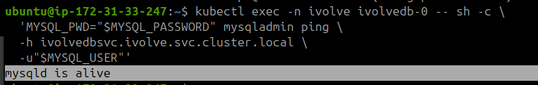
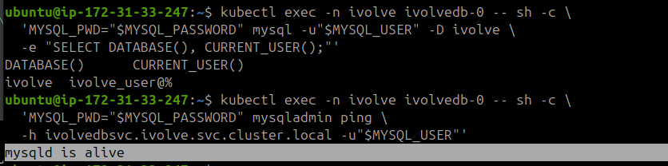
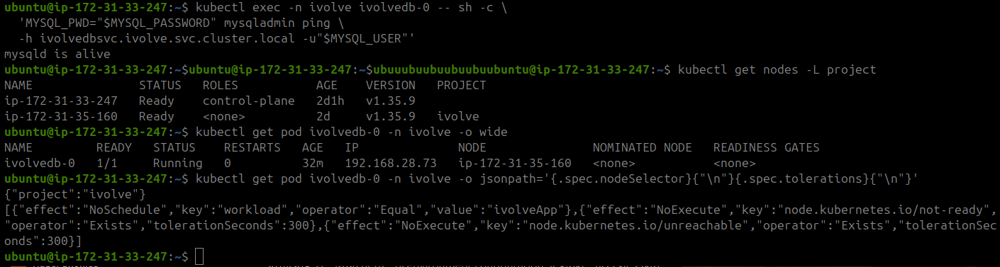
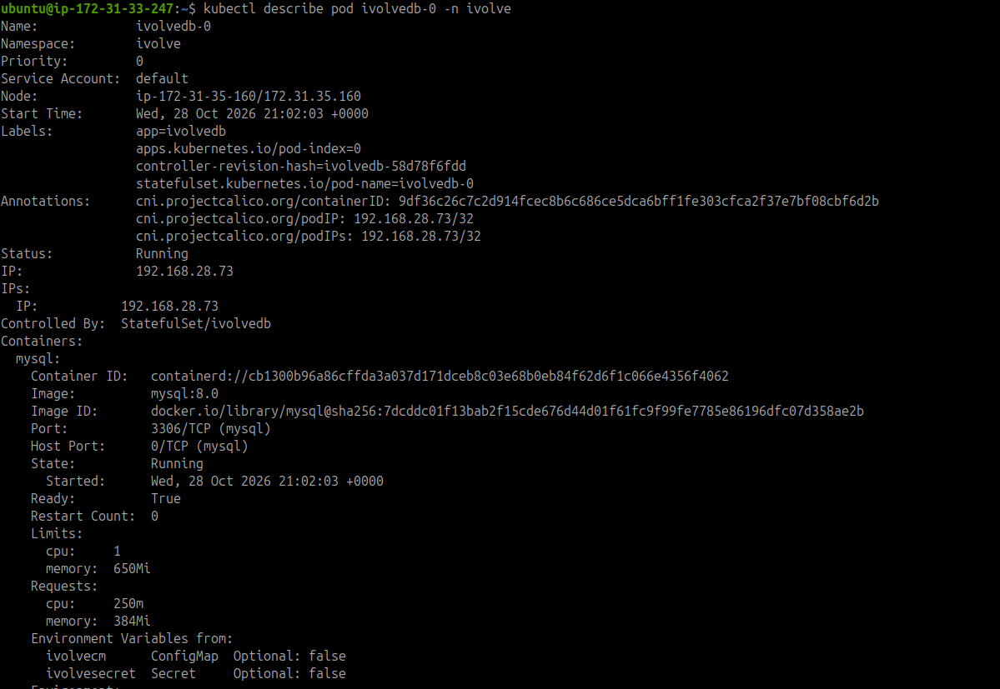

# Lab 14: StatefulSet with Headless Service



## Objective

Deploy a MySQL StatefulSet in Kubernetes using persistent storage, a Headless Service, ConfigMap, Secret, and node scheduling constraints.

## 1. Prepare Persistent Storage

**On the Worker node:**

Create the directory used by the PersistentVolume.

```bash
sudo mkdir -p /mnt/data/ivolvedb
sudo ls -ld /mnt/data/ivolvedb
```

## 2. Create Kubernetes Resources

**On the Master node:**

Create the manifest file:

```bash
cat <<'EOF' > lab14-statefulset.yaml
apiVersion: v1
kind: PersistentVolume
metadata:
  name: ivolvedb-pv
spec:
  capacity:
    storage: 1Gi
  accessModes:
    - ReadWriteOnce
  persistentVolumeReclaimPolicy: Retain
  storageClassName: manual
  hostPath:
    path: /mnt/data/ivolvedb
    type: DirectoryOrCreate
  nodeAffinity:
    required:
      nodeSelectorTerms:
        - matchExpressions:
            - key: kubernetes.io/hostname
              operator: In
              values:
                - ip-172-31-35-160
---
apiVersion: v1
kind: Service
metadata:
  name: ivolvedbsvc
  namespace: ivolve
spec:
  clusterIP: None
  selector:
    app: ivolvedb
  ports:
    - name: mysql
      port: 3306
      targetPort: 3306
---
apiVersion: apps/v1
kind: StatefulSet
metadata:
  name: ivolvedb
  namespace: ivolve
spec:
  serviceName: ivolvedbsvc
  replicas: 1
  selector:
    matchLabels:
      app: ivolvedb
  template:
    metadata:
      labels:
        app: ivolvedb
    spec:
      nodeSelector:
        project: ivolve
      tolerations:
        - key: workload
          operator: Equal
          value: ivolveApp
          effect: NoSchedule
      containers:
        - name: mysql
          image: mysql:8.0
          ports:
            - name: mysql
              containerPort: 3306
          envFrom:
            - configMapRef:
                name: ivolvecm
            - secretRef:
                name: ivolvesecret
          env:
            - name: MYSQL_ROOT_PASSWORD
              valueFrom:
                secretKeyRef:
                  name: ivolvesecret
                  key: MYSQL_ROOT_PASSWORD
            - name: MYSQL_USER
              valueFrom:
                configMapKeyRef:
                  name: ivolvecm
                  key: DB_USER
            - name: MYSQL_PASSWORD
              valueFrom:
                secretKeyRef:
                  name: ivolvesecret
                  key: DB_PASSWORD
            - name: MYSQL_DATABASE
              value: ivolve
          resources:
            requests:
              cpu: 250m
              memory: 384Mi
            limits:
              cpu: "1"
              memory: 650Mi
          volumeMounts:
            - name: data
              mountPath: /var/lib/mysql
  volumeClaimTemplates:
    - metadata:
        name: data
      spec:
        accessModes:
          - ReadWriteOnce
        storageClassName: manual
        resources:
          requests:
            storage: 1Gi
EOF
```

Apply the manifest:

```bash
kubectl apply -f lab14-statefulset.yaml
```



## 3. Verify Kubernetes Resources

Check the PersistentVolumes, PersistentVolumeClaims, StatefulSet, Pod, and Service.

```bash
kubectl get pv
kubectl get pvc -n ivolve
kubectl get statefulset -n ivolve
kubectl get pods -n ivolve -o wide
kubectl get svc -n ivolve
```



## 4. Check Worker Node and Cluster Health

Check the container runtime on the Worker node.

```bash
sudo systemctl status containerd --no-pager
```



Check the cluster nodes and running workloads from the Master.

```bash
kubectl get nodes -o wide
kubectl get pods -A -o wide
```



## 5. Verify MySQL Connectivity

### Test the Headless Service DNS

Connect to MySQL using the Service's fully qualified DNS name.

```bash
kubectl exec -n ivolve ivolvedb-0 -- sh -c \
  'MYSQL_PWD="$MYSQL_PASSWORD" mysqladmin ping \
  -h ivolvedbsvc.ivolve.svc.cluster.local \
  -u"$MYSQL_USER"'
```

Expected output:

```text
mysqld is alive
```



### Verify the Database and User

```bash
kubectl exec -n ivolve ivolvedb-0 -- sh -c \
  'MYSQL_PWD="$MYSQL_PASSWORD" mysql -u"$MYSQL_USER" -D ivolve \
  -e "SELECT DATABASE(), CURRENT_USER();"'
```

Expected result: the active database is `ivolve`, and the authenticated user is `ivolve_user@%`.



## 6. Verify Scheduling and Persistent Storage

Check the Worker label, Pod placement, node selector, and toleration.

```bash
kubectl get nodes -L project

kubectl get pod ivolvedb-0 -n ivolve -o wide

kubectl get pod ivolvedb-0 -n ivolve \
  -o jsonpath='{.spec.nodeSelector}{"\n"}{.spec.tolerations}{"\n"}'
```

The Pod should run on the Worker node labeled `project=ivolve` and tolerate the `workload=ivolveApp:NoSchedule` taint.



Inspect the Pod configuration and mounted volumes.

```bash
kubectl describe pod ivolvedb-0 -n ivolve
```



## 7. Final Verification

Run the following commands to capture the final cluster status.

```bash
echo "===== Nodes ====="
kubectl get nodes -L project

echo "===== StatefulSet and Service ====="
kubectl get statefulset,svc -n ivolve

echo "===== Pods and PVCs ====="
kubectl get pods,pvc -n ivolve -o wide

echo "===== Persistent Volumes ====="
kubectl get pv
```


## Results

- MySQL StatefulSet deployed with one replica.
- Headless Service created for MySQL access through Kubernetes DNS.
- ConfigMap and Secret referenced by the MySQL container.
- PersistentVolume and StatefulSet-generated PersistentVolumeClaim bound successfully.
- Pod scheduled on the Worker using a node selector and toleration.
- MySQL database and user connection verified successfully.
- Master and Worker nodes reported `Ready`.

## Cleanup Note

The unrelated Nginx test Deployment was removed because its Pods remained `Pending` due to the cluster's taints.

```bash
kubectl delete deployment nginx
```

The Lab 12 `mysql` StatefulSet remains scaled to zero to reduce memory usage. Its PersistentVolume and PersistentVolumeClaim were retained.

**Note:** The Worker has limited memory. Avoid starting additional workloads unless sufficient resources are available.
