# Lab 15 – Deploy Node.js Application on Kubernetes

## Lab Objective

Deploy a Node.js application on the Kubernetes cluster with the following requirements:

- Deploy the application using two replicas.
- Use the custom Docker image `hager83/ivolve-app:latest`.
- Consume the existing ConfigMap and Secret.
- Schedule application Pods on the Worker node using a Node Selector and Toleration.
- Reuse the PersistentVolume created in Lab 13.
- Use an Init Container to initialize the application database and grant privileges.
- Expose the application through a ClusterIP Service on port `3000`.
- Verify application health, database connectivity, storage, and Kubernetes resources.

---

## 1. Prepare and Back Up the Existing Persistent Volume

Before migrating the existing PVC from the `default` namespace to the `ivolve` namespace, back up its configuration and inspect the existing storage.

```bash
# 1. Create a backup directory
mkdir -p ~/lab15-backup

# 2. Back up the existing PVC
kubectl get pvc ivolvepvc -n default -o yaml \
  > ~/lab15-backup/ivolvepvc-default.yaml

# 3. Back up the PV
kubectl get pv ivolvepv -o yaml \
  > ~/lab15-backup/ivolvepv.yaml

# 4. Inspect the PV configuration
kubectl describe pv ivolvepv

# 5. Check whether any Pod is using the old PVC
kubectl get pods -A -o json | jq -r '
.items[]
| select(any(.spec.volumes[]?; .persistentVolumeClaim.claimName == "ivolvepvc"))
| [.metadata.namespace, .metadata.name, .status.phase]
| @tsv'

# 6. Verify the existing data on the Worker
# Replace the IP if the Worker public IP has changed.
ssh -i ~/Downloads/k8s-lab-key.pem ubuntu@<WORKER_PUBLIC_IP> \
  'sudo ls -lah /mnt/app-logs && sudo find /mnt/app-logs -maxdepth 2 -type f -ls'
```

The existing PV uses the Worker node's host path:

```text
/mnt/app-logs
```

The PV has a `Retain` reclaim policy, which helps preserve the underlying data when the PVC is deleted.

### Delete the old PVC

After confirming that no Pod is using the old claim:

```bash
# Verify the backup files
ls -lh ~/lab15-backup/

# Delete only the old PVC in the default namespace
kubectl delete pvc ivolvepvc -n default

# Check the PV status
kubectl get pv ivolvepv
```

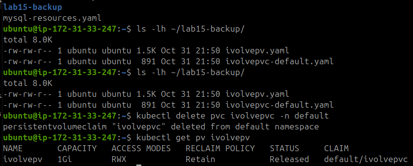

### Release the PV

The PV may still contain the old PVC reference. Remove the `claimRef` so that it can be bound to the new PVC.

```bash
kubectl patch pv ivolvepv \
  --type json \
  -p='[{"op":"remove","path":"/spec/claimRef"}]'
```

### Create the new PVC in the ivolve namespace

```bash
cat <<'EOF' > ~/lab15-backup/ivolvepvc.yaml
apiVersion: v1
kind: PersistentVolumeClaim
metadata:
  name: ivolvepvc
  namespace: ivolve
spec:
  accessModes:
    - ReadWriteMany
  storageClassName: ""
  volumeName: ivolvepv
  resources:
    requests:
      storage: 1Gi
EOF

kubectl apply -f ~/lab15-backup/ivolvepvc.yaml
```

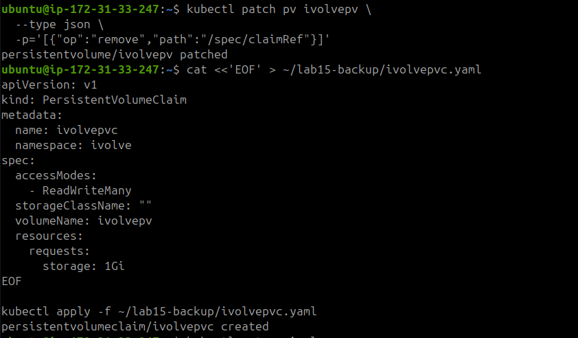

### Verify PV and PVC binding

```bash
kubectl get pv ivolvepv

kubectl get pvc ivolvepvc -n ivolve
```

The expected result is:

- PV status: `Bound`
- PVC status: `Bound`
- PVC namespace: `ivolve`
- PVC volume: `ivolvepv`

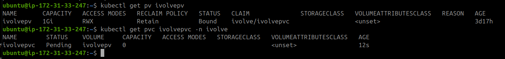

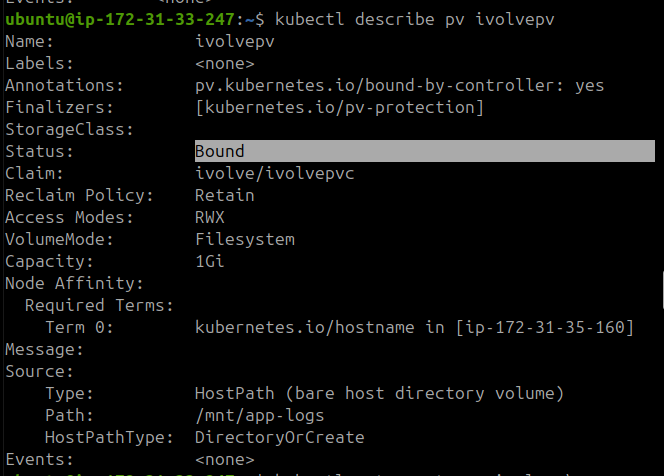

---

## 2. Verify the Existing MySQL Service

The application uses the MySQL StatefulSet created in Lab 14.

Verify that the MySQL Service has an endpoint:

```bash
# Verify MySQL Service endpoint
kubectl get endpoints ivolvedbsvc -n ivolve
```

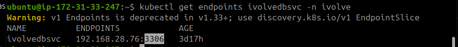

The application connects to MySQL using the existing ConfigMap and Secret:

- ConfigMap: `ivolvecm`
- Secret: `ivolvesecret`
- Database: `ivolve`
- Database user: `ivolve_user`

Secret values should never be displayed in the README or screenshots.

---

## 3. Create the Application Deployment and Service

Create the Deployment and Service manifest:

```bash
cat <<'EOF' > ~/lab15-backup/lab15-deployment.yaml
apiVersion: apps/v1
kind: Deployment
metadata:
  name: ivolveapp
  namespace: ivolve
spec:
  replicas: 2
  selector:
    matchLabels:
      app: ivolveApp
  template:
    metadata:
      labels:
        app: ivolveApp
    spec:
      nodeSelector:
        project: ivolve

      tolerations:
        - key: workload
          operator: Equal
          value: ivolveApp
          effect: NoSchedule

      initContainers:
        - name: mysql-init
          image: mysql:8.0
          imagePullPolicy: IfNotPresent
          env:
            - name: DB_HOST
              valueFrom:
                configMapKeyRef:
                  name: ivolvecm
                  key: DB_HOST
            - name: DB_USER
              valueFrom:
                configMapKeyRef:
                  name: ivolvecm
                  key: DB_USER
            - name: DB_PASSWORD
              valueFrom:
                secretKeyRef:
                  name: ivolvesecret
                  key: DB_PASSWORD
            - name: MYSQL_ROOT_PASSWORD
              valueFrom:
                secretKeyRef:
                  name: ivolvesecret
                  key: MYSQL_ROOT_PASSWORD
            - name: DB_NAME
              value: ivolve
          command:
            - sh
            - -c
            - |
              set -e
              export MYSQL_PWD="${MYSQL_ROOT_PASSWORD}"

              echo "Waiting for MySQL..."
              until mysqladmin ping -h "${DB_HOST}" -uroot --silent; do
                sleep 5
              done

              echo "Creating database and granting privileges..."
              mysql -h "${DB_HOST}" -uroot -e "
                CREATE DATABASE IF NOT EXISTS \`${DB_NAME}\`;
                GRANT ALL PRIVILEGES ON \`${DB_NAME}\`.* TO '${DB_USER}'@'%';
                FLUSH PRIVILEGES;
              "

              echo "Database initialization completed."
          resources:
            requests:
              cpu: 50m
              memory: 64Mi
            limits:
              cpu: 200m
              memory: 128Mi

      containers:
        - name: ivolve-app
          image: hager83/ivolve-app:latest
          imagePullPolicy: Always
          ports:
            - name: http
              containerPort: 3000
              protocol: TCP

          env:
            - name: DB_HOST
              valueFrom:
                configMapKeyRef:
                  name: ivolvecm
                  key: DB_HOST
            - name: DB_USER
              valueFrom:
                configMapKeyRef:
                  name: ivolvecm
                  key: DB_USER
            - name: DB_PASSWORD
              valueFrom:
                secretKeyRef:
                  name: ivolvesecret
                  key: DB_PASSWORD
            - name: DB_NAME
              value: ivolve

          volumeMounts:
            - name: app-logs
              mountPath: /app/logs

          readinessProbe:
            httpGet:
              path: /ready
              port: 3000
            initialDelaySeconds: 10
            periodSeconds: 10

          livenessProbe:
            httpGet:
              path: /health
              port: 3000
            initialDelaySeconds: 20
            periodSeconds: 20

          resources:
            requests:
              cpu: 50m
              memory: 64Mi
            limits:
              cpu: 250m
              memory: 192Mi

      volumes:
        - name: app-logs
          persistentVolumeClaim:
            claimName: ivolvepvc
---
apiVersion: v1
kind: Service
metadata:
  name: ivolvaappsvc
  namespace: ivolve
spec:
  type: ClusterIP
  selector:
    app: ivolveApp
  ports:
    - name: http
      port: 3000
      targetPort: 3000
      protocol: TCP
EOF
```

### Deployment configuration

| Component | Configuration |
|---|---|
| Deployment | `ivolveapp` |
| Replicas | 2 |
| Container image | `hager83/ivolve-app:latest` |
| Container port | 3000 |
| Namespace | `ivolve` |
| Node Selector | `project=ivolve` |
| Toleration | `workload=ivolveApp:NoSchedule` |
| Init Container | `mysql-init` |
| Persistent Volume Claim | `ivolvepvc` |
| Mount Path | `/app/logs` |
| Service | `ivolvaappsvc` |
| Service Type | ClusterIP |

The Init Container waits for MySQL to become available, creates the application database if it does not exist, and grants the application user the required privileges.

The application uses:

- Readiness Probe: `/ready`
- Liveness Probe: `/health`

### Validate and apply the manifest

First, validate the manifest on the API server:

```bash
kubectl apply --dry-run=server \
  -f ~/lab15-backup/lab15-deployment.yaml
```

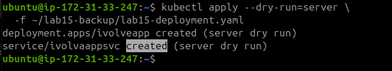

Apply the resources:

```bash
kubectl apply -f ~/lab15-backup/lab15-deployment.yaml
```

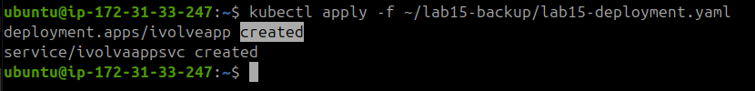

---

## 4. Resolve Worker Node Disk Pressure

During deployment, the Worker node experienced disk pressure because its original root EBS volume was too small.

The Worker EBS volume was increased from 8 GiB to 16 GiB. After the volume expansion, the partition and filesystem also needed to be extended.

Run the following commands **on the Worker node**, not on the Master.

### Inspect the partition

```bash
sudo parted /dev/nvme0n1 unit GiB print
```

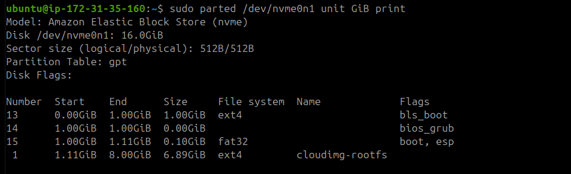

### Expand the partition

```bash
sudo growpart /dev/nvme0n1 1
```

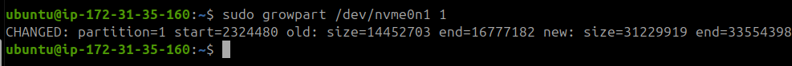

### Expand the filesystem

```bash
sudo resize2fs /dev/nvme0n1p1
```

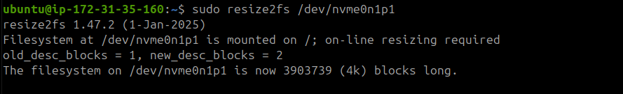

Verify the available disk space and Kubernetes node condition:

```bash
df -h /
```

From the Master, verify the Worker status:

```bash
kubectl describe node ip-172-31-35-160
```

The Worker should return to `Ready` status with `DiskPressure=False`.

---

## 5. Verify Application Health

The application exposes two HTTP endpoints:

- `/health` – Liveness check.
- `/ready` – Readiness check.

Because the Service is a ClusterIP, use port forwarding to access it from the Master.

### Terminal 1 – Master

```bash
kubectl port-forward svc/ivolvaappsvc 3000:3000 -n ivolve
```

Keep this terminal running.

### Terminal 2 – Master

```bash
echo "===== HEALTH CHECK ====="
curl -i http://localhost:3000/health

echo "===== READINESS CHECK ====="
curl -i http://localhost:3000/ready
```

Both endpoints should return a successful HTTP response, normally `HTTP 200 OK`.

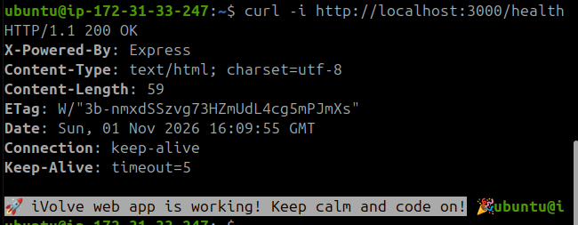

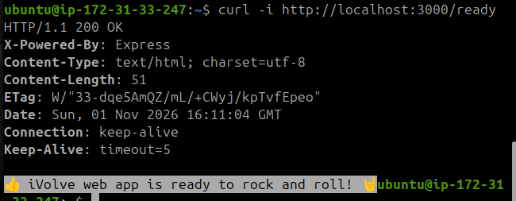

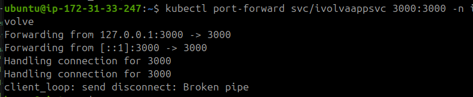

---

## 6. Final Kubernetes Verification

### Check cluster nodes

```bash
echo "===== NODES ====="
kubectl get nodes
```

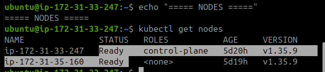

### Check all Pods in the namespace

```bash
echo "===== ALL IVOLVE PODS ====="
kubectl get pods -n ivolve -o wide
```

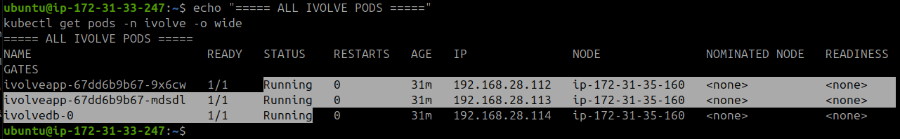

The expected application state is two Running and Ready application Pods, along with the existing MySQL Pod.

### Check Deployment and Service

```bash
echo "===== DEPLOYMENT ====="
kubectl get deployment ivolveapp -n ivolve

echo "===== SERVICE ====="
kubectl get svc ivolvaappsvc -n ivolve
```

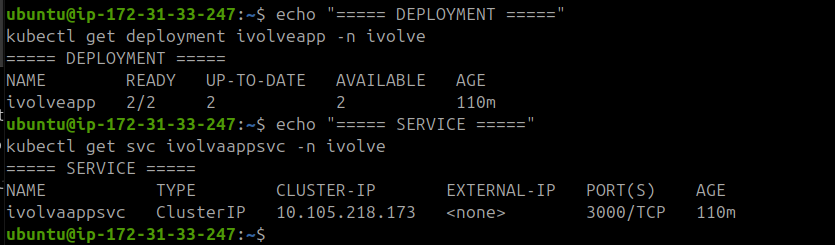

### Check Service endpoints

```bash
echo "===== ENDPOINTS ====="
kubectl get endpoints ivolvaappsvc -n ivolve
```

The Service should have two application Pod endpoints on port `3000`.

### Check Persistent Storage

```bash
echo "===== PVC ====="
kubectl get pvc -n ivolve

echo "===== PV ====="
kubectl get pv ivolvepv
```

The application PVC should remain `Bound` to `ivolvepv`.

### Check Resource Quota

```bash
echo "===== RESOURCE QUOTA ====="
kubectl get resourcequota -n ivolve
```

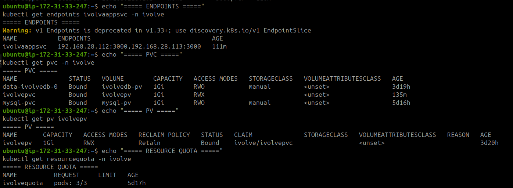

---

## 7. Database Verification

Verify that the application database exists and that the application user has the required privileges.

Run these commands on the Master.

### Check databases

```bash
kubectl exec -n ivolve ivolvedb-0 -- sh -c \
  'MYSQL_PWD="$MYSQL_ROOT_PASSWORD" mysql -uroot -e "SHOW DATABASES;"'
```

The output should include the `ivolve` database.

### Check application user privileges

```bash
kubectl exec -n ivolve ivolvedb-0 -- sh -c \
  'MYSQL_PWD="$MYSQL_ROOT_PASSWORD" mysql -uroot -e "SHOW GRANTS FOR '\''ivolve_user'\''@'\''%'\'';"'
```

The output should show the grants assigned to `ivolve_user` on the `ivolve` database.

### Test the application user connection

```bash
kubectl exec -n ivolve ivolvedb-0 -- sh -c \
  'MYSQL_PWD="$MYSQL_PASSWORD" mysql -u"$MYSQL_USER" -D ivolve -e "SELECT DATABASE(), CURRENT_USER();"'
```

Expected output:

```text
DATABASE()    CURRENT_USER()
ivolve        ivolve_user@%
```

These commands verify the database, user grants, and application user connectivity without displaying Secret values.

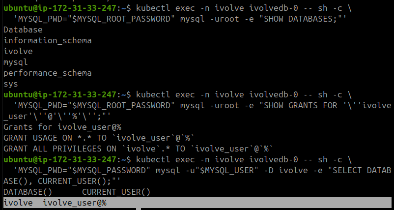

---

## 8. Verify Application Logs

Check the Init Container logs and application logs for the healthy application Pods.

```bash
for pod in $(kubectl get pods -n ivolve -l app=ivolveApp \
  --field-selector=status.phase=Running \
  -o jsonpath='{.items[*].metadata.name}'); do

  echo "===== INIT CONTAINER: $pod ====="
  kubectl logs "$pod" -n ivolve -c mysql-init

  echo "===== APPLICATION: $pod ====="
  kubectl logs "$pod" -n ivolve -c ivolve-app

done
```

Expected Init Container messages include:

```text
Waiting for MySQL...
mysqld is alive
Creating database and granting privileges...
Database initialization completed.
```

Expected application messages include:

```text
Attempt 1: Connecting to MySQL...
Database initialized successfully.
Server started on http://0.0.0.0:3000
```

---

## 9. Configure Docker Hub Image Pull Secret

This section demonstrates how Kubernetes pulls an application image from Docker Hub using an `imagePullSecret`. The test was performed first with a public repository, then with the repository set to private.

### 9.1 Verify the Application Image on the Worker

Connect to the Worker node and check whether the application image already exists in the containerd image store.

Run on the **Worker**:

```bash
sudo ctr -n k8s.io images list | grep ivolve-app
```

The image was found in the Worker containerd image store.

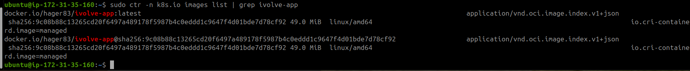

### 9.2 Check Docker Hub Repository Visibility

Before configuring authentication, the Docker Hub repository was public.

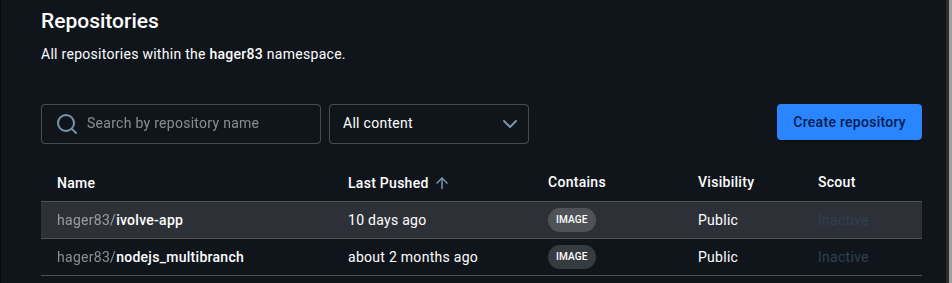


### 9.3 Generate a Docker Hub Personal Access Token

Create a Personal Access Token (PAT) from Docker Hub to use for Kubernetes image authentication.

Use a read-only token with access to the repository being pulled.

### 9.4 Create the Kubernetes Image Pull Secret

Run on the **Master**:

```bash
read -r -p "Docker Hub username: " DOCKERHUB_USERNAME
read -r -s -p "Docker Hub access token: " DOCKERHUB_TOKEN
echo

kubectl create secret docker-registry dockerhub-secret \
  --docker-server=https://index.docker.io/v1/ \
  --docker-username="$DOCKERHUB_USERNAME" \
  --docker-password="$DOCKERHUB_TOKEN" \
  -n ivolve \
  --dry-run=client -o yaml | kubectl apply -f -

unset DOCKERHUB_USERNAME DOCKERHUB_TOKEN
```

The Secret is created in the same namespace as the application Deployment.

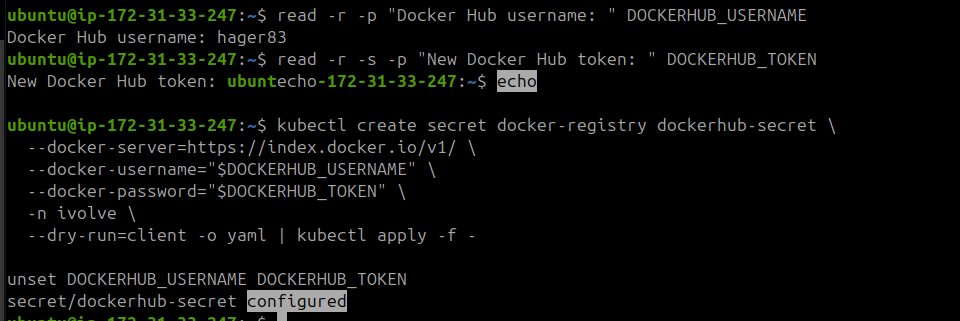

Verify that the Secret exists:

```bash
kubectl get secret dockerhub-secret -n ivolve
```

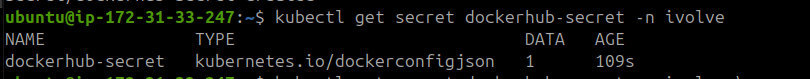

### 9.5 Attach the Secret to the Deployment

Configure the Deployment Pod template to use `dockerhub-secret` when pulling container images.

```bash
kubectl patch deployment ivolveapp -n ivolve \
  --type=strategic \
  -p '{"spec":{"template":{"spec":{"imagePullSecrets":[{"name":"dockerhub-secret"}]}}}}'
```

Verify the configuration:

```bash
kubectl get deployment ivolveapp -n ivolve \
  -o jsonpath='{.spec.template.spec.imagePullSecrets[*].name}{"\n"}'
```

Expected output:

```text
dockerhub-secret
```

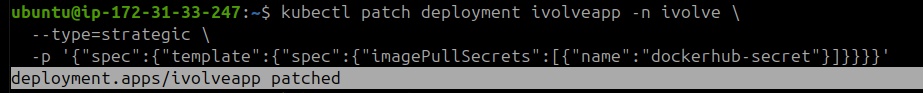

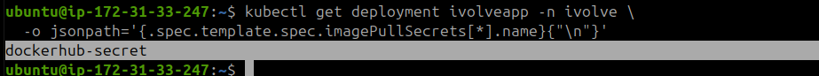

### 9.6 Test Pulling from a Private Repository

Change the Docker Hub repository visibility from Public to Private.

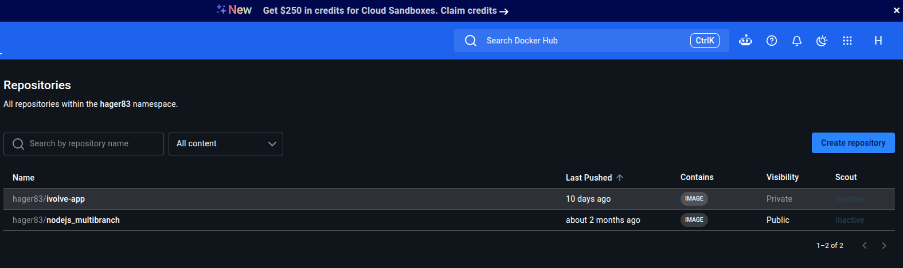

Restart the Deployment to create a new Pod and trigger an image pull:

```bash
kubectl rollout restart deployment/ivolveapp -n ivolve
```

Wait for the rollout to complete:

```bash
kubectl rollout status deployment/ivolveapp -n ivolve \
  --timeout=180s
```

The Deployment successfully rolled out using the configured image pull Secret.

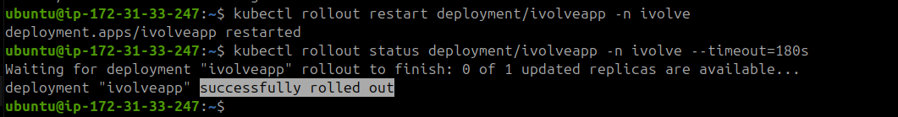

### 9.7 Final Verification

**Check the Deployment:**

```bash
kubectl get deployment ivolveapp -n ivolve
```

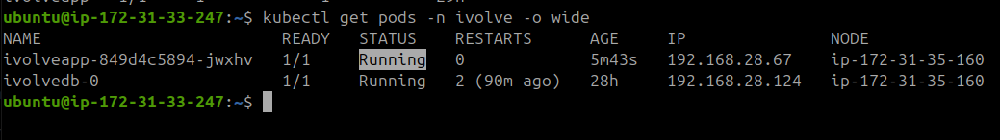

**Check the application Pods:**

```bash
kubectl get pods -n ivolve -o wide
```

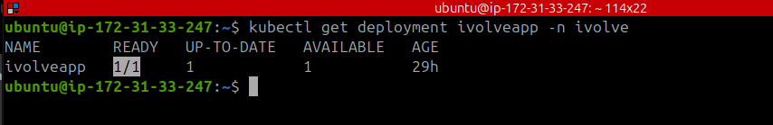

**Check the latest namespace events:**

```bash
kubectl get events -n ivolve --sort-by='.lastTimestamp' | tail -10
```

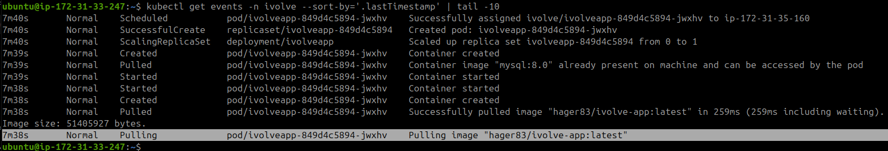

The rollout completed successfully, and the application Pod became available after configuring the Docker Hub credentials.

This test demonstrates how Kubernetes uses an `imagePullSecret` to authenticate against a private Docker Hub repository before pulling the application image.

---

**Lab Status:** The Deployment, Service, scheduling, and persistent storage setup have been successfully verified. Complete the final database and HTTP checks to confirm all lab requirements.