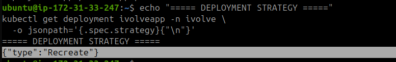
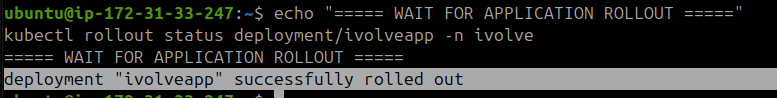
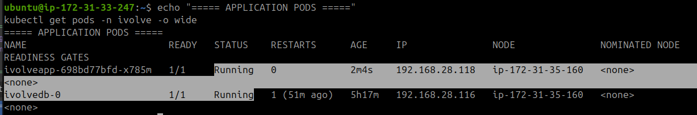
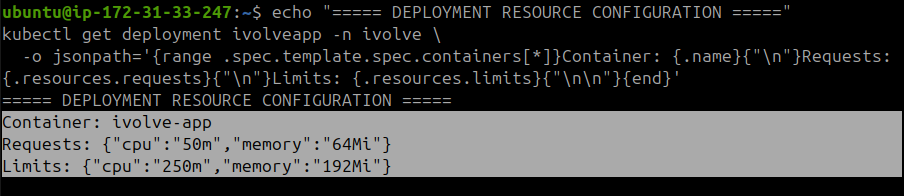
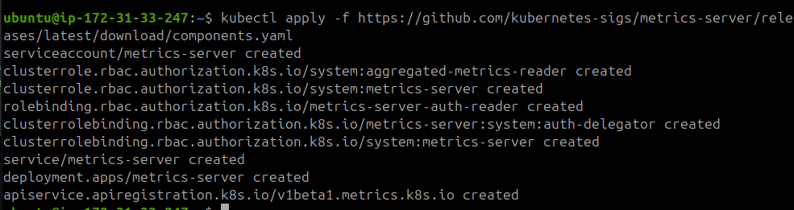
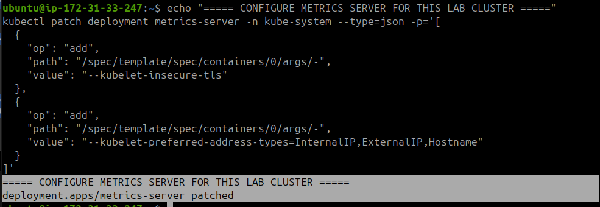
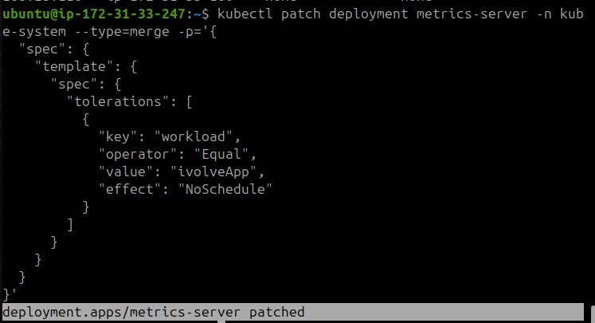
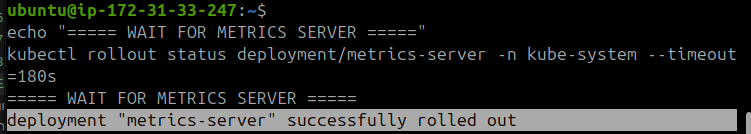
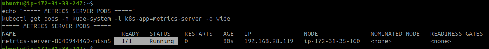
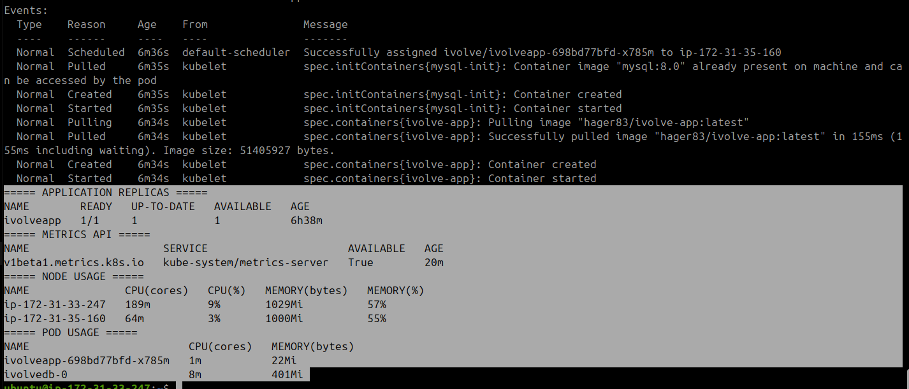

# Lab 16: Pod Resource Management with CPU and Memory Requests and Limits

## 1. Update Application Resource Requests and Limits

Update the existing `ivolveapp` Deployment to configure CPU and memory requests and limits.

The Deployment uses the `Recreate` strategy to avoid temporarily running old and new application Pods together during the update. The replica count is set to `1` because the Worker node has limited CPU and memory capacity.

```bash
kubectl patch deployment ivolveapp -n ivolve --type=json -p='[
  {
    "op": "remove",
    "path": "/spec/strategy/rollingUpdate"
  },
  {
    "op": "replace",
    "path": "/spec/strategy/type",
    "value": "Recreate"
  },
  {
    "op": "replace",
    "path": "/spec/replicas",
    "value": 1
  },
  {
    "op": "replace",
    "path": "/spec/template/spec/containers/0/resources",
    "value": {
      "requests": {
        "cpu": "1",
        "memory": "1Gi"
      },
      "limits": {
        "cpu": "2",
        "memory": "2Gi"
      }
    }
  }
]'

echo "===== WAIT FOR ROLLOUT ====="
kubectl rollout status deployment/ivolveapp -n ivolve

echo "===== CHECK PODS ====="
kubectl get pods -n ivolve -o wide

echo "===== CHECK DEPLOYMENT ====="
kubectl get deployment ivolveapp -n ivolve
```







## 2. Verify Resource Configuration

Use `kubectl describe pod` to inspect the application Pod and verify its resource configuration.

```bash
echo "===== POD RESOURCE CONFIGURATION ====="
kubectl describe pod -n ivolve -l app=ivolveApp

echo "===== DEPLOYMENT RESOURCE CONFIGURATION ====="
kubectl get deployment ivolveapp -n ivolve \
  -o jsonpath='{range .spec.template.spec.containers[*]}Container: {.name}{"\n"}Requests: {.resources.requests}{"\n"}Limits: {.resources.limits}{"\n\n"}{end}'
```



The application container is configured with:

| Resource | Request | Limit |
|---|---:|---:|
| CPU | 1 Core | 2 Cores |
| Memory | 1Gi | 2Gi |

## 3. Install Metrics Server

Metrics Server collects resource usage data from the Kubernetes nodes and containers. It makes this information available through the Kubernetes Metrics API.

```bash
kubectl apply -f https://github.com/kubernetes-sigs/metrics-server/releases/latest/download/components.yaml
```



## 4. Configure Metrics Server

Configure Metrics Server to communicate with the kubelets in the lab cluster.

The `--kubelet-insecure-tls` option is used as a lab-only workaround for kubelet certificate verification.

```bash
echo "===== CONFIGURE METRICS SERVER FOR THIS LAB CLUSTER ====="

kubectl patch deployment metrics-server -n kube-system --type=json -p='[
  {
    "op": "add",
    "path": "/spec/template/spec/containers/0/args/-",
    "value": "--kubelet-insecure-tls"
  },
  {
    "op": "add",
    "path": "/spec/template/spec/containers/0/args/-",
    "value": "--kubelet-preferred-address-types=InternalIP,ExternalIP,Hostname"
  }
]'
```



The Worker node has a custom `NoSchedule` taint:

`workload=ivolveApp:NoSchedule`

Add a matching toleration to the Metrics Server Deployment so that it can be scheduled on the Worker node without removing or changing the existing taint.

```bash
kubectl patch deployment metrics-server -n kube-system --type=merge -p='{
  "spec": {
    "template": {
      "spec": {
        "tolerations": [
          {
            "key": "workload",
            "operator": "Equal",
            "value": "ivolveApp",
            "effect": "NoSchedule"
          }
        ]
      }
    }
  }
}'
```



## 5. Verify Metrics Server Deployment

Wait for the Metrics Server Deployment to become available.

```bash
echo "===== WAIT FOR METRICS SERVER ====="
kubectl rollout status deployment/metrics-server -n kube-system --timeout=180s
```



Check that the Metrics Server Pod is running.

```bash
echo "===== METRICS SERVER PODS ====="
kubectl get pods -n kube-system -l k8s-app=metrics-server -o wide
```



## 6. Verify Resource Usage

Verify the application resource configuration, Deployment replicas, and Metrics API availability.

```bash
echo "===== APPLICATION RESOURCE CONFIGURATION ====="
kubectl describe pod -n ivolve -l app=ivolveApp

echo "===== APPLICATION REPLICAS ====="
kubectl get deployment ivolveapp -n ivolve

echo "===== METRICS API ====="
kubectl get apiservices v1beta1.metrics.k8s.io

echo "===== NODE USAGE ====="
kubectl top nodes

echo "===== POD USAGE ====="
kubectl top pods -n ivolve
```



## Results

- Updated the `ivolveapp` Deployment with CPU and memory requests and limits.
- Verified the configured resources using `kubectl describe pod`.
- Installed and configured Metrics Server.
- Added a toleration to allow Metrics Server to run on the tainted Worker node.
- Verified that the Metrics API is available.
- Used `kubectl top nodes` and `kubectl top pods` to monitor real-time resource usage.

**Final Application Configuration:**

- Replicas: `1`
- CPU Request: `1`
- CPU Limit: `2`
- Memory Request: `1Gi`
- Memory Limit: `2Gi`
- Application Pod Status: `Running`
- Metrics Server Status: `Running`
