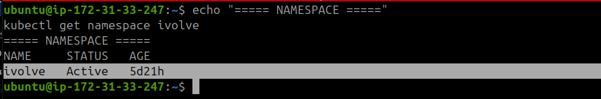
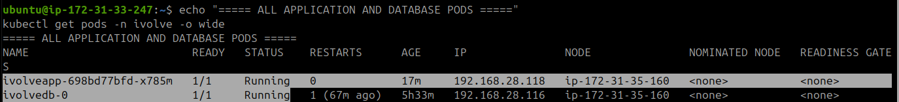
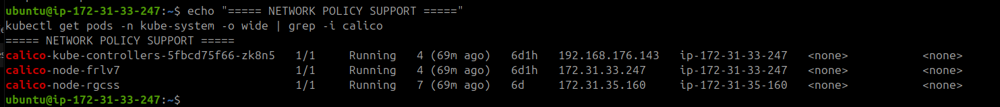
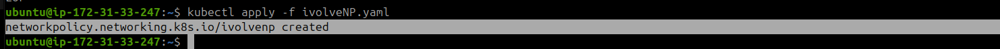
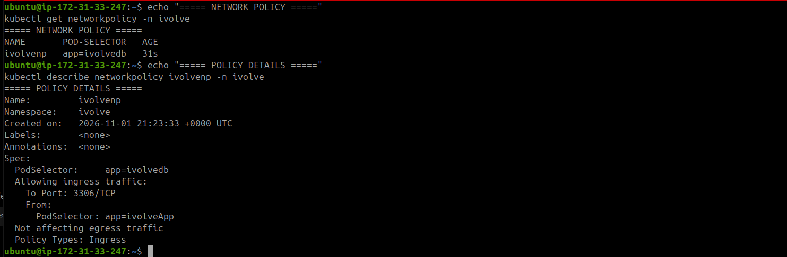
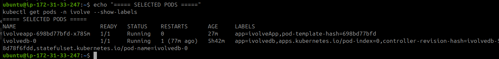
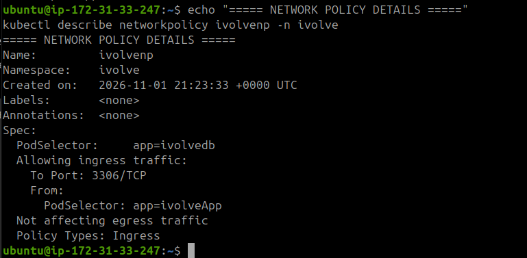
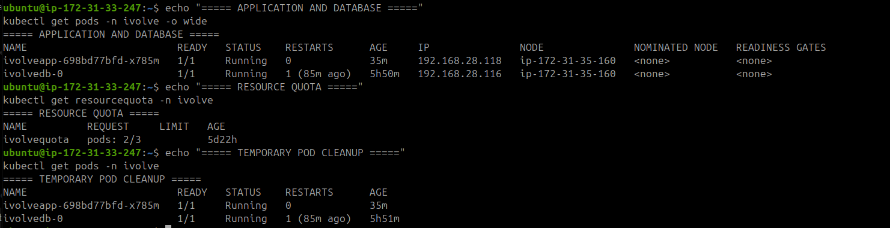

# Lab 17: Control Pod-to-Pod Traffic via Network Policy

## 1. Inspect the Existing Kubernetes Resources

Check that the namespace exists:

```bash
echo "===== NAMESPACE ====="
kubectl get namespace ivolve
```



Check the application and database pods:

```bash
echo "===== ALL APPLICATION AND DATABASE PODS ====="
kubectl get pods -n ivolve -o wide
```



Inspect pod labels and workload configurations:

```bash
echo "===== POD LABELS ====="
kubectl get pods -n ivolve --show-labels

echo "===== MYSQL STATEFULSET ====="
kubectl get statefulset ivolvedb -n ivolve -o yaml

echo "===== APPLICATION DEPLOYMENT ====="
kubectl get deployment ivolveapp -n ivolve -o yaml
```

Verify that Calico is running, since it supports Kubernetes NetworkPolicy enforcement:

```bash
echo "===== NETWORK POLICY SUPPORT ====="
kubectl get pods -n kube-system -o wide | grep -i calico
```



## 2. Create the Network Policy

Create a NetworkPolicy named `ivolvenp` targeting MySQL pods using the label `app=ivolvedb`.

The policy allows ingress traffic only from application pods labeled `app=ivolveApp`, on TCP port `3306`.

```bash
cat <<'EOF' > ivolveNP.yaml
apiVersion: networking.k8s.io/v1
kind: NetworkPolicy
metadata:
  name: ivolvenp
  namespace: ivolve
spec:
  podSelector:
    matchLabels:
      app: ivolvedb
  policyTypes:
    - Ingress
  ingress:
    - from:
        - podSelector:
            matchLabels:
              app: ivolveApp
      ports:
        - protocol: TCP
          port: 3306
EOF
```

## 3. Apply the Network Policy

Apply the configuration:

```bash
kubectl apply -f ivolveNP.yaml
```



Verify the created policy:

```bash
echo "===== NETWORK POLICY ====="
kubectl get networkpolicy -n ivolve

echo "===== POLICY DETAILS ====="
kubectl describe networkpolicy ivolvenp -n ivolve
```



Verify the pod labels and confirm that the policy targets the intended MySQL pod:

```bash
echo "===== SELECTED PODS ====="
kubectl get pods -n ivolve --show-labels
```



## 4. Test Allowed Traffic from an Application Pod

Create a temporary test pod with the same label as the application pods (`app=ivolveApp`).

This pod uses the MySQL image to run `mysqladmin` for connectivity testing.

```bash
cat <<'EOF' > allowed-test-pod.yaml
apiVersion: v1
kind: Pod
metadata:
  name: allowed-test
  namespace: ivolve
  labels:
    app: ivolveApp
spec:
  nodeSelector:
    project: ivolve
  tolerations:
    - key: workload
      operator: Equal
      value: ivolveApp
      effect: NoSchedule
  containers:
    - name: tester
      image: mysql:8.0
      command: ["sh", "-c", "sleep 3600"]
EOF

kubectl apply -f allowed-test-pod.yaml

kubectl wait --for=condition=Ready pod/allowed-test \
  -n ivolve --timeout=120s
```

Test connectivity to MySQL:

```bash
kubectl exec -n ivolve allowed-test -- \
  mysqladmin ping -h ivolvedbsvc -P 3306 --connect-timeout=5
```

**Expected result:** MySQL responds with an `Access denied` message because no password was provided. This confirms that the connection reached the MySQL server and that network traffic was allowed.



Delete the temporary pod before creating the next test pod:

```bash
kubectl delete pod allowed-test -n ivolve
```

## 5. Test Blocked Traffic from an Unauthorized Pod

Create another temporary pod with a different label that does not match the allowed application selector.

```bash
cat <<'EOF' > blocked-test-pod.yaml
apiVersion: v1
kind: Pod
metadata:
  name: blocked-test
  namespace: ivolve
  labels:
    network-policy-test: blocked
spec:
  nodeSelector:
    project: ivolve
  tolerations:
    - key: workload
      operator: Equal
      value: ivolveApp
      effect: NoSchedule
  containers:
    - name: tester
      image: mysql:8.0
      command: ["sh", "-c", "sleep 3600"]
EOF

kubectl apply -f blocked-test-pod.yaml

kubectl wait --for=condition=Ready pod/blocked-test \
  -n ivolve --timeout=120s
```

Attempt to connect to MySQL:

```bash
kubectl exec -n ivolve blocked-test -- \
  mysqladmin ping -h ivolvedbsvc -P 3306 --connect-timeout=5
```

**Expected result:** The connection fails with a timeout (`Can't connect to MySQL server`, error 110), confirming that the NetworkPolicy blocks traffic from unauthorized pods.



Delete the temporary test pod:

```bash
kubectl delete pod blocked-test -n ivolve
```

## 6. Final Verification

Verify the NetworkPolicy and ensure that the application and database pods are still running.

```bash
echo "===== NETWORK POLICY ====="
kubectl get networkpolicy -n ivolve

echo "===== NETWORK POLICY DETAILS ====="
kubectl describe networkpolicy ivolvenp -n ivolve

echo "===== APPLICATION AND DATABASE ====="
kubectl get pods -n ivolve -o wide

echo "===== RESOURCE QUOTA ====="
kubectl get resourcequota -n ivolve

echo "===== TEMPORARY POD CLEANUP ====="
kubectl get pods -n ivolve
```

Remove the local YAML test files if they are no longer needed:

```bash
rm -f allowed-test-pod.yaml blocked-test-pod.yaml
```

## 7. Result

Successfully created and verified a Kubernetes NetworkPolicy that:

- Selects MySQL pods using `app=ivolvedb`.
- Allows ingress traffic only from application pods labeled `app=ivolveApp`.
- Restricts allowed traffic to TCP port `3306`.
- Blocks connections from unauthorized pods.
- Leaves egress traffic unaffected.

Both connectivity tests confirmed the expected network behavior, and the temporary test pods were removed after testing.