# Lab 18 – Kubernetes Monitoring and Alerting

## Introduction

In this lab, I set up a monitoring and alerting system for the Kubernetes cluster using Prometheus, Node Exporter, Grafana, and Alertmanager. The setup monitors both Master and Worker nodes, visualizes infrastructure metrics, and sends email notifications when alerts are triggered.

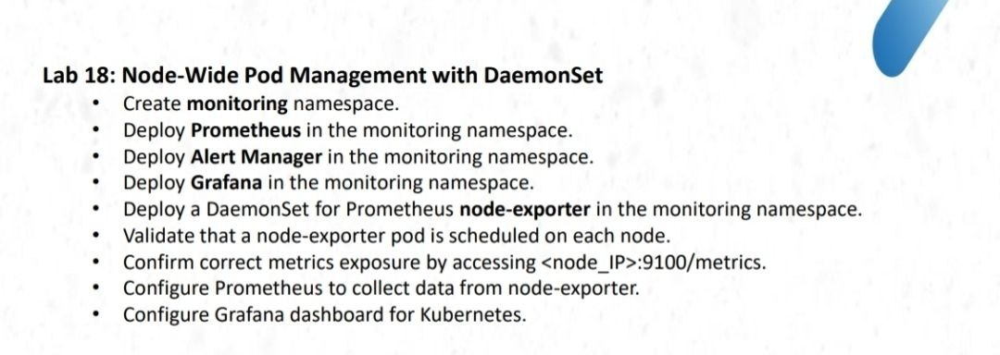

## 1. Create Monitoring Namespace

```bash
kubectl create namespace monitoring

kubectl get namespaces
```

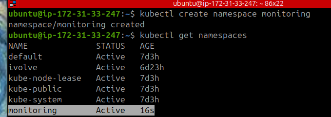


## 2. Check Node Taints

```bash
kubectl describe node ip-172-31-33-247 | grep -i -A5 taints

kubectl describe node ip-172-31-35-160 | grep -i -A5 taints
```

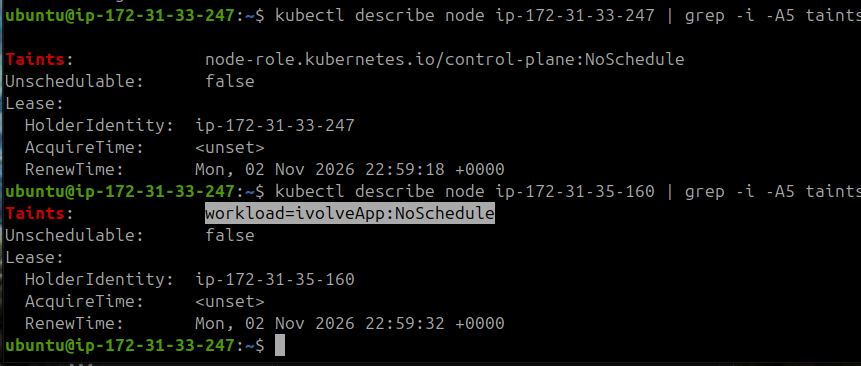

## 3. Deploy Node Exporter

Create the working directory:

```bash
mkdir -p ~/lab18
cd ~/lab18
```

Create `node-exporter.yaml`:

```bash
cat <<'EOF' > node-exporter.yaml
apiVersion: apps/v1
kind: DaemonSet
metadata:
  name: node-exporter
  namespace: monitoring
  labels:
    app: node-exporter
spec:
  selector:
    matchLabels:
      app: node-exporter
  template:
    metadata:
      labels:
        app: node-exporter
    spec:
      hostNetwork: true
      hostPID: true

      tolerations:
        - key: node-role.kubernetes.io/control-plane
          operator: Exists
          effect: NoSchedule

        - key: workload
          operator: Equal
          value: ivolveApp
          effect: NoSchedule

      containers:
        - name: node-exporter
          image: prom/node-exporter:v1.9.1
          args:
            - --path.rootfs=/host
          ports:
            - name: metrics
              containerPort: 9100
              hostPort: 9100
              protocol: TCP
          resources:
            requests:
              cpu: 50m
              memory: 64Mi
            limits:
              cpu: 200m
              memory: 128Mi
          volumeMounts:
            - name: rootfs
              mountPath: /host
              readOnly: true
              mountPropagation: HostToContainer

      volumes:
        - name: rootfs
          hostPath:
            path: /
EOF
```

Apply the DaemonSet and check its status:

```bash
kubectl apply -f node-exporter.yaml

kubectl rollout status daemonset/node-exporter -n monitoring --timeout=180s

kubectl get daemonset -n monitoring

kubectl get pods -n monitoring -o wide
```

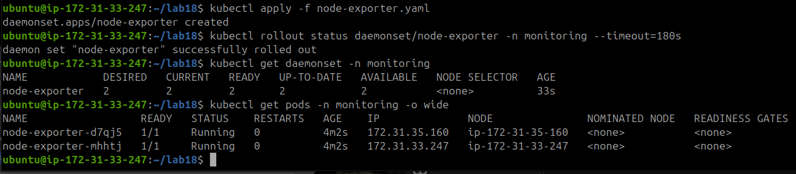

### Metrics Exposure Check

On the Master node:

```bash
curl -s http://127.0.0.1:9100/metrics | head -20
```

On the Worker node:

```bash
curl -s http://172.31.35.160:9100/metrics | head -20
```

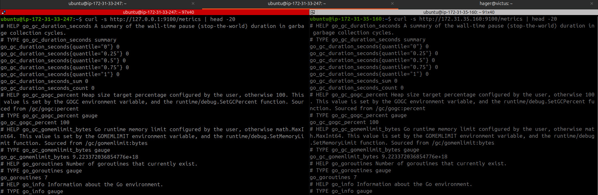

Open:

```text
http://localhost:9100
```

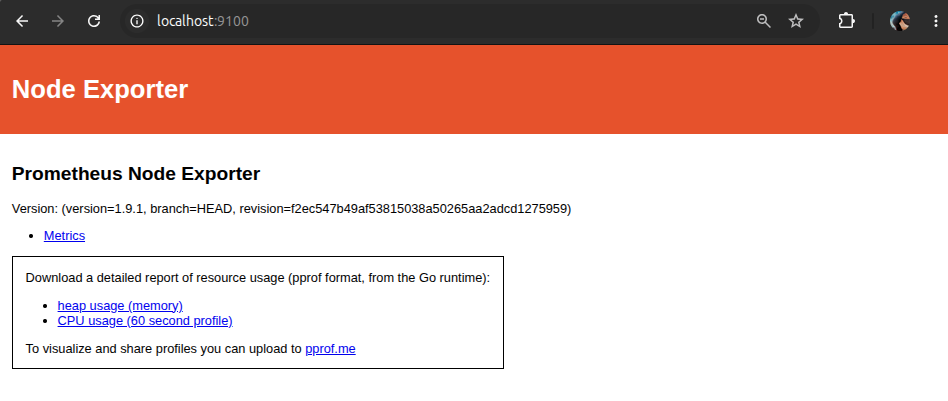

Open:

```text
http://localhost:9100/metrics
```

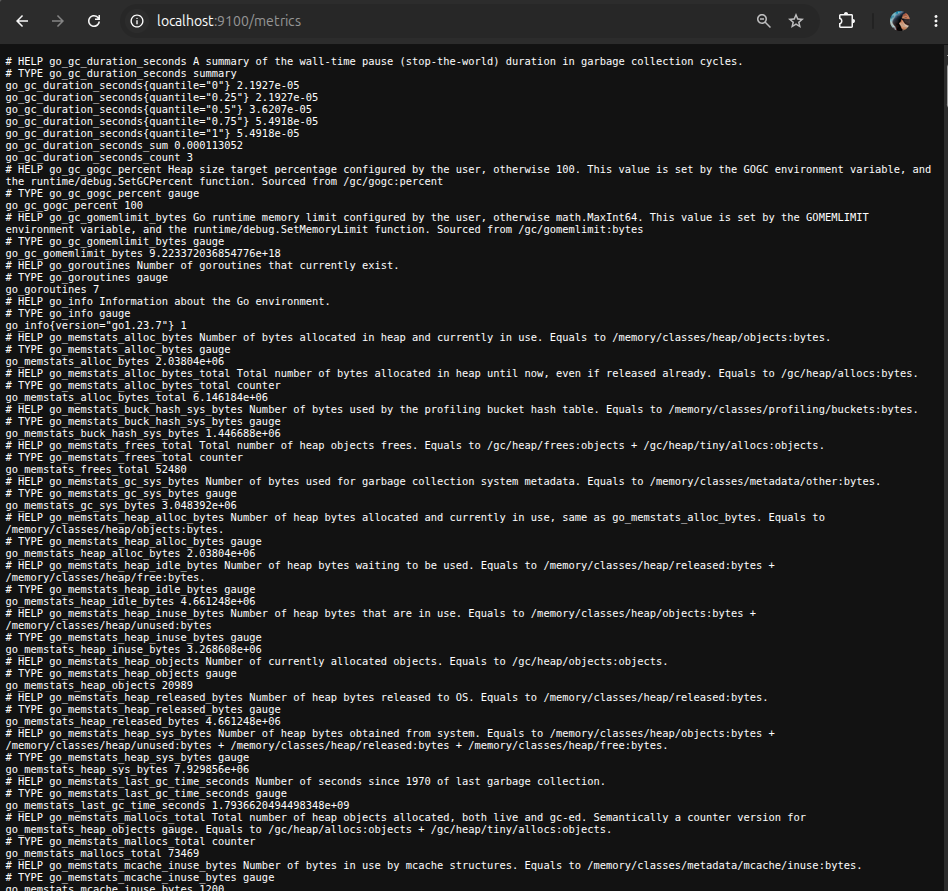

### Worker Security Group Configuration

Added an inbound security group rule to the Worker EC2 instance to allow TCP traffic on port 9100 from the Master node (`172.31.33.247/32`). This enables Prometheus on the Master to scrape Node Exporter metrics from the Worker without exposing the port to the public internet.

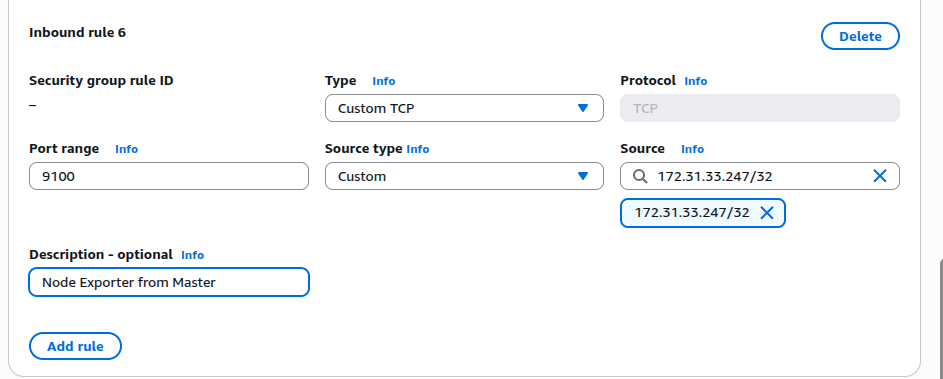

Verification: Tested connectivity from the Master using `curl`. The Worker returned HTTP 200 OK, confirming successful metrics access.

```bash
curl --connect-timeout 5 -s -o /dev/null \
-w "HTTP Status: %{http_code}\n" \
http://172.31.35.160:9100/metrics
```

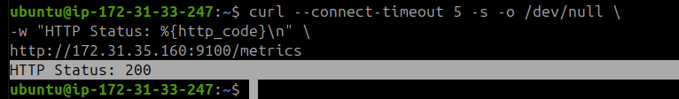

## 4. Deploy Prometheus

### Create prometheus-config.yaml

```bash
cat <<'EOF' > prometheus-config.yaml
apiVersion: v1
kind: ConfigMap
metadata:
  name: prometheus-config
  namespace: monitoring
data:
  prometheus.yml: |
    global:
      scrape_interval: 15s

    scrape_configs:
      - job_name: 'prometheus'
        static_configs:
          - targets: ['localhost:9090']

      - job_name: 'node-exporter'
        static_configs:
          - targets:
              - '172.31.33.247:9100'
              - '172.31.35.160:9100'
EOF
```

### Create prometheus-deployment.yaml

```bash
cat <<'EOF' > prometheus-deployment.yaml
apiVersion: apps/v1
kind: Deployment
metadata:
  name: prometheus
  namespace: monitoring
spec:
  replicas: 1
  selector:
    matchLabels:
      app: prometheus
  template:
    metadata:
      labels:
        app: prometheus
    spec:
      tolerations:
        - key: node-role.kubernetes.io/control-plane
          operator: Exists
          effect: NoSchedule

      containers:
        - name: prometheus
          image: prom/prometheus:v3.5.0
          args:
            - --config.file=/etc/prometheus/prometheus.yml
            - --storage.tsdb.path=/prometheus
            - --web.enable-lifecycle
          ports:
            - containerPort: 9090
              name: web
          resources:
            requests:
              cpu: 150m
              memory: 256Mi
            limits:
              cpu: 300m
              memory: 384Mi
          volumeMounts:
            - name: config
              mountPath: /etc/prometheus
            - name: data
              mountPath: /prometheus

      volumes:
        - name: config
          configMap:
            name: prometheus-config
        - name: data
          emptyDir: {}
EOF
```

### Create prometheus-service.yaml

```bash
cat <<'EOF' > prometheus-service.yaml
apiVersion: v1
kind: Service
metadata:
  name: prometheus
  namespace: monitoring
spec:
  type: ClusterIP
  selector:
    app: prometheus
  ports:
    - name: web
      port: 9090
      targetPort: 9090
      protocol: TCP
EOF
```

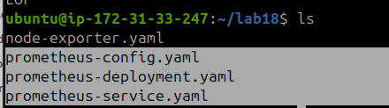

### Apply the Configurations

```bash
kubectl apply -f prometheus-config.yaml
kubectl apply -f prometheus-deployment.yaml
kubectl apply -f prometheus-service.yaml
```

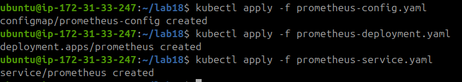

### Verify Prometheus

```bash
kubectl rollout status deployment/prometheus -n monitoring --timeout=180s

kubectl get pods -n monitoring -o wide

kubectl get svc -n monitoring
```

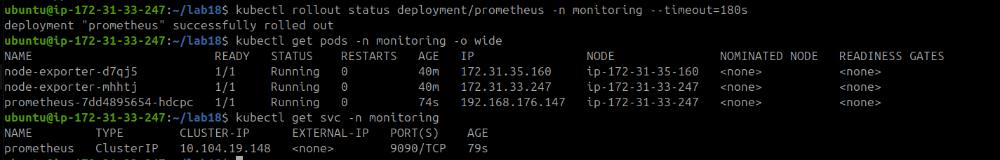

Port-forward Prometheus:

```bash
kubectl port-forward -n monitoring svc/prometheus 9090:9090
```

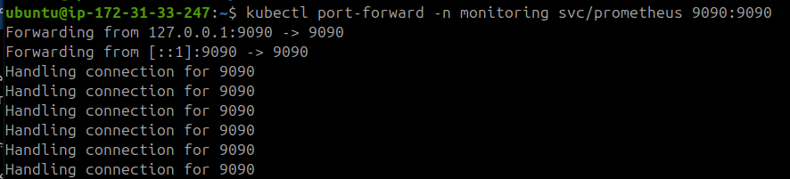

Open the Prometheus targets page:

```text
http://localhost:9090/targets
```

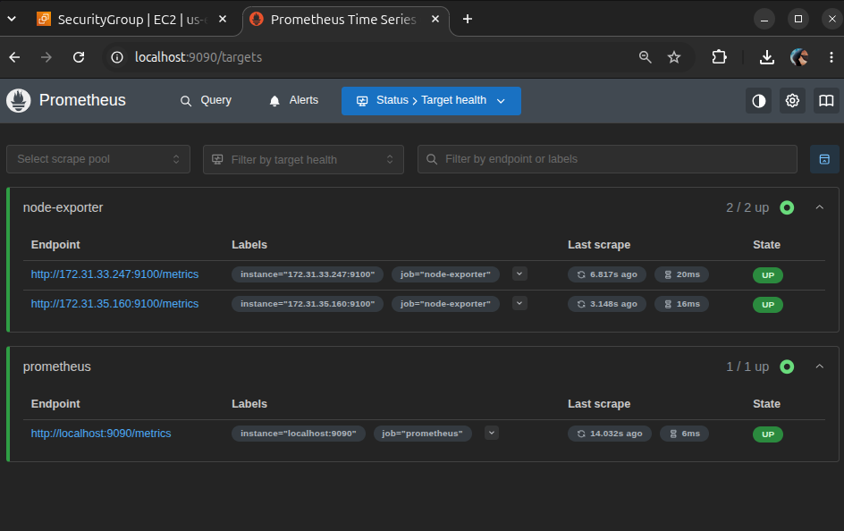

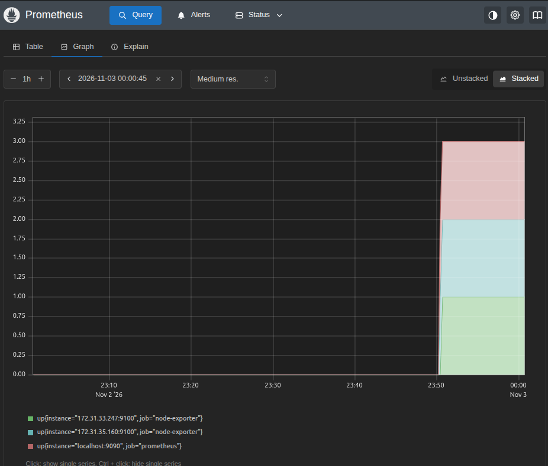

Check memory metrics:

```promql
node_memory_MemAvailable_bytes
```

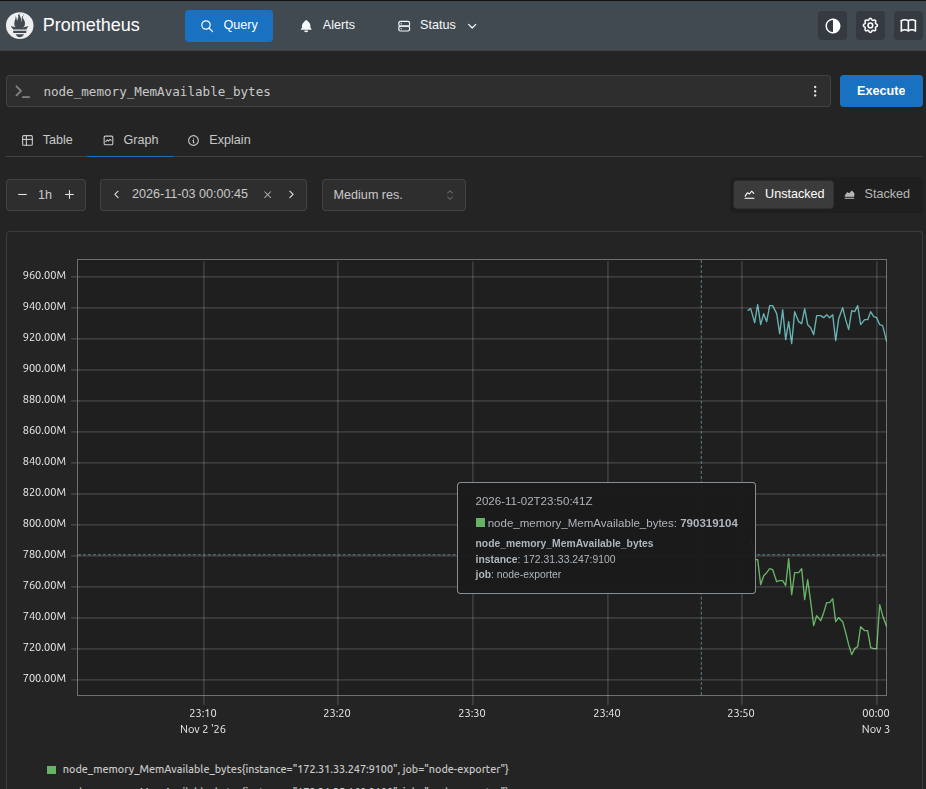

## 5. Deploy Alertmanager

### Create alertmanager-deployment.yaml

```bash
cat <<'EOF' > alertmanager-deployment.yaml
apiVersion: apps/v1
kind: Deployment
metadata:
  name: alertmanager
  namespace: monitoring
spec:
  replicas: 1
  selector:
    matchLabels:
      app: alertmanager
  template:
    metadata:
      labels:
        app: alertmanager
    spec:
      tolerations:
        - key: node-role.kubernetes.io/control-plane
          operator: Exists
          effect: NoSchedule
      containers:
        - name: alertmanager
          image: prom/alertmanager:v0.28.1
          ports:
            - name: web
              containerPort: 9093
          resources:
            requests:
              cpu: 50m
              memory: 64Mi
            limits:
              cpu: 150m
              memory: 128Mi
EOF
```

### Create alertmanager-service.yaml

```bash
cat <<'EOF' > alertmanager-service.yaml
apiVersion: v1
kind: Service
metadata:
  name: alertmanager
  namespace: monitoring
spec:
  type: ClusterIP
  selector:
    app: alertmanager
  ports:
    - name: web
      port: 9093
      targetPort: 9093
      protocol: TCP
EOF
```

### Apply the Configurations

```bash
kubectl apply -f alertmanager-deployment.yaml
kubectl apply -f alertmanager-service.yaml

kubectl rollout status deployment/alertmanager -n monitoring --timeout=180s
```

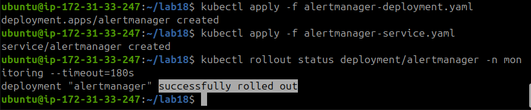

Check the pods:

```bash
kubectl get pods -n monitoring -o wide
```

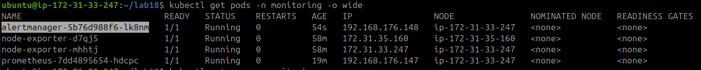

Check the services:

```bash
kubectl get svc -n monitoring
```

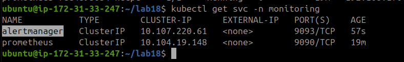

## 6. Deploy Grafana

### Create grafana-deployment.yaml

```bash
cat <<'EOF' > grafana-deployment.yaml
apiVersion: apps/v1
kind: Deployment
metadata:
  name: grafana
  namespace: monitoring
spec:
  replicas: 1
  selector:
    matchLabels:
      app: grafana
  template:
    metadata:
      labels:
        app: grafana
    spec:
      tolerations:
        - key: node-role.kubernetes.io/control-plane
          operator: Exists
          effect: NoSchedule
      containers:
        - name: grafana
          image: grafana/grafana:11.6.0
          ports:
            - name: web
              containerPort: 3000
          resources:
            requests:
              cpu: 100m
              memory: 128Mi
            limits:
              cpu: 250m
              memory: 256Mi
EOF
```

### Create grafana-service.yaml

```bash
cat <<'EOF' > grafana-service.yaml
apiVersion: v1
kind: Service
metadata:
  name: grafana
  namespace: monitoring
spec:
  type: ClusterIP
  selector:
    app: grafana
  ports:
    - name: web
      port: 3000
      targetPort: 3000
      protocol: TCP
EOF
```

### Apply the Configurations

```bash
kubectl apply -f grafana-deployment.yaml
kubectl apply -f grafana-service.yaml

kubectl rollout status deployment/grafana -n monitoring --timeout=180s
```

### Increase EBS Volume Size

I had a resource limitation, so I modified the EBS volume size on the Master node from 8 GB to 20 GB.

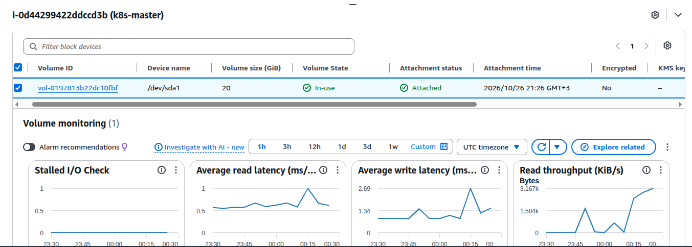

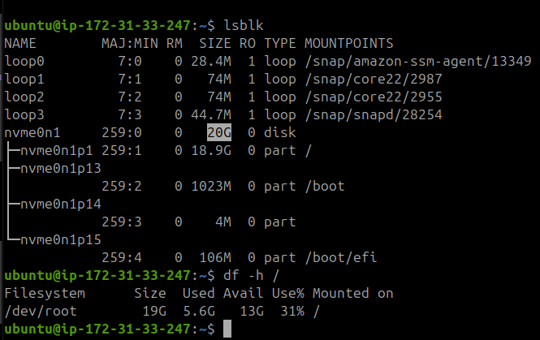

### Verify Monitoring Resources

```bash
kubectl get pods -n monitoring -o wide
kubectl get svc -n monitoring
```

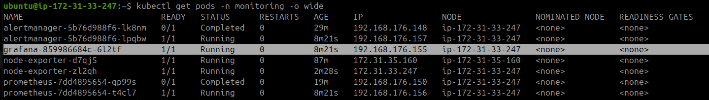

```bash
kubectl get deployments -n monitoring

kubectl get svc -n monitoring
```

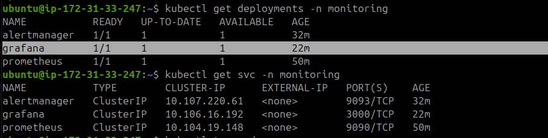

### Access Grafana

Port-forward on the Master:

```bash
kubectl port-forward -n monitoring svc/grafana 3000:3000
```

Add Prometheus as a data source in Grafana, then import the Node Exporter Full dashboard (ID: **1860**).


## 7. Configure Email Notifications

### Create the Secret for Sending Alerts by Email

```bash
kubectl create secret generic alertmanager-email \
  -n monitoring \
  --from-literal=smtp-username='hagershohieb0@gmail.com' \
  --from-literal=smtp-password='pass^^'
```

Verify the Secret:

```bash
kubectl get secret alertmanager-email -n monitoring
```

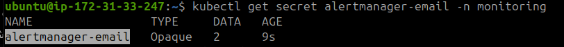

### Create alertmanager-config.yaml

```bash
cat > alertmanager-config.yaml <<'EOF'
apiVersion: v1
kind: ConfigMap
metadata:
  name: alertmanager-config
  namespace: monitoring
data:
  alertmanager.yml: |
    global:
      smtp_smarthost: 'smtp.gmail.com:587'
      smtp_from: 'hagershohieb0@gmail.com'
      smtp_auth_username: 'hagershohieb0@gmail.com'
      smtp_auth_password_file: '/etc/alertmanager/secrets/smtp-password'
      smtp_require_tls: true

    route:
      receiver: 'email-notifications'
      group_wait: 10s
      group_interval: 1m
      repeat_interval: 1h

    receivers:
      - name: 'email-notifications'
        email_configs:
          - to: 'hagershohieb0@gmail.com'
            send_resolved: true
EOF
```

Apply the Alertmanager configuration:

```bash
kubectl apply -f alertmanager-config.yaml
```

## 8. Configure Prometheus Alert Rules

Update `prometheus-config.yaml`:

```bash
cat > prometheus-config.yaml <<'EOF'
apiVersion: v1
kind: ConfigMap
metadata:
  name: prometheus-config
  namespace: monitoring
data:
  prometheus.yml: |
    global:
      scrape_interval: 15s

    alerting:
      alertmanagers:
        - static_configs:
            - targets:
                - 'alertmanager:9093'

    rule_files:
      - /etc/prometheus/alert.rules

    scrape_configs:
      - job_name: 'prometheus'
        static_configs:
          - targets: ['localhost:9090']

      - job_name: 'node-exporter'
        static_configs:
          - targets:
              - '172.31.33.247:9100'
              - '172.31.35.160:9100'

  alert.rules: |
    groups:
      - name: test-alerts
        rules:
          - alert: TestAlert
            expr: vector(1)
            for: 10s
            labels:
              severity: warning
            annotations:
              summary: "Test Alert"
              description: "This is a test alert from Kubernetes Prometheus."

      - name: infrastructure-alerts
        rules:
          - alert: HighCPUUsage
            expr: |
              (1 - avg by (instance) (
                rate(node_cpu_seconds_total{mode="idle"}[5m])
              )) * 100 > 80
            for: 2m
            labels:
              severity: warning
            annotations:
              summary: "High CPU usage"
              description: "CPU usage is above 80% on {{ $labels.instance }}."

          - alert: LowDiskSpace
            expr: |
              (
                node_filesystem_avail_bytes{mountpoint="/", fstype!=""}
                /
                node_filesystem_size_bytes{mountpoint="/", fstype!=""}
              ) * 100 < 15
            for: 2m
            labels:
              severity: critical
            annotations:
              summary: "Low disk space"
              description: "Root filesystem has less than 15% free space on {{ $labels.instance }}."
EOF
```

Apply the updated Prometheus configuration:

```bash
kubectl apply -f prometheus-config.yaml
```

Restart Prometheus:

```bash
kubectl rollout restart deployment/prometheus -n monitoring

kubectl rollout status deployment/prometheus -n monitoring
```

Open the alerts page:

```text
http://localhost:9090/alerts
```

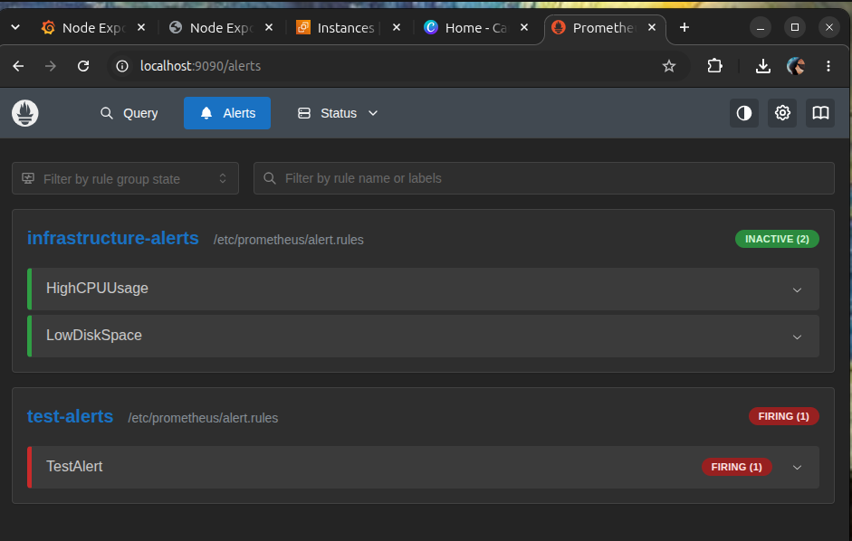

### Verify Email Notification

The test alert was triggered and the email notification was received.

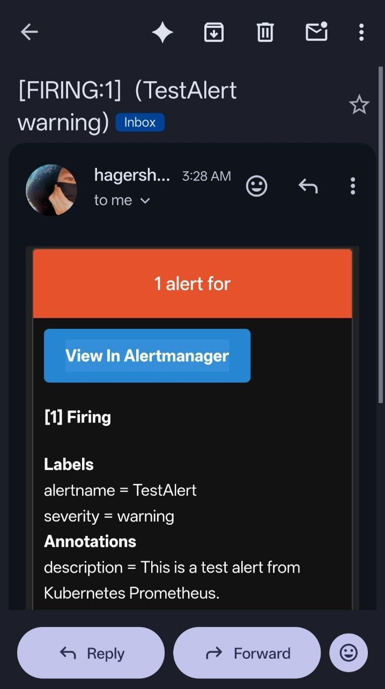

### Remove the Test Alert

Remove the following test alert group from `prometheus-config.yaml`:

```yaml
- name: test-alerts
  rules:
    - alert: TestAlert
      expr: vector(1)
      for: 10s
      labels:
        severity: warning
      annotations:
        summary: "Test Alert"
        description: "This is a test alert from Kubernetes Prometheus."
```

Reapply the updated configuration and ensure everything is OK.


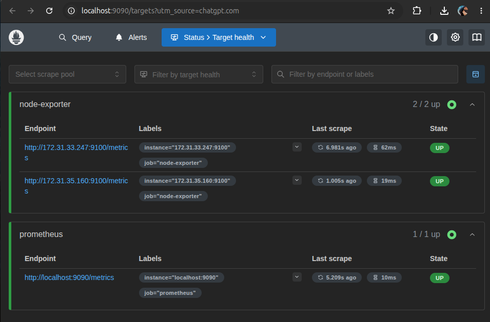

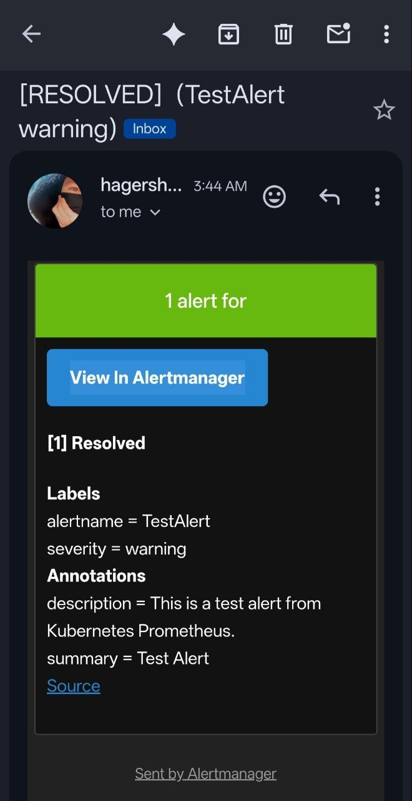

## Conclusion

In this lab, I successfully deployed a monitoring and alerting stack on my Kubernetes cluster. Node Exporter collects metrics from both nodes, Prometheus scrapes and evaluates the metrics, Grafana visualizes them, and Alertmanager sends email notifications when alerts are triggered. I also tested the email notification flow and verified the resolved alert notification.