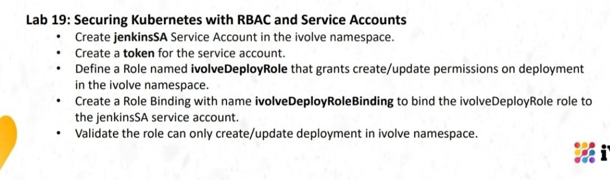
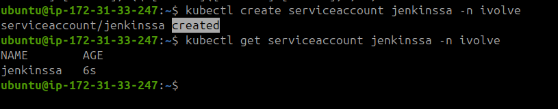
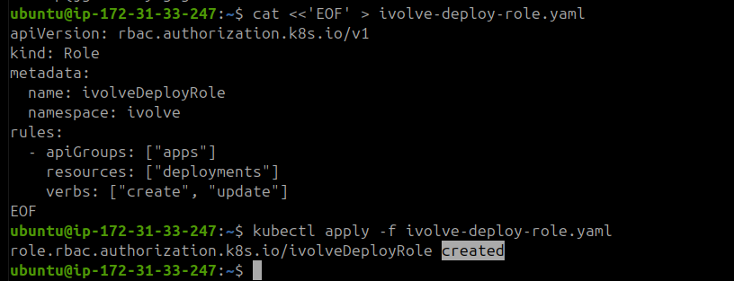
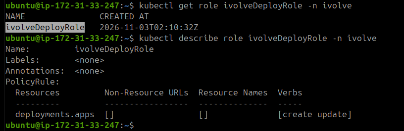
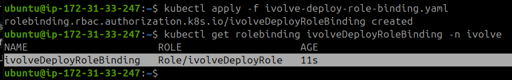
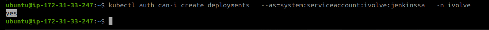
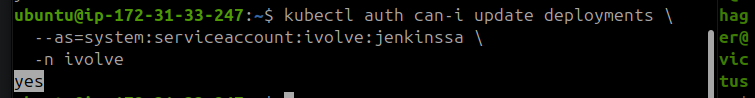
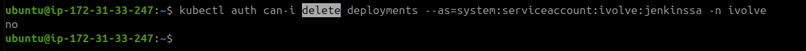
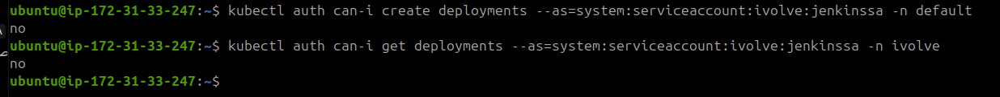
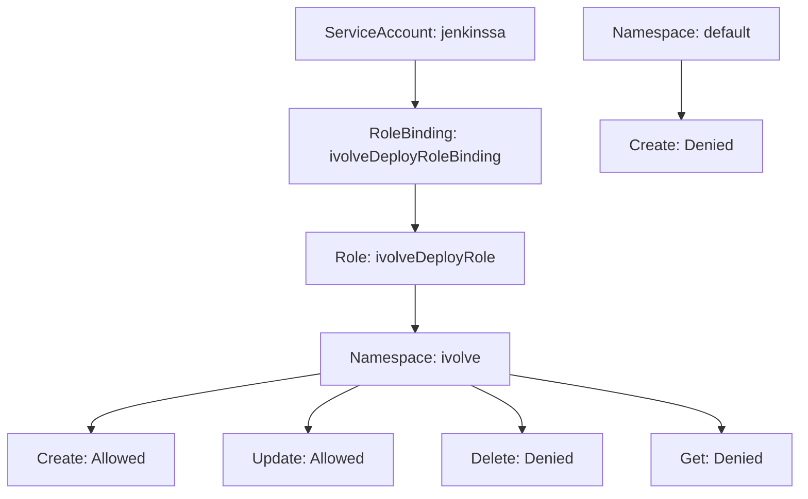

# Lab 19 – Securing Kubernetes with RBAC and Service Accounts



## 1. Create ServiceAccount

Create a ServiceAccount named `jenkinssa` in the `ivolve` namespace.

**Note:** Kubernetes resource names must use lowercase letters. Therefore, `jenkinssa` is used instead of `jenkinsSA`.

```bash
kubectl create serviceaccount jenkinssa -n ivolve
```



## 2. Generate ServiceAccount Token

Generate an authentication token for the ServiceAccount.

```bash
kubectl create token jenkinssa -n ivolve
```

**Note:** The token allows Jenkins to authenticate with the Kubernetes API using the ServiceAccount identity. Keep the token secure and do not commit it to GitHub.

## 3. Create Role

Create a Role named `ivolveDeployRole` in the `ivolve` namespace.

**File: `ivolve-deploy-role.yaml`**

```bash
cat <<'EOF' > ivolve-deploy-role.yaml
apiVersion: rbac.authorization.k8s.io/v1
kind: Role
metadata:
  name: ivolveDeployRole
  namespace: ivolve
rules:
  - apiGroups: ["apps"]
    resources: ["deployments"]
    verbs: ["create", "update"]
EOF
```

**Note:** The Role defines the permissions granted to a user or ServiceAccount. In this case, it allows creating and updating Deployments only within the `ivolve` namespace.

### Apply the Role

```bash
kubectl apply -f ivolve-deploy-role.yaml
```



### Verify the Role

```bash
kubectl get role ivolveDeployRole -n ivolve

kubectl describe role ivolveDeployRole -n ivolve
```



## 4. Create RoleBinding

Create a RoleBinding named `ivolveDeployRoleBinding` to connect the `ivolveDeployRole` Role with the `jenkinssa` ServiceAccount.

**File: `ivolve-deploy-role-binding.yaml`**

```bash
cat <<'EOF' > ivolve-deploy-role-binding.yaml
apiVersion: rbac.authorization.k8s.io/v1
kind: RoleBinding
metadata:
  name: ivolveDeployRoleBinding
  namespace: ivolve
subjects:
  - kind: ServiceAccount
    name: jenkinssa
    namespace: ivolve
roleRef:
  kind: Role
  name: ivolveDeployRole
  apiGroup: rbac.authorization.k8s.io
EOF
```

**Note:** The `subjects` section identifies who receives the permissions, while `roleRef` specifies the Role being assigned.

### Apply the RoleBinding

```bash
kubectl apply -f ivolve-deploy-role-binding.yaml
```



## 5. Validate RBAC Permissions

Use `kubectl auth can-i` to verify the permissions assigned to the ServiceAccount.

The `--as` option impersonates the ServiceAccount to check what actions it is allowed to perform.

### 5.1 Check Create Permission

Verify that the ServiceAccount can create Deployments in the `ivolve` namespace.

```bash
kubectl auth can-i create deployments \
  --as=system:serviceaccount:ivolve:jenkinssa -n ivolve
```

**Expected result:** `yes`



### 5.2 Check Update Permission

Verify that the ServiceAccount can update Deployments in the `ivolve` namespace.

```bash
kubectl auth can-i update deployments \
  --as=system:serviceaccount:ivolve:jenkinssa \
  -n ivolve
```

**Expected result:** `yes`



### 5.3 Check Delete Permission

Verify that the ServiceAccount cannot delete Deployments.

```bash
kubectl auth can-i delete deployments --as=system:serviceaccount:ivolve:jenkinssa -n ivolve
```

**Expected result:** `no`



### 5.4 Check Namespace Isolation and Read Permissions

Verify that the ServiceAccount cannot create Deployments in the `default` namespace and cannot get Deployments in the `ivolve` namespace.

```bash
kubectl auth can-i create deployments --as=system:serviceaccount:ivolve:jenkinssa -n default

kubectl auth can-i get deployments --as=system:serviceaccount:ivolve:jenkinssa -n ivolve
```

**Expected result:** `no` for both commands.



## 6. RBAC Validation Summary

The following table summarizes the permission checks performed for the `jenkinssa` ServiceAccount.

| Permission Check  | Expected Result| Actual Result| Status |
|---|---|---|---|
| Create deployment in `ivolve` | `yes` | `yes` | 🟢 **PASSED** |
| Update deployment in `ivolve` | `yes` | `yes` | 🟢 **PASSED** |
| Delete deployment in `ivolve` | no | no | 🟢 **PASSED** |
| Create deployment in `default` | no | no | 🟢 **PASSED** |
| Get deployments in `ivolve` | no | no | 🟢 **PASSED** |

<details>
<summary>RBAC Permission Flow</summary>



</details>

**Final Result:** All permission checks returned the expected results. The ServiceAccount has only the required Create and Update permissions for Deployments in the `ivolve` namespace, confirming that RBAC is configured correctly.