# Kubernetes Cluster Setup on AWS EC2 Using kubeadm

This lab demonstrates how to build a Kubernetes cluster on AWS EC2 using `kubeadm`, with one control-plane node and one worker node. It covers containerd, Kubernetes components, Calico networking, joining the worker, and deploying an NGINX application.


## Architecture

- **Cloud Provider:** AWS EC2
- **Operating System:** Ubuntu
- **Container Runtime:** containerd
- **Kubernetes Installation Tool:** kubeadm
- **Networking Plugin:** Calico v3.33.0
- **Nodes:** 1 Control Plane + 1 Worker
- **Application:** NGINX with two replicas
- **Service Type:** NodePort

---

## Phase 1 — Create the EC2 Instances

### 1.1 Create the Master Node

Create an EC2 instance for the Kubernetes control plane.

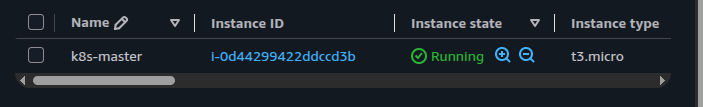

### 1.2 Create the Worker Node

Create a second EC2 instance to run application workloads.

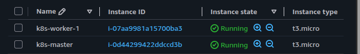

Make sure both instances are in the appropriate network and can communicate with each other.

---

## Phase 2 — Connect to the Instances

### 2.1 Connect to the Master Node

Set the private key permissions and connect using SSH.

```bash
chmod 400 k8s-lab-key.pem
ssh -i k8s-lab-key.pem ubuntu@<MASTER_PUBLIC_IP>
```

Replace `<MASTER_PUBLIC_IP>` with the current public IP address of the Master instance.

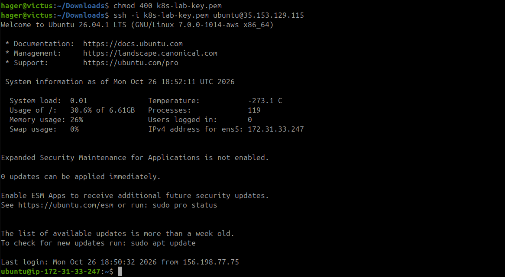

Check the hostname, network addresses, memory, and available disk space.

```bash
hostname
ip -4 addr
free -h
df -h /
```

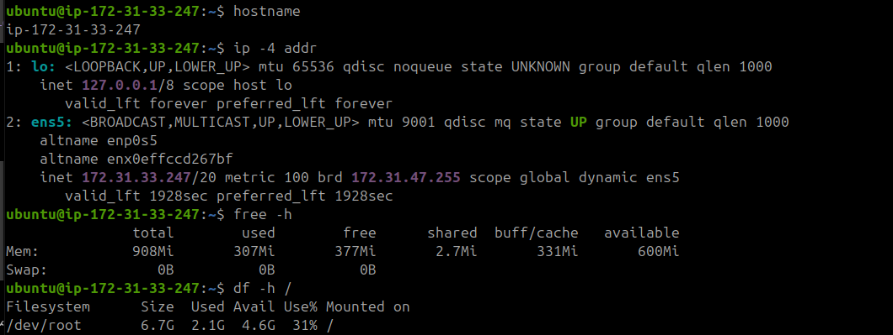

### 2.2 Connect to the Worker Node

```bash
ssh -i ~/Downloads/k8s-lab-key.pem ubuntu@<WORKER_PUBLIC_IP>
```

Replace `<WORKER_PUBLIC_IP>` with the current public IP address of the Worker instance.

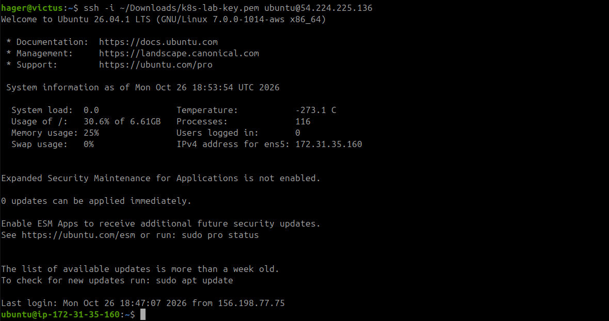

Check the Worker node's system resources.

```bash
hostname
ip -4 addr
free -h
df -h /
```

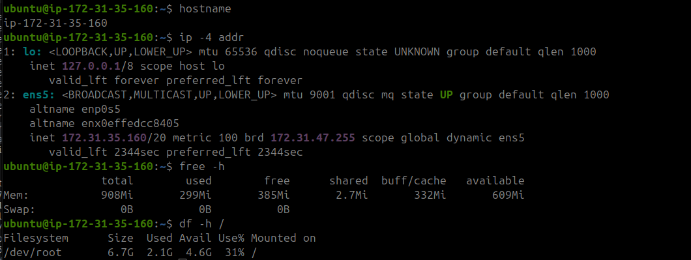

> **Note:** If an EC2 instance is stopped and started, its public IPv4 address may change. Use the current address when reconnecting. The private IP addresses are used for communication within the cluster.

---

## Phase 3 — Prepare Both Nodes

Run the following commands on **both the Master and Worker nodes**.

### 3.1 Update the System and Install Dependencies

```bash
sudo apt update
sudo apt upgrade -y

sudo apt install -y \
  curl \
  ca-certificates \
  gnupg \
  apt-transport-https
```

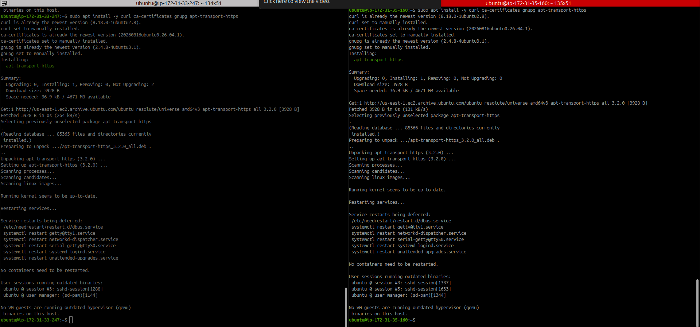

### 3.2 Verify IP Forwarding and Install containerd

Check IPv4 forwarding:

```bash
sysctl net.ipv4.ip_forward
```

The expected value is:

```text
net.ipv4.ip_forward = 1
```

Install containerd:

```bash
sudo apt install -y containerd
```

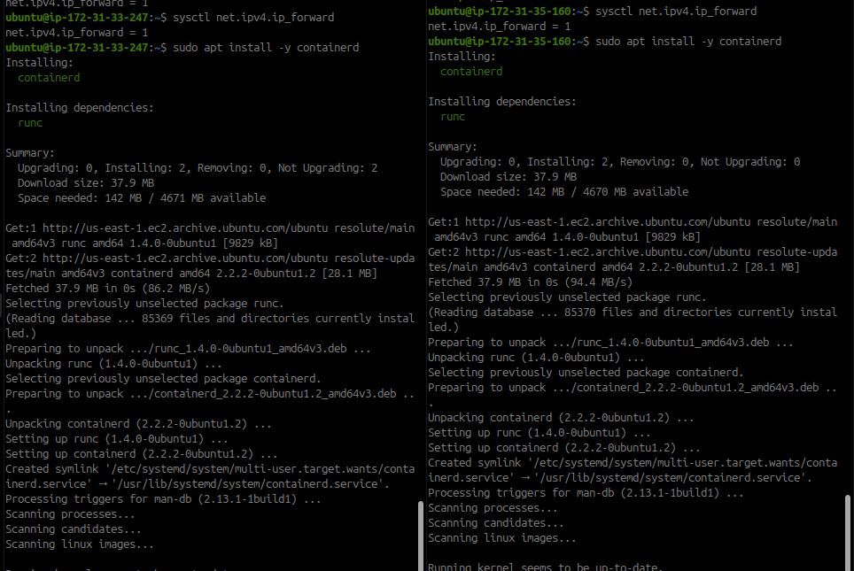

Enable and start the container runtime:

```bash
sudo systemctl enable --now containerd
sudo systemctl restart containerd
sudo systemctl status containerd --no-pager
```

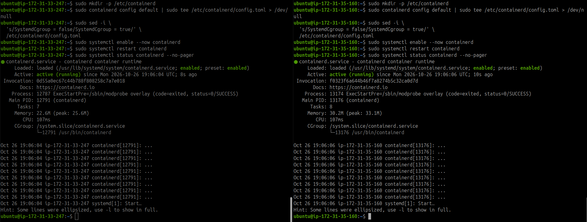

### 3.3 Install kubeadm, kubelet, and kubectl

Add the Kubernetes v1.35 package repository:

```bash
sudo mkdir -p -m 755 /etc/apt/keyrings

curl -fsSL \
  https://pkgs.k8s.io/core:/stable:/v1.35/deb/Release.key \
  | sudo gpg --dearmor --yes \
      -o /etc/apt/keyrings/kubernetes-apt-keyring.gpg

echo 'deb [signed-by=/etc/apt/keyrings/kubernetes-apt-keyring.gpg] https://pkgs.k8s.io/core:/stable:/v1.35/deb/ /' \
  | sudo tee /etc/apt/sources.list.d/kubernetes.list

sudo apt update

sudo apt install -y kubelet kubeadm kubectl

sudo apt-mark hold kubelet kubeadm kubectl

sudo systemctl enable kubelet
```

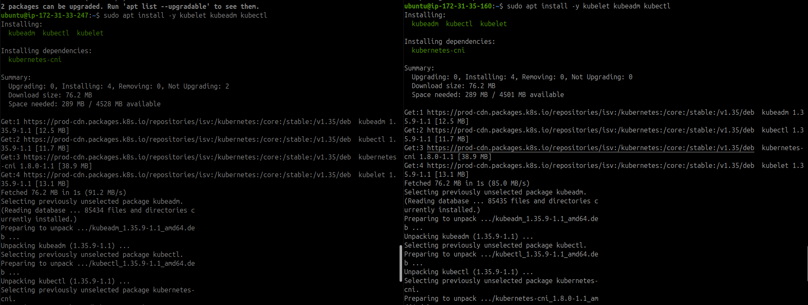

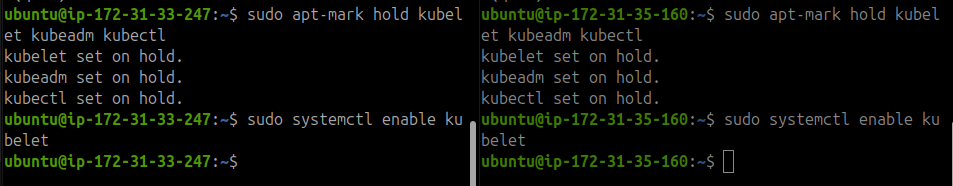

Verify the installed versions:

```bash
kubeadm version
kubelet --version
kubectl version --client
```

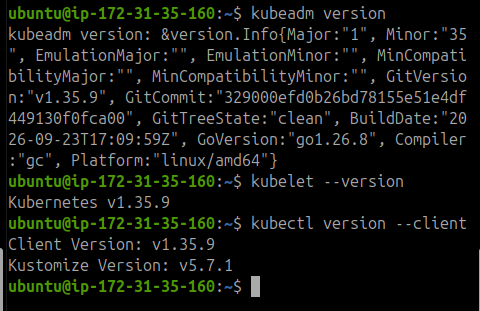

---

## Phase 4 — Initialize the Control Plane

Perform this phase on the **Master node only**.

### 4.1 Identify the Master Private IP

```bash
hostname -I
```

Use the private IP address assigned to the Master instance.

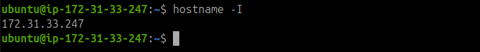

### 4.2 Initialize the Kubernetes Cluster

Initialize the control plane using the Master private IP and the Pod network CIDR:

```bash
sudo kubeadm init \
  --apiserver-advertise-address=<MASTER_PRIVATE_IP> \
  --pod-network-cidr=192.168.0.0/16
```

Replace `<MASTER_PRIVATE_IP>` with the actual private IP address of the Master instance.

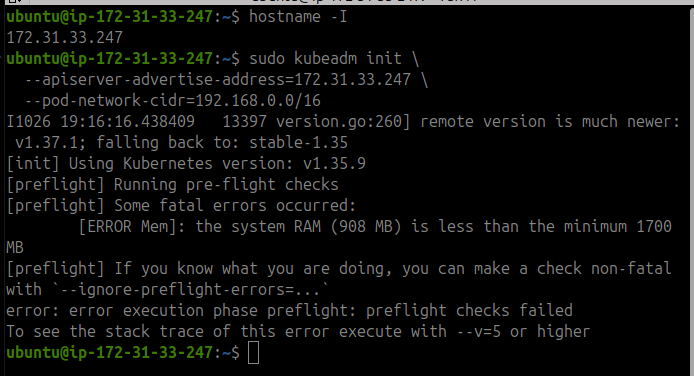

> **Resource note:** If the instance does not have sufficient resources, stop it and change its instance type to one suitable for the lab. Then reconnect using its current public IP and verify the private IP before continuing. Do not run `kubeadm init` again on an already initialized cluster unless you intentionally reset it.

### 4.3 Configure kubectl on the Master

Set up the kubeconfig file for the current user:

```bash
mkdir -p "$HOME/.kube"

sudo cp -i /etc/kubernetes/admin.conf "$HOME/.kube/config"

sudo chown "$(id -u):$(id -g)" "$HOME/.kube/config"
```

Verify the cluster:

```bash
kubectl get nodes -o wide
```

The Master may initially show `NotReady` until the network plugin is installed.

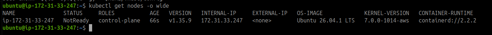

---

## Phase 5 — Install Calico Networking

Install Calico v3.33.0 as the cluster network plugin.

```bash
kubectl apply -f \
  https://raw.githubusercontent.com/projectcalico/calico/v3.33.0/manifests/calico.yaml
```

Monitor the system Pods and wait for the nodes to become ready:

```bash
kubectl get pods -n kube-system
kubectl get nodes -w
```

Press `Ctrl+C` to stop watching after the nodes become ready.

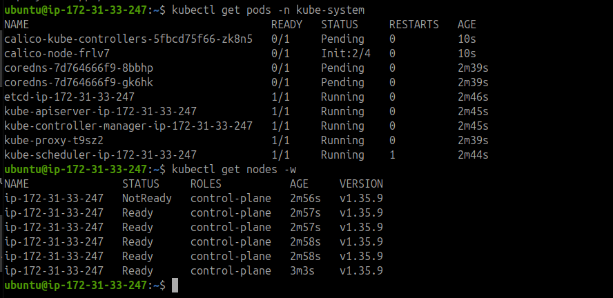

Check the system Pods:

```bash
kubectl get pods -n kube-system
```

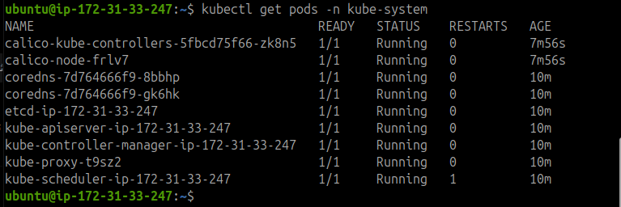

---

## Phase 6 — Configure AWS Security Groups

The Master and Worker must be able to communicate over the private network.

Attach the appropriate security group to **both EC2 instances** and configure inbound rules that allow the required cluster traffic.

| Protocol / Port | Purpose | Source |
|---|---|---|
| TCP 22 | SSH access | Restrict to your trusted IP where possible |
| TCP 6443 | Kubernetes API server | The cluster security group |
| TCP 179 | Calico BGP peering | The cluster security group |
| IP protocol 4 | Calico IP-in-IP traffic | The cluster security group |

> IP protocol 4 is **IP-in-IP**, not TCP port 4. Allow this traffic only between the cluster nodes. Additional ports may be needed depending on the Kubernetes and Calico configuration.

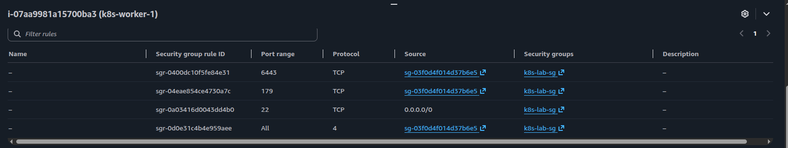

### Verify API Server Connectivity from the Worker

Run this command on the Worker:

```bash
nc -vz -w 5 <MASTER_PRIVATE_IP> 6443
```

Replace the placeholder with the Master private IP.

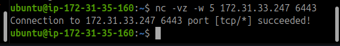

---

## Phase 7 — Join the Worker Node

Generate a fresh join command on the **Master**:

```bash
sudo kubeadm token create --print-join-command
```

Copy the generated command and run it on the **Worker** using `sudo`.

It will have a format similar to:

```bash
sudo kubeadm join <MASTER_PRIVATE_IP>:6443 \
  --token <TOKEN> \
  --discovery-token-ca-cert-hash sha256:<CA_CERTIFICATE_HASH>
```

Use the actual command generated by your cluster. Do not publish the token in a public repository.

### Verify the Cluster

Return to the Master and run:

```bash
kubectl get nodes -o wide
```

Both nodes should eventually show `Ready`.

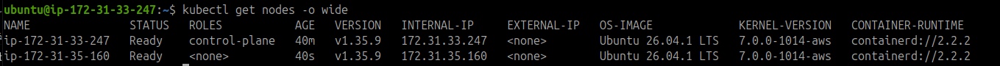

Check all Pods across namespaces:

```bash
kubectl get pods -A
```

The following command is deprecated in newer Kubernetes versions and is not required for verification:

```bash
kubectl get componentstatuses
```

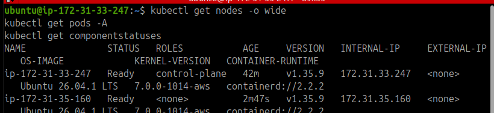

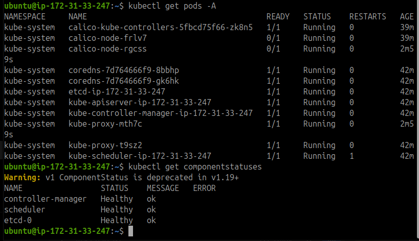

---

## Phase 8 — Deploy NGINX

Create an NGINX Deployment on the Master:

```bash
kubectl create deployment nginx --image=nginx
```

Scale the Deployment to two replicas:

```bash
kubectl scale deployment nginx --replicas=2
```

Verify the Deployment and Pods:

```bash
kubectl get deployments
kubectl get pods -o wide
```

Expected result: two NGINX Pods should be `Running` and `Ready`.

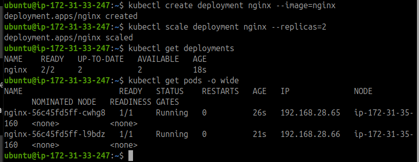

---

## Phase 9 — Expose NGINX Using NodePort

Create a NodePort Service:

```bash
kubectl expose deployment nginx --port=80 --type=NodePort
```

Verify the Service and application Pods:

```bash
kubectl get services
kubectl get pods -o wide
```

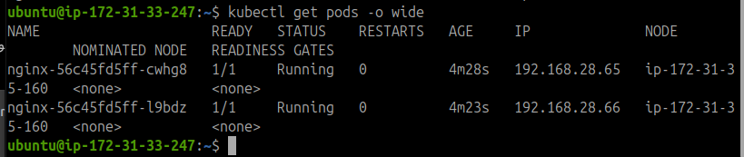

The Service output should show a mapping similar to:

```text
80:<NODE_PORT>/TCP
```

Kubernetes assigns the NodePort automatically. Use the actual port shown by `kubectl get services`.

> **Optional application test:** You can test NGINX by opening `http://<NODE_PRIVATE_IP>:<NODE_PORT>` from a network that can reach the node, provided the relevant security rules permit the traffic. Alternatively, use `kubectl port-forward` for a local test. These checks are optional for this lab's cluster-setup objective.

---

## Phase 10 — Final Verification

Run the following commands on the Master:

```bash
# Check cluster nodes
kubectl get nodes -o wide

# Check system Pods
kubectl get pods -n kube-system

# Check NGINX Deployment
kubectl get deployments

# Check application Pods and their assigned nodes
kubectl get pods -o wide

# Check Services
kubectl get services
```

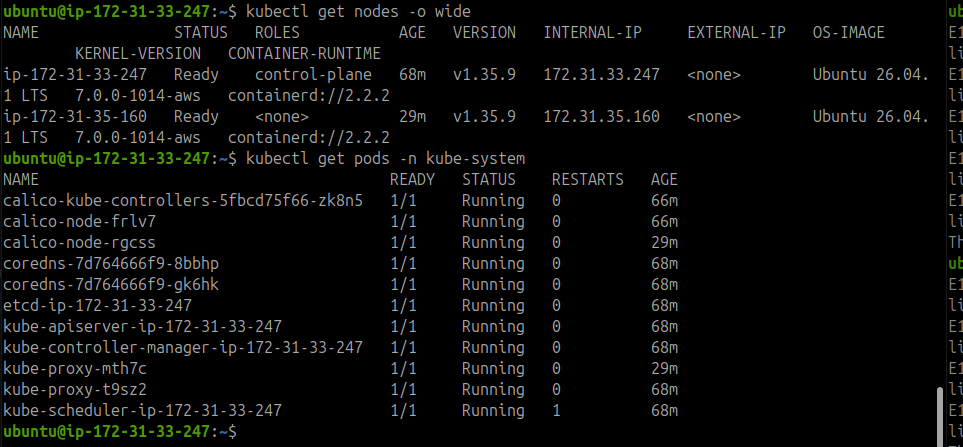

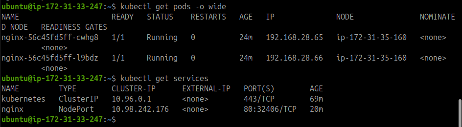

### Expected Results

- One control-plane node and one worker node are registered.
- Both nodes are `Ready`.
- Calico node Pods are `1/1 Running`.
- CoreDNS and the other essential system Pods are running.
- The NGINX Deployment has two available replicas.
- The NGINX Service is exposed using NodePort.

## Troubleshooting Notes

- **Worker cannot join:** Check the Master private IP, TCP 6443 access, and the generated join command.
- **Calico Pods are not Ready:** Inspect the Calico Pod logs and events. Check BGP connectivity on TCP 179 and IP-in-IP protocol 4 when using the default IP-in-IP networking configuration.
- **kubectl connects to localhost:8080:** Run cluster administration commands on the Master with the correct kubeconfig configured.
- **Node remains NotReady:** Check Calico, kubelet, and containerd status before changing the cluster configuration.
- **EC2 public IP changes:** Reconnect using the instance's current public IP. Continue using the private IP for node-to-node cluster communication.

## Cleanup

To avoid unnecessary AWS charges when you finish the lab:

- Stop the EC2 instances if you plan to continue later.
- Terminate the instances if you no longer need them.
- Check for remaining EBS volumes, Elastic IP addresses, and other billable resources.

