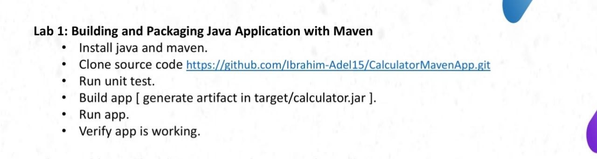
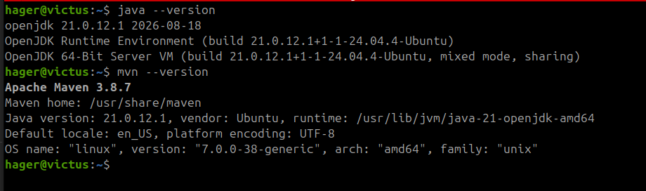
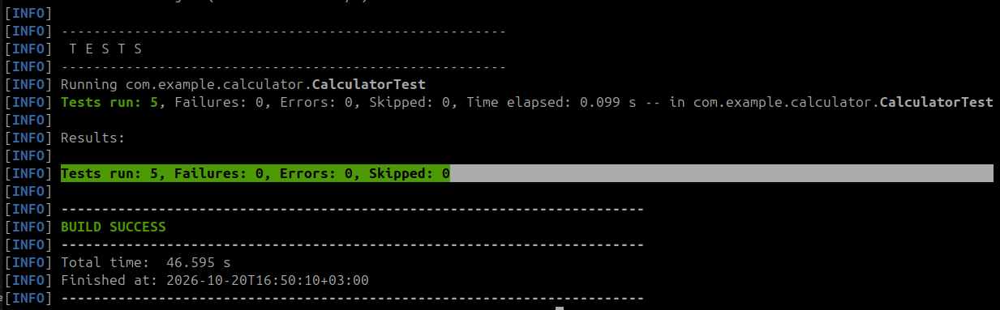
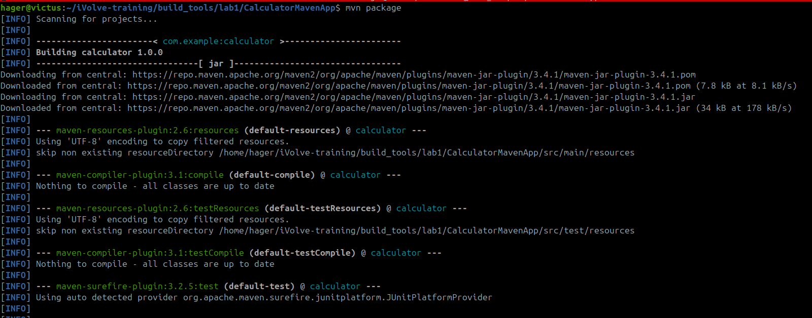
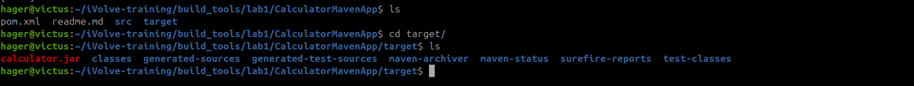
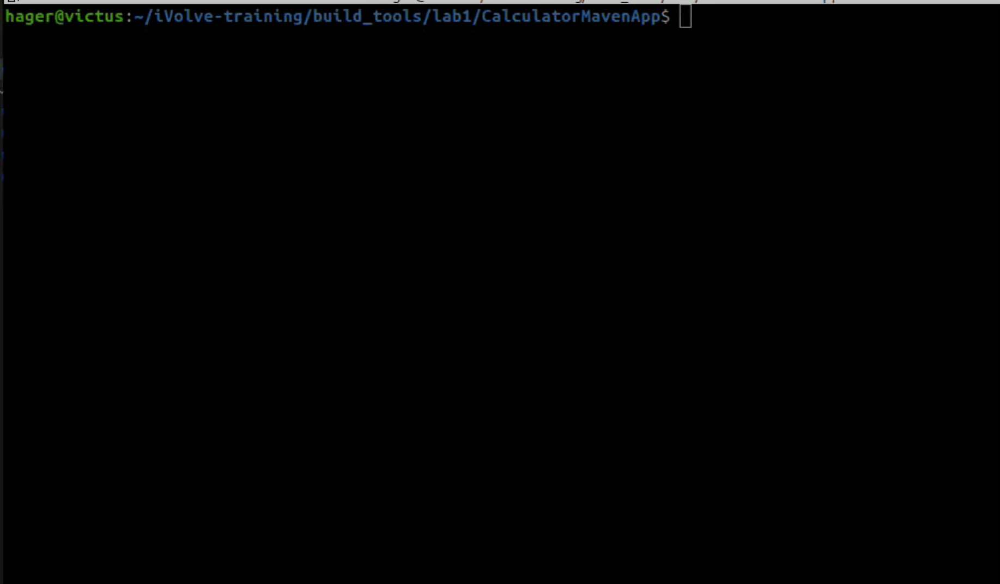

# Lab 1: Calculator Maven Application

## Overview

This lab demonstrates a simple Java calculator project managed with Maven. The project includes calculator operations and a JUnit 5 test suite.



## Prerequisites

The project requires Java 17 and Maven. Check that both are installed:

```bash
java -version
mvn -version
```



## Run the Unit Tests

From the `CalculatorMavenApp` directory, run:

```bash
mvn test
```

### Test Results

The Maven test run completed successfully:

- Test suite: `com.example.calculator.CalculatorTest`
- Tests run: 5
- Failures: 0
- Errors: 0
- Skipped: 0
- Build status: `BUILD SUCCESS`



## Build the Application

Create the executable JAR with:

```bash
mvn package
```

The build creates `target/calculator.jar`.



The generated artifact is shown below:



## Run the Application

Run the JAR from the `CalculatorMavenApp` directory:

```bash
java -jar target/calculator.jar
```

Enter two numbers when prompted. The application displays their sum, difference, product, and quotient.



## Conclusion

Successfully tested, built, and packaged the Java calculator application using Maven. All five unit tests passed, and the generated JAR file was executed successfully.

This lab provided hands-on experience with the basic Maven workflow, from testing source code to packaging and running a Java application.