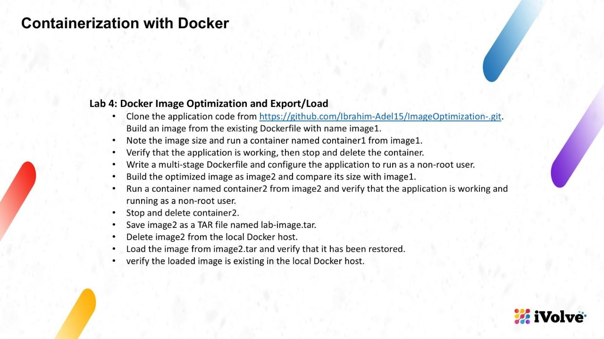
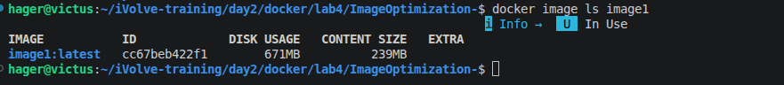
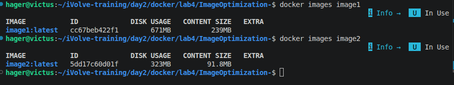
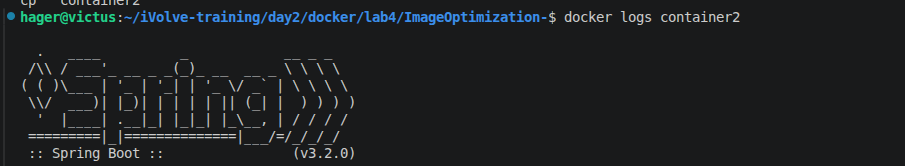
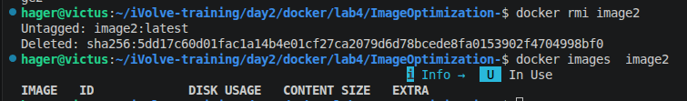
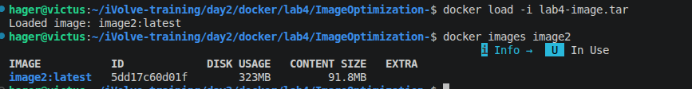

# Lab 4: Docker Image Optimization and Export/Load



## 1. Before Optimization

The original Dockerfile uses Maven and JDK to build and run the Spring Boot application in the same image.

### Build the original image

```bash
docker build -t image1 .
```

### Check the image size

```bash
docker images image1
```

**Image size before optimization:**

| Image | Disk Usage | Content Size |
|---|---:|---:|
| `image1:latest` | 671 MB | 239 MB |



### Run the container

```bash
docker run -d --name container1 -p 8080:8080 image1
```

Check the running container and application logs:

```bash
docker ps
docker logs container1
```


### Verify the application

Open the application in your browser:

[http://localhost:8080/](http://localhost:8080/)


### Stop and remove the container

```bash
docker stop container1
docker rm container1
```

These commands stop the container and remove it while keeping the original image.

---

## 2. Multi-Stage Dockerfile Optimization

A multi-stage Dockerfile separates the build environment from the runtime environment.

- **Builder stage:** Uses Maven and JDK to build the application.
- **Runtime stage:** Uses a lightweight JRE image and copies only the packaged JAR.
- **Non-root user:** Runs the application as `appuser` instead of root.

The optimized Dockerfile is saved as `Dockerfile.optimized`.

### Build the optimized image

```bash
docker build -f Dockerfile.optimized -t image2 .
```

---

## 3. Compare Image Sizes

Check the original and optimized image sizes:

```bash
docker images image1
docker images image2
```

### Results

| Image | Disk Usage | Content Size |
|---|---:|---:|
| `image1:latest` | 671 MB | 239 MB |
| `image2:latest` | 323 MB | 91.8 MB |



The optimized image has a smaller footprint because the final image does not include the Maven build environment and the full JDK.

### Size reduction

Based on the reported disk usage:

The optimized image is approximately **51.9% smaller** by disk usage.

Based on content size, the reduction is approximately **61.6%**.

---

## 4. Run and Verify the Optimized Image

Run a container from `image2`:

```bash
docker run -d --name container2 -p 8080:8080 image2
```

Check the container status and logs:

```bash
docker ps
docker logs container2
```



### Verify the application

Open the application in your browser:

[http://localhost:8080/](http://localhost:8080/)


### Verify the non-root user

```bash
docker exec container2 whoami
```

The expected output is:

```text
appuser
```

This confirms that the application container is running as a non-root user.


### Stop and remove the optimized container

```bash
docker stop container2
docker rm container2
```

---

## 5. Export the Optimized Image

Save `image2` as a TAR archive:

```bash
docker save -o lab4-image.tar image2
```

Verify that the archive exists:

```bash
ls -lh lab4-image.tar
```

The TAR file contains the Docker image and its layers, allowing the image to be transferred or restored without rebuilding it.

---

## 6. Delete the Image from the Local Docker Host

Remove the optimized image:

```bash
docker rmi image2
```

Verify that it is no longer listed:

```bash
docker images image2
```



---

## 7. Load and Verify the Image

Restore the image from the saved TAR archive:

```bash
docker load -i lab4-image.tar
```

Verify that the image has been restored:

```bash
docker images image2
```

The output should show `image2:latest` in the local Docker image list.



---

## Conclusion

In this lab, I:

- Built and tested the original Docker image.
- Created a multi-stage Dockerfile to optimize the image.
- Configured the application to run as a non-root user.
- Compared the original and optimized image sizes.
- Exported the optimized image to a TAR archive.
- Removed the local image and restored it using `docker load`.

**Result:** The optimized image reduced the reported disk usage from 671 MB to 323 MB, approximately a 51.9% reduction, while retaining the application and its non-root runtime configuration.