# Lab 7: Multi-Network Microservices, Volumes, and Bind Mounts

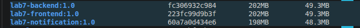

## 1. Create Docker Networks

Create two separate bridge networks with different subnets to control communication between the microservices.

### Create the frontend-backend network

```bash
docker network create \
  --driver bridge \
  --subnet 172.30.1.0/24 \
  frontend-backend
```

### Create the backend-notification network

```bash
docker network create \
  --driver bridge \
  --subnet 172.30.2.0/24 \
  backend-notification
```

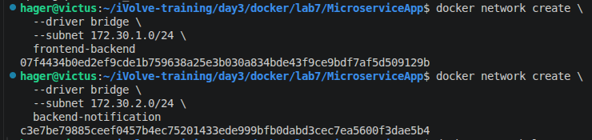

The two networks allow the Backend to communicate with both the Frontend and Notification services, while the Frontend and Notification services are not directly connected to each other.

## 2. Create Docker Volumes

Create two Docker volumes to persist application logs.

```bash
docker volume create backend-logs
docker volume create notification-logs
```

Verify the created volumes:

```bash
docker volume ls
```

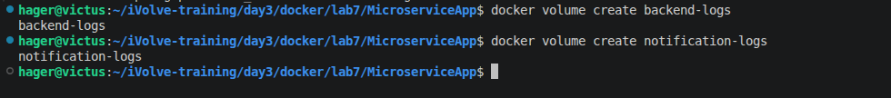

- `backend-logs`: Stores the Backend application logs.
- `notification-logs`: Stores the Notification service logs.

## 3. Create a Host Directory for Persistent Data

Create a directory on the host machine to store the Backend's application data.

```bash
mkdir -p ./persistent-data
```

Verify the directory:

```bash
ls -ld ./persistent-data
```

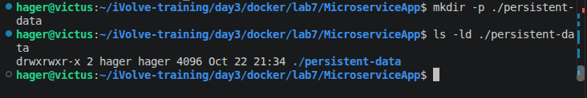

This directory will be mounted inside the Backend container at `/app/data`. The application stores its messages in `messages.json`, allowing the data to persist even if the Backend container is removed and recreated.

## 4. Build Docker Images

Build a separate image for each microservice from its Dockerfile.

### Build the Frontend image

```bash
docker build -t lab7-frontend:1.0 ./frontend
```

### Build the Backend image

```bash
docker build -t lab7-backend:1.0 ./backend
```

### Build the Notification image

```bash
docker build -t lab7-notification:1.0 ./notification
```

Verify the images:

```bash
docker images
```

## 5. Run the Notification Container

Start the Notification service on the `backend-notification` network and mount its log volume.

```bash
docker run -d \
  --name notification \
  --network backend-notification \
  --network-alias notification \
  --mount type=volume,source=notification-logs,target=/app/logs \
  lab7-notification:1.0
```

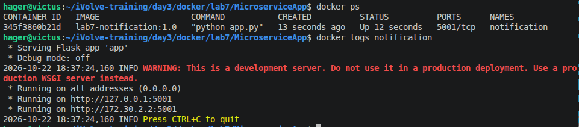

The Notification service listens on port `5001` and records received notification messages in `/app/logs/notification.log`.

## 6. Run the Backend Container

Start the Backend container on the `backend-notification` network.

```bash
docker run -d \
  --name backend \
  --network backend-notification \
  --network-alias backend \
  -e NOTIFICATION_URL=http://notification:5001/notify \
  --mount type=bind,source="$(pwd)/persistent-data",target=/app/data \
  --mount type=volume,source=backend-logs,target=/app/logs \
  lab7-backend:1.0
```

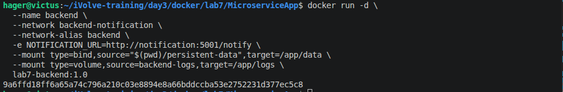

### Connect the Backend to the Frontend Network

The Backend must communicate with both the Frontend and Notification services. Connect it to the second network:

```bash
docker network connect frontend-backend backend
```

The Backend is now connected to both Docker networks.

### Storage Configuration

- **Bind Mount:** Maps the host directory `persistent-data` to `/app/data` inside the Backend container.
- **Docker Volume:** Maps `backend-logs` to `/app/logs` to persist Backend logs.
- **Environment Variable:** `NOTIFICATION_URL` specifies the Notification service endpoint.

## 7. Run the Frontend Container

Start the Frontend container on the `frontend-backend` network.

```bash
docker run -d \
  --name frontend \
  --network frontend-backend \
  -e BACKEND_URL=http://backend:5000 \
  -p 8080:3000 \
  lab7-frontend:1.0
```

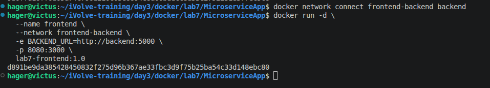

The `-p 8080:3000` option publishes port `3000` inside the container as port `8080` on the host machine.

The `BACKEND_URL` environment variable allows the Frontend to communicate with the Backend using Docker's network name resolution.

## 8. Verify Running Containers

Check the status of all containers:

```bash
docker ps
```

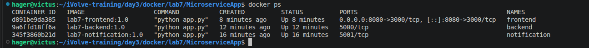

Verify that the `frontend`, `backend`, and `notification` containers are running.

## 9. Access the Web Application

Open the application in your browser:

[http://localhost:8080/](http://localhost:8080/)

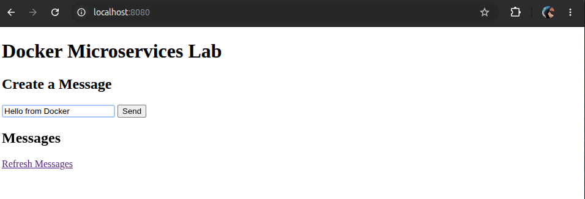

Enter a message in the input field and click **Send**.

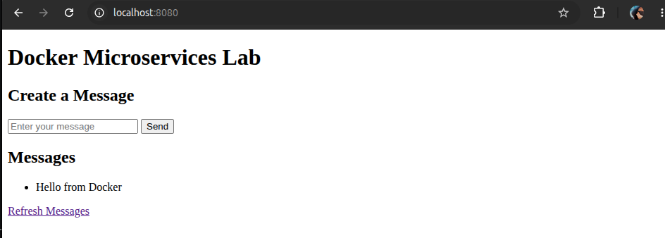

The Frontend sends the message to the Backend, which saves it to the JSON file and attempts to send a notification to the Notification service.

## 10. Verify Persistent Application Data

Check the messages saved by the Backend:

```bash
cat persistent-data/messages.json
```

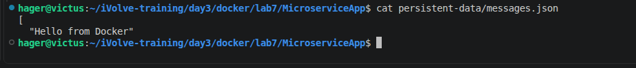

The file should contain the messages submitted through the web application.

The host directory is mounted to `/app/data` inside the Backend container, so the stored messages remain available if the container is removed and recreated.

## 11. Verify Application Logs

### Check Backend logs

```bash
docker logs backend
```

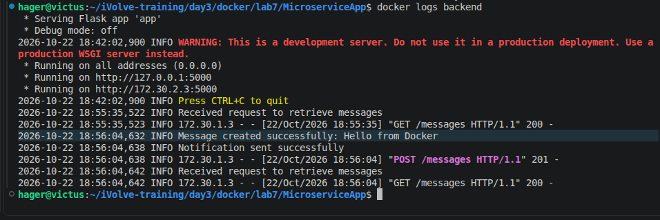

The Backend also writes application logs to `/app/logs/backend.log`, which is persisted using the `backend-logs` Docker volume.

### Check Notification logs

```bash
docker exec notification cat /app/logs/notification.log
```

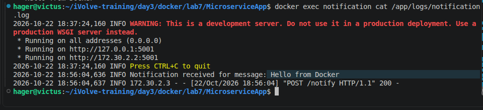

The Notification service records received notification messages in `/app/logs/notification.log`, which is persisted using the `notification-logs` Docker volume.

## 12. Lab Summary

In this lab, I practiced:

- Creating custom Docker bridge networks with separate subnets.
- Building Docker images for three microservices.
- Connecting containers to multiple Docker networks.
- Configuring inter-service communication using environment variables and container names.
- Creating Docker volumes to persist application logs.
- Using a Bind Mount to persist application data on the host.
- Running and verifying a multi-container application.
- Testing message creation, retrieval, and persistence through a web interface.

**Result:** The three microservices run in separate containers, communicate through the configured Docker networks, and use persistent storage for application data and logs.
