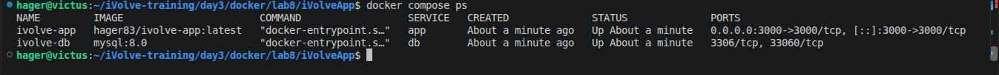
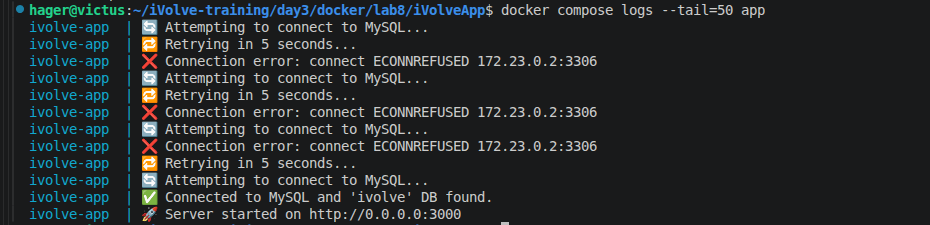
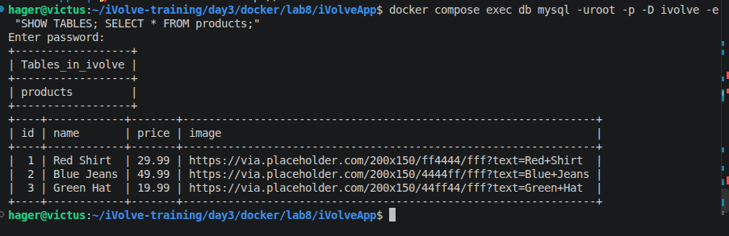
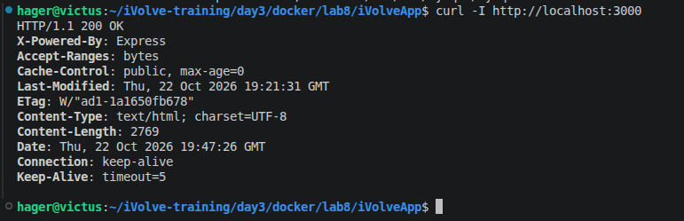

write make the compose 

```

```

build it 




logs 


```
docker compose logs --tail=50 app
```




```
docker compose logs --tail=50 db
```


- fix the db connection  and rebuild 


```
docker compose exec db mysql -uroot -p -D ivolve -e "SHOW TABLES; SELECT * FROM products;"
```




```
curl -i http://localhost:3000/health
curl -i http://localhost:3000/ready
```


```
http://localhost:3000
```


```
curl -I http://localhost:3000
```




```
docker volume ls
```


```
docker inspect ivolve-app
```

---
```
docker compose restart
docker compose exec db mysql -uroot -p -D ivolve -e "SELECT * FROM products;"
```


```
docker login
docker push hager83/ivolve-app:latest
```


---------------------------------------------------------------------------------------------------------------------------------------------


# Lab 8: Containerized Node.js and MySQL Stack Using Docker Compose


## 1. Objective

Containerize a Node.js application and a MySQL database using Docker Compose, with persistent storage, a custom network, and Docker Hub image publishing.

## 2. Project Architecture

- **Application:** Node.js application running on port `3000`.
- **Database:** MySQL 8.0 with database `ivolve`.
- **Network:** Custom Docker network `ivolve-net`.
- **Application Logs:** Persistent volume mounted at `/app/logs/`.
- **Database Storage:** Persistent volume mounted at `/var/lib/mysql`.

## 3. Build and Start Services

```bash
docker compose config
docker compose up --build -d
docker compose ps
```

## 4. Verify Application

```bash
curl -I http://localhost:3000
docker compose logs --tail=50 app
```

Open the application at `http://localhost:3000`.


## 5. Verify Database Connectivity

```bash
docker compose exec db mysql -uroot -p -D ivolve -e "SHOW TABLES; SELECT * FROM products;"
```


## 6. Verify Network and Volumes

```bash
docker network ls
docker volume ls
docker inspect ivolve-app
```

The application and database communicate through `ivolve-net`. Docker volumes preserve application logs and database data beyond the lifetime of individual containers.

## 7. Publish Image to Docker Hub

```bash
docker login
docker compose build app
docker compose push app
```


**Docker Hub Image:** `YOUR_DOCKERHUB_USERNAME/ivolve-app:latest`

## 8. Stop the Services

```bash
docker compose down
```

The named volumes are retained when running `docker compose down` without the `-v` option.

## 9. Security Notes

- Store database credentials in a local `.env` file.
- Exclude `.env` from Git.
- Never commit passwords or other secrets.
